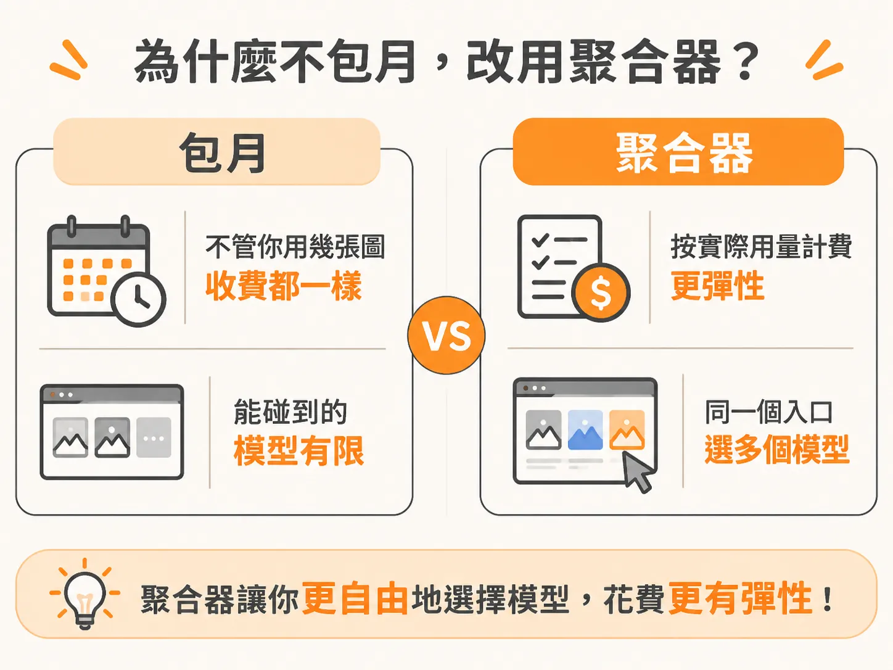
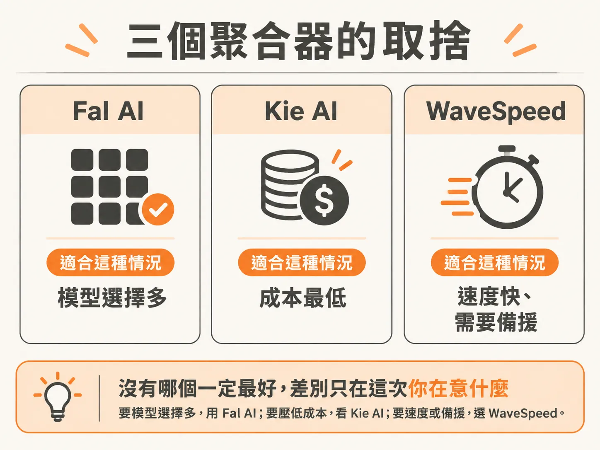

# 缺素材就自己生：/generate 接 Fal AI 生圖生影

元件撿回來、滑桿也調順了，區塊、間距、字級都到位，整頁看起來卻還是空空的。

設計裡最重要的那張大圖，或是首頁主視覺（hero）需要的一段影片，你手邊都沒有。為了幾個素材訂閱每月扣款的服務，又覺得不划算。

`/generate` 補的就是這個缺口：讓 agent 接上生圖、生成影片的模型，你在做頁面的同一段對話裡把素材生出來，直接放進區塊。

## 為什麼不包月，改用聚合器

`/generate` 接的是 Fal AI 這類聚合器（aggregator）。聚合器把多家模型集中在同一個入口，讓你依實際用量付費。

包月和按用量，差在費用和模型選擇兩件事。

先看費用：包月服務不管你這個月只用兩張圖，收費都一樣；按用量付費則是用多少、付多少，沒用就不用付。

再看模型：透過 Fal AI，Seedance、Veo、Nano Banana 這些模型都能直接用，不必為每個服務再付一次月費、多訂一套方案。想換模型，換個選項就好，不必另外換合約。

## 三個聚合器的取捨

實際用起來，不只有 Fal AI 可選。

Fal AI 是預設選項：按用量付費，也能直接使用 Seedance、Veo、Nano Banana 等模型。

Kie AI 的定位很明確，是成本最低的聚合器。如果這次最在意價格，例如要一次生成很多張圖再挑選，它會是優先考慮的選項。

WaveSpeed 主打速度，也可以作為備援，另外還有一些小眾（niche）模型。如果 Fal AI 暫時卡住，或你想用的模型在其他地方找不到，WaveSpeed 就能接手。

沒有哪個一定最好，差別只在這次你在意什麼：要模型選擇多，用 Fal AI；要壓低成本，看 Kie AI；要速度或備援，選 WaveSpeed。

## 影片也走同一條路

`/generate` 除了生圖，同一個入口也能接影片模型。首頁主視覺要動態畫面時，不必另外找一套工具，也不用再學一組 API。

對做頁面的人來說，圖片和影片是用同一種方式補上的。你不用一下想「這張圖要去哪裡找」、一下想「這段影片要去哪裡找」。

## 把素材放進區塊

素材生出來之後，得放進頁面才有用。

做法很簡單：在專案裡生成素材，再放進既有區塊，例如首頁主視覺、特色卡片或案例牆。不是另外開一個「素材區」，而是用素材補上原本留白的位置。

這時要回頭看設計本身：頁面得有畫面，人才會想往下看，光把一堆技術感的區塊疊起來不算數。一張合適的圖放進對的區塊，勝過十張圖散在頁面上。

## 什麼時候該按下去

不是每個區塊都需要生成素材。先把版面和層級安排好，等到真的缺一張「非它不可」的畫面時，再呼叫 `/generate`。

怎麼判斷：如果這個位置空著，讀者會看不懂嗎？會，就生成素材。如果只是覺得「看起來有點單調」，先調整間距、字級或色塊，通常更省錢，也更快。

收尾時檢查一次：打開頁面，指出哪個區塊是空的、缺的是圖片還是影片，以及打算用哪個聚合器生成。三件事都說得清楚，這段流程就算走完了。
