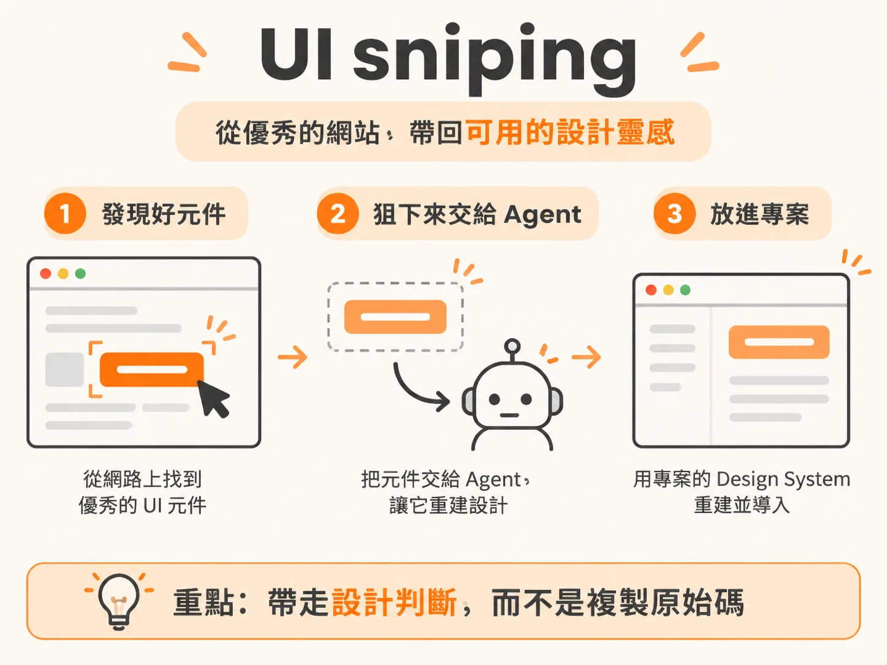
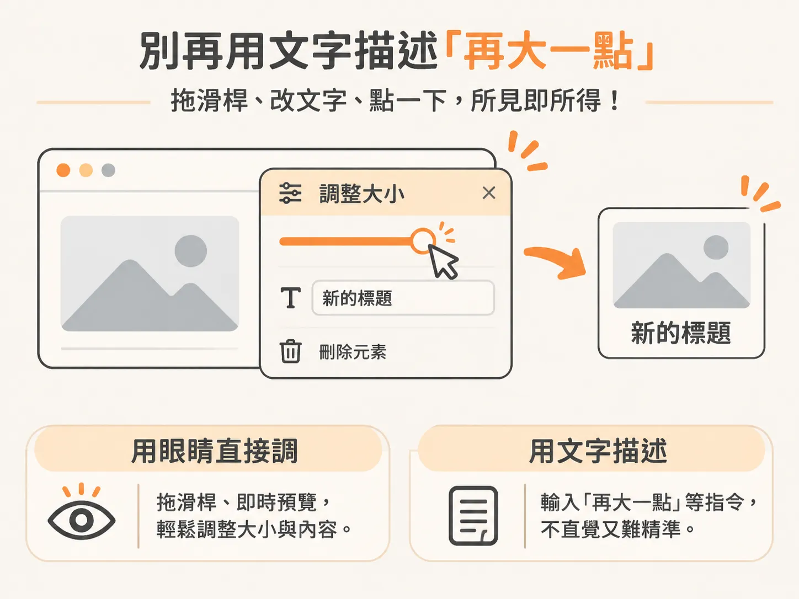
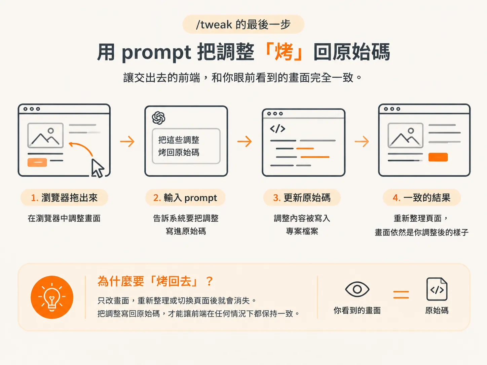

# UI Sniping 與 /tweak：撿別人的元件，用自己的滑桿調

上一課把品味鎖進 `/design-system-x`，新頁面總算有了自己的視覺語言。但首頁的 hero 區塊，看起來還是差一點。你打開 agent，請它「做一個漂亮的 hero」，看了第一版不滿意，又補一句「再大氣一點」。來回幾次，token 花了不少，畫面還是不像你想要的樣子。

這個圈子繞來繞去，卡住的其實是兩件事：明明有現成的好設計，卻還是從零開始；明明眼睛一看就知道哪裡不對，卻只能靠文字描述。UI sniping 和 /tweak 就是衝著這兩件事來的。

## UI sniping：先承認別人的元件比你好

UI sniping 的做法很直接：從網路上找到漂亮、已經做好的元件，帶回自己的專案。

做法有兩條路。一是 **21st.dev**，上面有幾千個現成的 UI 元件，可以逛，也可以直接複製。挑好區塊丟給 agent，就能接進自己的網站。不必從零開始設計，先拿到一個別人打磨過的區塊，後面的設計也有了參考基準。

二是 **Robo Capture**，一款 Chrome 擴充功能。在任何一個跑得起來的網站上看到喜歡的元素，都能把它「狙」下來丟給 agent，讓 agent 用你自己的 design system 重建。

關鍵在於「重建」，不是直接複製。你帶走的是別人的設計判斷，最後套用的仍是自己專案的字體、顏色和間距。

如果只是想看看別人做過哪些設計，可以逛逛每天更新的網站畫廊 **recent.design**，找一些靈感。

## 為什麼要手動安裝 unpacked extension？

Robo Capture 沒有上架 Chrome 商店，得手動載入 unpacked extension，也就是未封裝的擴充功能。

第一次做會卡一下，不過學會之後，你就多了一個本事：在自己電腦上裝自訂的 agent 工具。以後碰到沒上架的擴充功能，同樣的步驟再走一次就好。

做法是打開 Chrome 的擴充功能頁面，開啟開發人員模式，選擇「載入未封裝項目」，再指定解壓縮後的資料夾。

## /tweak：別再用文字描述「再大一點」

從網路上找來的元件，通常不會剛好符合你的需求。可能想把間距拉開、把字放大兩級，或乾脆拿掉某個小區塊。

以前只能回頭改提示詞，燒 token，結果也不見得合你的品味。每次視覺微調都重新請 agent 生成，就像為了一顆螺絲，把整台機器搬過來。

**/tweak** 換掉的就是這一套。它會在頁面上放一塊可以動的滑桿面板，讓你直接拖滑桿調大小、在頁面上改文字，點一下就把不要的元素刪掉。

你不用再描述想要的樣子，直接動手調就好。哪裡不對就拖一拖，拖到順眼為止，不必再費力解釋「大氣」到底是什麼意思。

## 用一個 prompt 把結果寫回原始碼

畫面調漂亮了還不算完，重新整理頁面，效果可能就沒了。/tweak 的最後一步，是用一個 prompt 把所有調整「烤」回最終設計。

差別就在這裡：眼前看到的畫面，得跟最後交付的成果是同一個。你在瀏覽器裡調好的樣子要真的寫回原始碼，不然改動只留在 demo 上，交出去的前端就不是你調的那個。

## 什麼時候用哪一招？

這兩種方法處理的是不同階段的事：還沒有東西可調的時候，用 UI sniping 找一個好的起點；已經有元件、只是畫面不太對，就用 /tweak 直接調。

這些情況都不必硬用文字提示詞去解。要做一個漂亮的區塊，先去 21st.dev 挑元件；要把它調成自己喜歡的樣子，交給滑桿。
