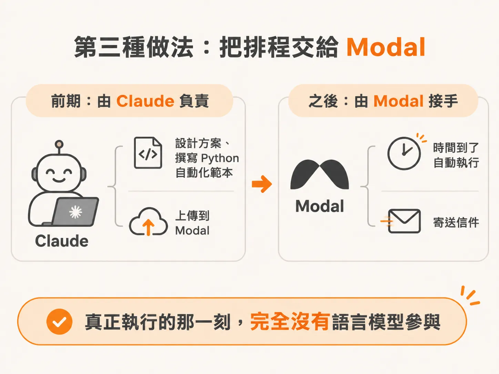
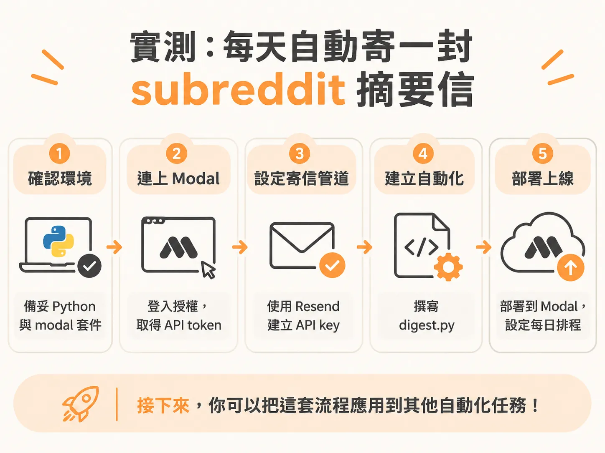
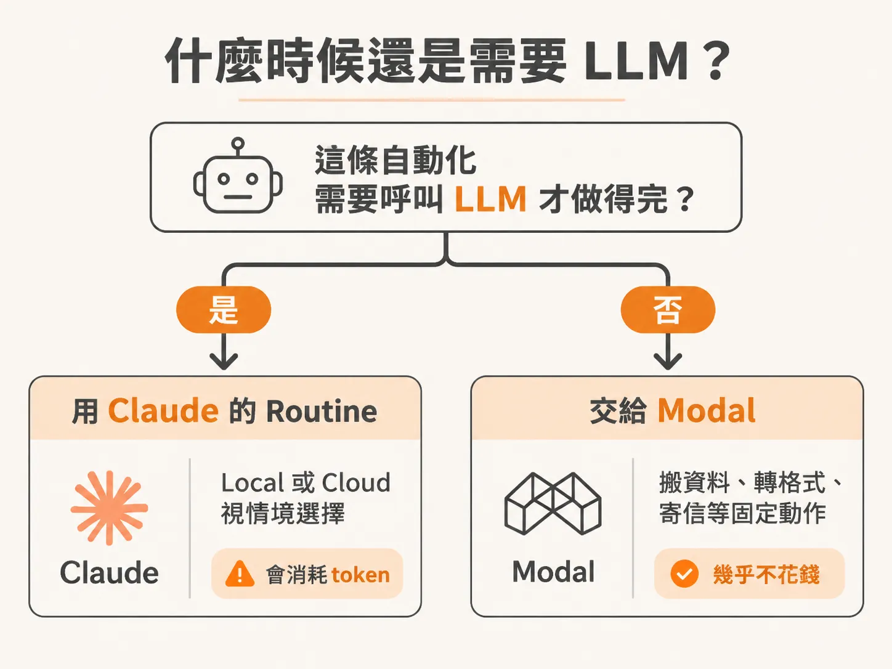

# 在你睡覺時，routine 照樣跑

上一段把第三種 routine 拆開來看：程式由 Claude 寫，執行交給 Modal。這一段就實際建一條起來。

題目是「抓資料、整理格式、寄信」這種不需要模型思考的流程。留在 Claude Code 的 routine 上，每一次執行都要付 token；搬到 Modal，時間到了它自己跑，整段流程完全不呼叫模型。

## 把自動化交給 Modal

還有一種做法是走 modal.com。它不需要你正在用 Claude，也不用每次執行都花 token。

分工很單純：Claude 負責設計，也負責寫程式，寫完直接把這份自動化範本上傳到 Modal。之後的排程交給 Modal 自己的服務。

一條跑得夠久的 routine 長這樣：每天晚上 9 點，它去檢查 YouTube 頻道有沒有新上傳的長影片，有就自動切成 shorts，直接發到 YouTube Shorts。這條 routine 四個月前設好，之後沒有再動過。過去 90 天，長影片累積 150 萬次觀看，shorts 已經到那個數字的一半，全部都是這一條自動化跑出來的。

## 打開 dashboard 只會看到函式

在 Modal 的 dashboard 裡，一個 app 就是一條自動化。點進去看，裡面只有幾個函式（function），真正被排程的是其中一個。你可以把它想成一份自動化範本。

它跟 n8n、Make.com 這類工具在做的事一樣，差別是這裡用程式碼寫，語言是 Python。這段 Python 不需要你自己寫：把需求講清楚，Claude 會寫、會測，也可以請它直接部署到 Modal。

## 實測：每天一封 subreddit 摘要信

要真的跑一次，最簡單的題目是這個：瀏覽指定的 subreddit，抓出裡面的熱門貼文，定期把摘要寄到你的信箱。

一個 prompt 就能搞定，它不只寫 digest 的邏輯，前後都包了：

1. 檢查你的環境。需要 Python 和 modal 套件，兩者都免費。
2. 連到你的 Modal 帳號。它會開瀏覽器，你在那裡登入授權。
3. 設定寄信管道。用 Resend 這個免費服務。
4. 建立 digest 自動化。
5. 部署到 Modal，讓它照你要的排程每天執行。
6. 說明接下來可以往哪裡走，或套用到別的自動化。

實際跑起來的順序是：它先問你要寄到哪個 email，再確認 Python 和 modal 裝好了沒。接著開瀏覽器讓你授權 Claude Code 存取你的 Modal workspace。授權完成後，它回報 API token 已建立——系統之間就是靠這個 token 溝通。

寄信這一段要一個 Resend 的 API key，只需要建一次。API key 是敏感資料，Claude 不會把它留在檔案裡，而是鎖進 Modal 的 secret vault，其他地方看不到。

然後 digest.py 出現。這是一個 Python 檔，裡面是讓整條自動化從頭跑到尾的程式碼，包含你剛剛接上的所有東西。它會問你要不要部署。你說要，它就上傳到 Modal，回報已經上線。dashboard 上會出現你的第一條自動化。

## 為什麼執行不花 token

寄摘要這件事是一個 deterministic 的程式函式（deterministic code function）：同樣的輸入，走同樣的步驟，產生同樣的輸出。每次執行都不經過 LLM，所以不消耗 token。

Claude Code 的 routine 能力是 Anthropic 做的，而 Anthropic 有動機讓你多花 token。當一段自動化本來就不需要思考，把它寫成 deterministic 的程式、放到 Modal 上跑，成本會低很多。

## 什麼時候還是要 LLM

有些自動化需要一個「大腦」。例如 subreddit 摘要抓回來之後，你想再壓成更短的版本，這一步就需要模型。這種情況一樣可以在 Modal 上做，差別是要在流程裡呼叫 LLM。

怎麼接？直接問 Claude，它通常會指向 Claude API key，或建議你用 OpenRouter 這類服務。

判斷很簡單：

- 這條自動化要呼叫 LLM 才做得完 → 用 Claude 的 routine，local 或 cloud 看你的情境，但要記得那會花 token。
- 這條自動化只是搬資料、轉格式、寄信，不需要思考 → 交給 Modal，幾乎不花錢。

## 做完這一條，你的 workspace 多了什麼

你得到一條每天自己跑的 routine：固定時間抓 subreddit 熱門貼文，整理成摘要，寄進你的信箱。它不佔 Claude Code 的 session，不在你的筆電上跑，也不會因為你關機而停。

醒來就有信。routine 在你睡覺時繼續跑，說的就是這件事。
