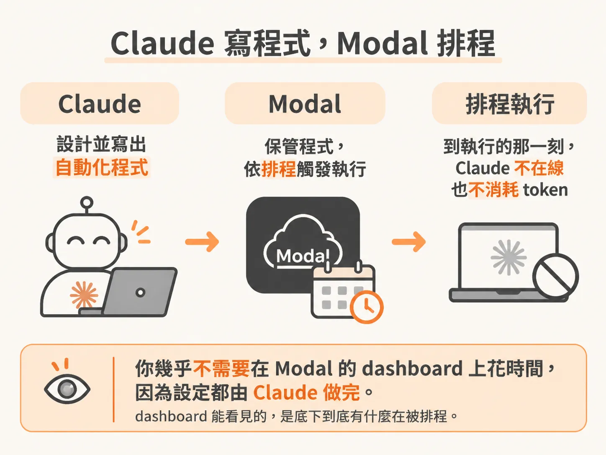
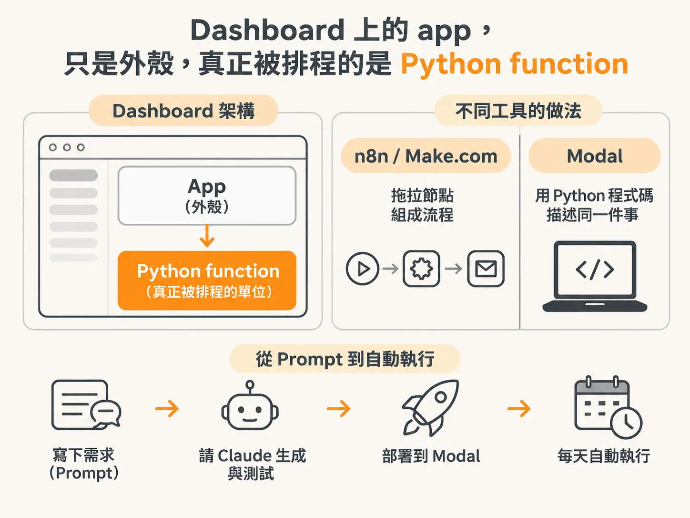
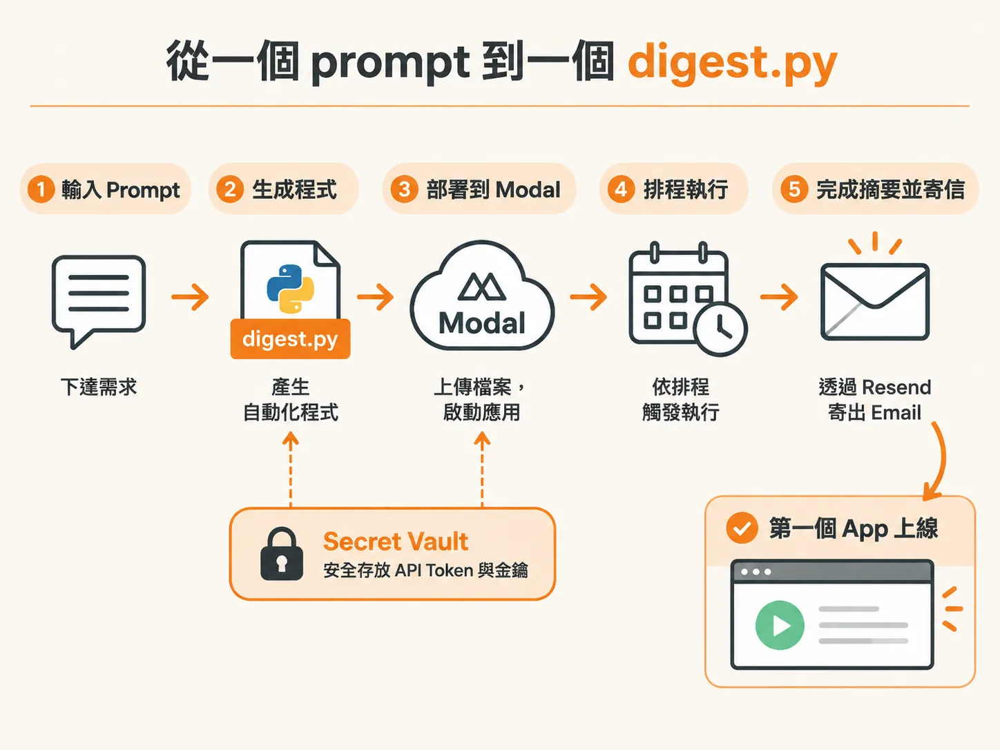
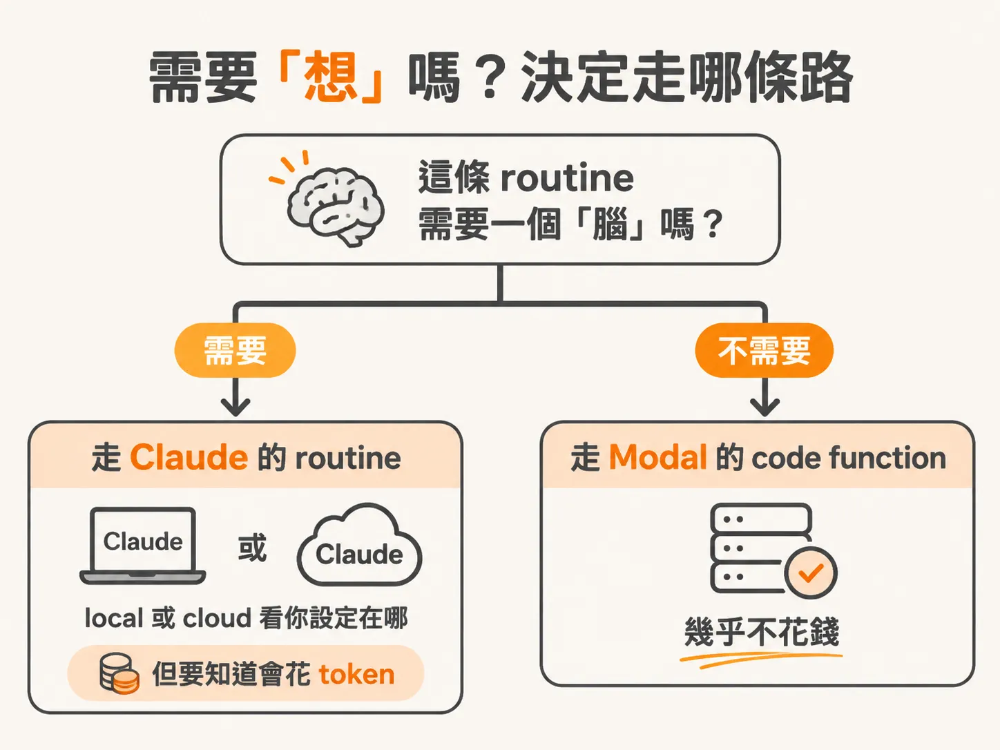

# Modal 的 app，就是一組 Python function

你已經有一條 routine 在排程上跑，但每次觸發都在燒 token。如果這件事其實不需要「思考」（抓幾篇貼文、整理成摘要、寄出去），那不一定非得用 Claude 的 routine 來跑。

第三種做法是 modal.com。它不需要 Claude 或 Claude Code，每次執行也不花 token，因為真正在跑的是程式碼。

## Claude 寫程式，Modal 排程

前兩種 routine 都在 Claude Code 裡跑；這種做法則把寫程式這件事交給 Claude。流程是：Claude 幫你設計、把自動化寫成程式，這支程式就是模板；接著它直接把模板放進 Modal，之後的排程由 Modal 負責。

所以你幾乎不會在 Modal 的 dashboard 上花時間，設定都由 Claude 做完。dashboard 能幫你看見的，是底下到底有什麼在被排程。

## Dashboard 上的 app，就是你的自動化

在 Modal 的 dashboard 裡，apps 就是你的自動化。帳號裡有一條叫 auto clipper 的 routine：每天晚上 9 點，它去巡 YouTube 頻道有沒有新的長影片，有的話就自動做成 shorts，發到 YouTube Shorts。

過去 90 天，長影片累積 150 萬次觀看；shorts 已經追到那個數字的一半，而且完全來自這一條自動化。它是四個多月前設定的，之後就沒再動過，只在背景自己跑。

點進那個 app，裡面其實只有一堆 functions。真正被排程的是其中一個 function。你可以把它想成一個自動化模板，跟 n8n 或 Make.com 裡看到的東西是同一件事，差別只在於這裡是用程式碼寫的，而且寫的就是 Python。

那段 Python 不是手寫的。做法是把需求寫成 prompt 交給 Claude，讓它寫、讓它測，再叫它部署到 Modal，之後每天自己跑。

## 從一個 prompt 到一個 digest.py

有一個例子可以直接拿來試：掃某個 subreddit，抓出裡面的熱門貼文，定時把摘要寄到你的 email。這一個 prompt 會做幾件事：先檢查你電腦上該裝的東西在不在（Python 和 modal 套件，都免費）；帶你用瀏覽器登入 Modal 帳號授權；設定好 email 連線；把 digest 建起來；最後部署，也就是放進 Modal，讓它照你要的排程每天跑；收尾再交代下一步可以往哪走。

實際跑起來，它會先問你要寄到哪個 email，確認套件，然後開瀏覽器讓你授權 Claude Code 存取你的 workspace。連上之後它會回報 API token 已建立，兩個系統就是靠這組 token 在講話。寄信走免費的 Resend.com，API key 只要建一次；因為它是敏感資料，Claude 會把它鎖進 Modal 的 secret vault，不讓它出現在別的地方。

建好的自動化放在一個叫 digest.py 的 Python 檔裡，裡面就是把整條流程跑完的程式碼，包含你剛接上的那些服務。按下部署，檔案上傳到 Modal，dashboard 上就出現第一條正在跑的 app。

## 需要「想」嗎？決定走哪條路

為什麼不花 token？因為像寄送 digest 這種自動化，是 deterministic code function：每次執行都不牽涉任何 LLM，就是照程式碼跑。

差別在這裡：用 Claude Code 的 routine 去自動化事情，這個能力是 Anthropic 做的，而它有動機讓你多花一點 token。所以當一件事本來就能寫成 deterministic、不需要 LLM 的程式，Modal 是比較好的去處。

不過你確實可以在 Modal 的自動化裡放進 LLM。例如 Reddit 摘要出來之後，你想再壓成更精簡的一段文字，一樣可以呼叫 LLM；Claude 會指你去用它自己的 API key，或去接 OpenRouter 這類服務。

判斷原則很簡單：這條 routine 需要一個「腦」嗎？需要，就走 Claude 的 routine，local 或 cloud 看你設定在哪，但要知道那是要花 token 的。不需要思考、不需要 LLM，就走 Modal，它幾乎是免費的。

這就是第三種 routine 的樣子：程式由 Claude 寫，執行交給 Modal，而它能一路跑到你睡覺的時候。
