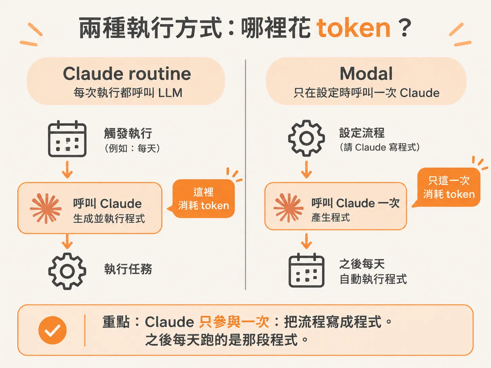
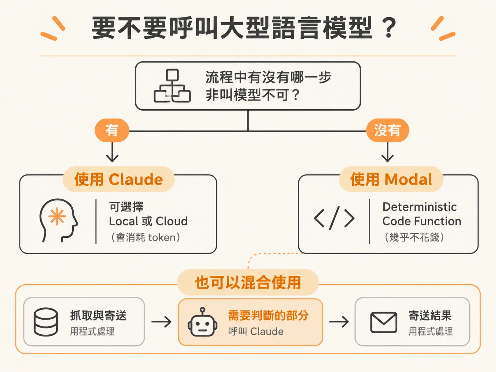

# 需要一個大腦嗎：什麼時候該用 Claude routine，什麼時候交給 Modal

你的 routine 每天早上跑一次：抓資料、整理、寄一封信給你。它很穩，你已經好幾個月沒打開它。

但每一次執行都在花 token。而它做的事只是：打開一個網頁、拿下前幾則貼文、套進固定格式、寄出。整段流程裡，沒有一個地方需要判斷。

這不是 routine 不好。是這段流程不需要一個大腦。

## 第三種做法：Claude 負責寫，Modal 負責跑

設定 routine 有幾種做法：前兩種是 Claude routine，分 local 與 cloud；第三種走 modal.com。它有個好處：你就算不用 Claude、不用 Claude Code，也照樣能用；每次執行也不一定會花 token。

做法是這樣。你請 Claude 幫你設計一段自動化，並把程式碼寫出來。產出的東西可以想成一個「自動化模板」。Claude 再把這個模板上傳到 Modal。之後的排程由 Modal 自己管，照你設定的頻率跑。

Claude 只參與一次：把流程寫成程式。之後每天跑的是那段程式。

## 一個跑了四個月的例子

帳號裡有一條叫 auto clipper 的自動化。它每天晚上九點檢查 YouTube 頻道有沒有新的長片；如果有，就自動切成 shorts，直接發到 YouTube Shorts。

這條自動化是四個月前設定的，之後沒有再動過。它就自己在背景跑，產短片、發佈，不需要人。

成效看數字：最近 90 天，長片總共有 150 萬次觀看；shorts 的觀看數已經達到那個數字的一半，而且全部來自這一條自動化。

更關鍵的一點：它每次執行不花任何 token。

## 為什麼不花 token：deterministic code function

打開這條自動化，裡面其實只有幾個 function。被排程的那個東西，就是一個自動化模板。

它跟 n8n、Make.com 上拼出來的流程很像，差別在於這裡是用程式碼寫的，而且是 Python。那段 Python 不是自己手寫的，是請 Claude 寫出來的：寫程式、測試、部署到 Modal，全交給它，之後就每天自己跑。

這種東西叫 deterministic code function。翻成白話：同樣的輸入進去，走的是同一條程式路徑，中間不呼叫任何 LLM。所以每跑一次，不會產生推論成本。Modal 的免費額度對輕量自動化來說很夠；一條每天跑的小流程，實際上可以是零元。

## 真的部署一次：Reddit 每日摘要

要驗證這件事，最有用的做法是自己部署一條。

給 Claude 一段 prompt：到指定的 subreddit 抓熱門貼文，整理成摘要，定期寄到你的 email。這段 prompt 會讓 Claude 依序做完這幾件事。

- 先檢查你的環境。需要 Python 與 modal 套件，兩者都免費。
- 連到你的 Modal 帳號。它會開瀏覽器讓你登入，授權 Claude Code 存取你的 workspace，然後產生一組 API token。之後兩邊系統就靠這組 token 溝通。
- 設定寄信。這裡用 Resend 這個免費服務，你只需要建一次 API key。
- 把 API key 收好。因為它很敏感，Claude 會把它鎖進 Modal 的 secret vault，不讓它出現在其他地方。
- 產出程式。自動化會落在一個叫 `digest.py` 的檔案裡，內容是把整段流程從頭跑到尾的程式碼，包含你剛剛接上的每一個服務。
- 部署。Claude 會問你要不要部署；你確認後，它把程式上傳到 Modal。完成後狀態會顯示 live，你在 dashboard 就看得到這條自動化。

到這裡，你有了第一條跑在 Modal 上的自動化。

## 判斷準則：需不需要一個大腦

分界線只有一條：這段自動化需不需要一個大腦。

如果你判斷流程裡有某一步，必須叫用大型語言模型才能完成，那就用 Claude routine，local 或 cloud 看你怎麼設定。代價是它會用 token。

如果整段流程不需要思考，只是抓取、轉換、搬移、寄送，那 Modal 是更好的選擇，因為它幾乎不花錢。

用 Claude Code 的 routine 來自動化很順手，但這個能力是 Anthropic 做的，而 token 是它的收入來源，它天然有讓你多用一點 token 的誘因。當一段流程本來就不需要判斷，把它留在每次都要叫模型的 routine 上，就是持續在付一筆不該付的錢。

反過來說，需要 LLM 的步驟也不該硬拿掉。假設 Reddit 摘要抓回來後，你想把內容再精簡一點，那一步就是需要大腦的。做法是在同一條自動化裡叫用 LLM：可以問 Claude 怎麼接，它通常會指向自己的 Claude API key，或建議你用 OpenRouter 這類服務。

所以一條流程可以兩段式：抓取與寄送交給 deterministic 的程式，需要判斷的那一段才叫模型。

判斷順序是這樣：先問這段流程需不需要一個大腦。需要，就留在 Claude routine，並接受它會用 token。不需要，就把它寫成 deterministic code function，交給 Modal 排程。

這樣一來，routine 就真的在你睡覺的時候跑，而且不花你每次執行的錢。
