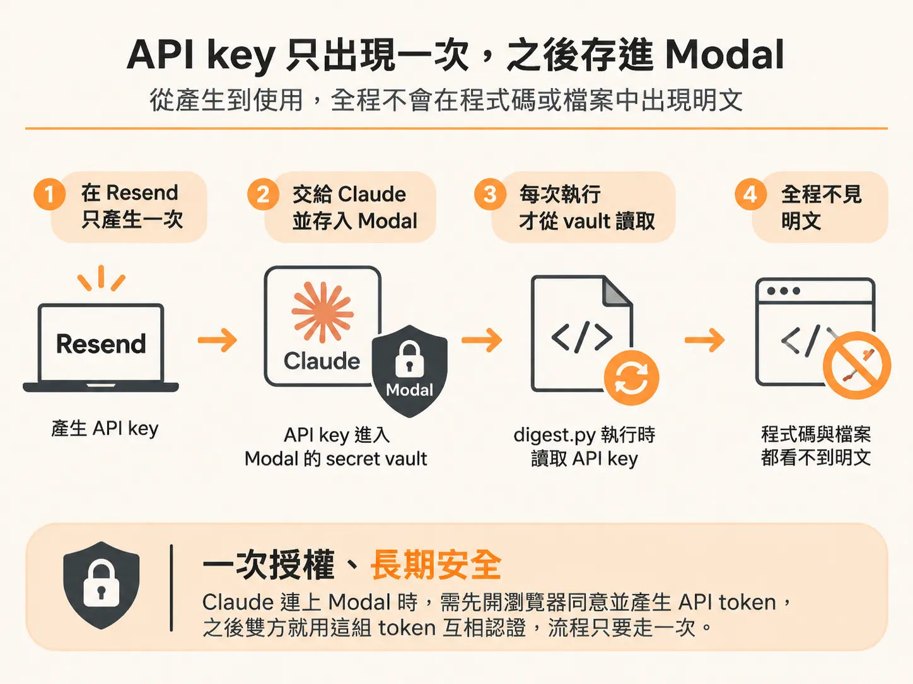
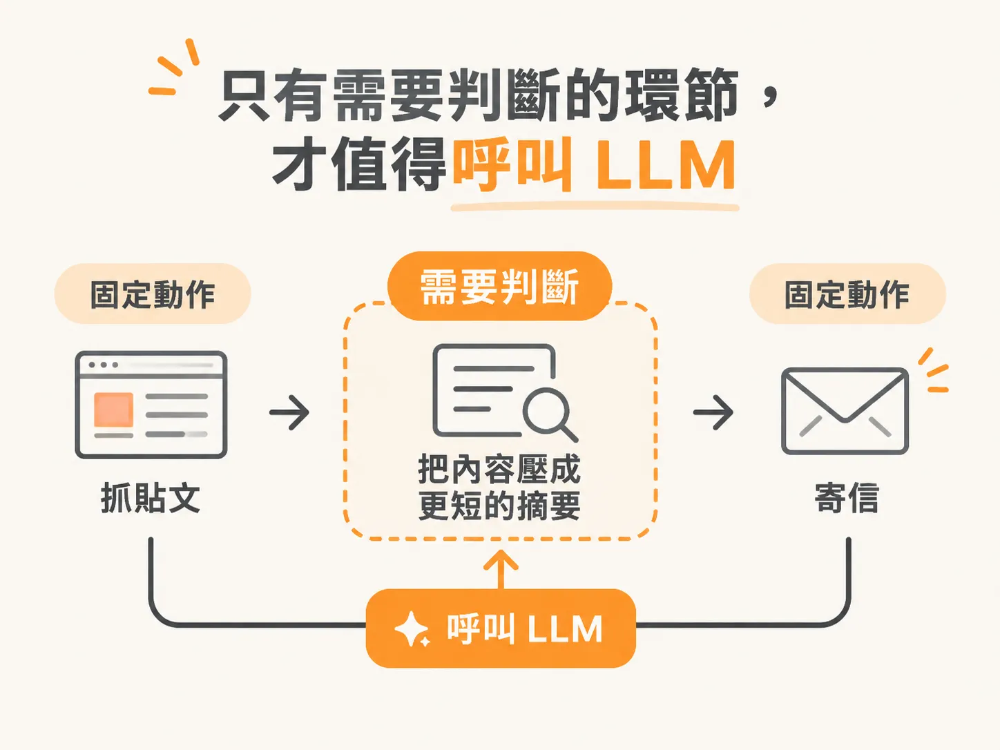

# 把 API key 鎖進 Modal secret vault

上一段的 digest pipeline 跑起來之後，第一個會卡住的地方就是寄信要用的 key。只要一條 automation 會把結果寄到你的信箱，它就一定用得到一組 API key。申請本身不難，難的是申請下來之後，這把 key 要放哪。

放進 repo、貼到對話、寫死在 `digest.py` 裡，都等於把它公開。比較穩的做法，是讓它只在執行當下被讀到。

## 授權一次，key 進 secret vault

寄信可以用 Resend 這個免費服務。你在 Resend 建一次 API key，之後寄信都靠它。

把 key 交給 Claude 時，它會直接鎖進 Modal 的 secret vault，字串不會被寫進程式碼。這把 key 就不會出現在其他任何地方。事後打開 `digest.py` 也看不到它，只會看到一段去讀 secret 的程式。

前面還有一層授權：Claude 要連上你的 Modal 工作區時，會開瀏覽器讓你按同意，然後產生一組 API token。之後兩邊就用這組 token 互相認證。這個流程只要走一次。

## 沒有模型被呼叫，所以不花 token

整條 automation 最後會變成一個 Python 檔，叫 `digest.py`。它把你要的流程從頭跑到尾，包括你接上的那幾個服務。

每次執行都是同一段程式，不會去問模型任何問題。前面提過的 deterministic code function 就是這個意思：輸入固定、行為固定，跑一次跟跑一百次是同一件事。排程由 Modal 處理，時間到了就把程式叫起來。

沒有呼叫模型，就沒有 token 帳單。Modal 的免費額度給得算大方，只跑輕量的 automation，帳單可以是 0。有人把這種排程放著四個月沒動，每天照時間跑，一毛錢都沒付。

這也是它跟 Claude Code 的 routine 最大的差別。routine 是模型廠商做的功能，廠商的收入跟你的 token 用量綁在一起；一件事根本不需要判斷，就不必讓它經過模型。

## 什麼時候值得再加一個 LLM

假設你已經有一條每天抓某個 subreddit 熱門貼文、整理成摘要寄給你的 automation。抓跟寄都不需要大腦，交給 deterministic 的程式就好。

但如果你還想把抓下來的內容再壓成更短、更好讀的一段文字，這裡就多了一個「需要判斷」的步驟。這時可以在同一條 automation 裡呼叫 LLM，把原始輸出改寫成你要的樣子。

要接哪一家的模型，有兩條路：用 Claude 自己的 API key，或接 OpenRouter 這類把多家模型放在同一個介面的服務。兩種都按用量計費，所以在決定之前，先確認這個「摘要」真的有需要。

## 判斷規則只有一句

如果這條 routine 需要一個大腦，也就是你認為非得叫某種大型語言模型進來參與，那就走 Claude Code 的 routine。local 或 cloud 看你把東西放在哪，但要知道那會消耗 token。

如果它不需要思考，只是照順序做幾件固定的事，Modal 就是比較好的選擇，因為它幾乎不花錢。

這條線不是技術限制，是成本判斷。很多工作被說成「要 AI 才做得動」，其實只是還沒有人把它拆成幾個固定步驟。拆完之後，剩下的那一段才需要模型，其他都可以交給一段在你睡覺時自己跑的程式。
