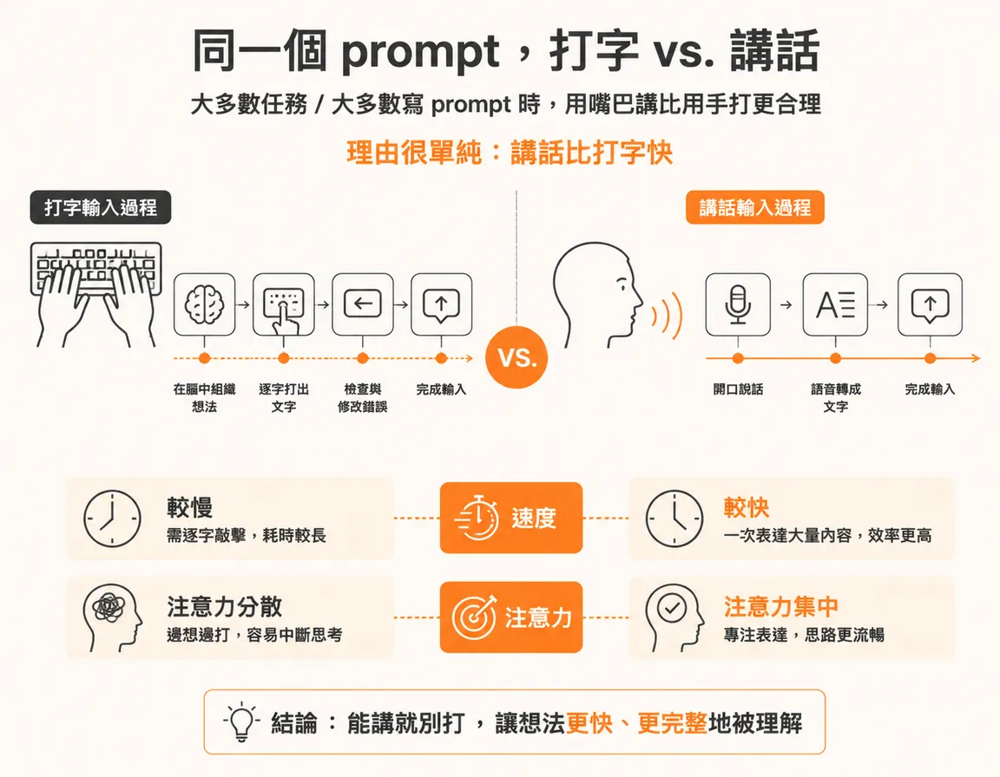
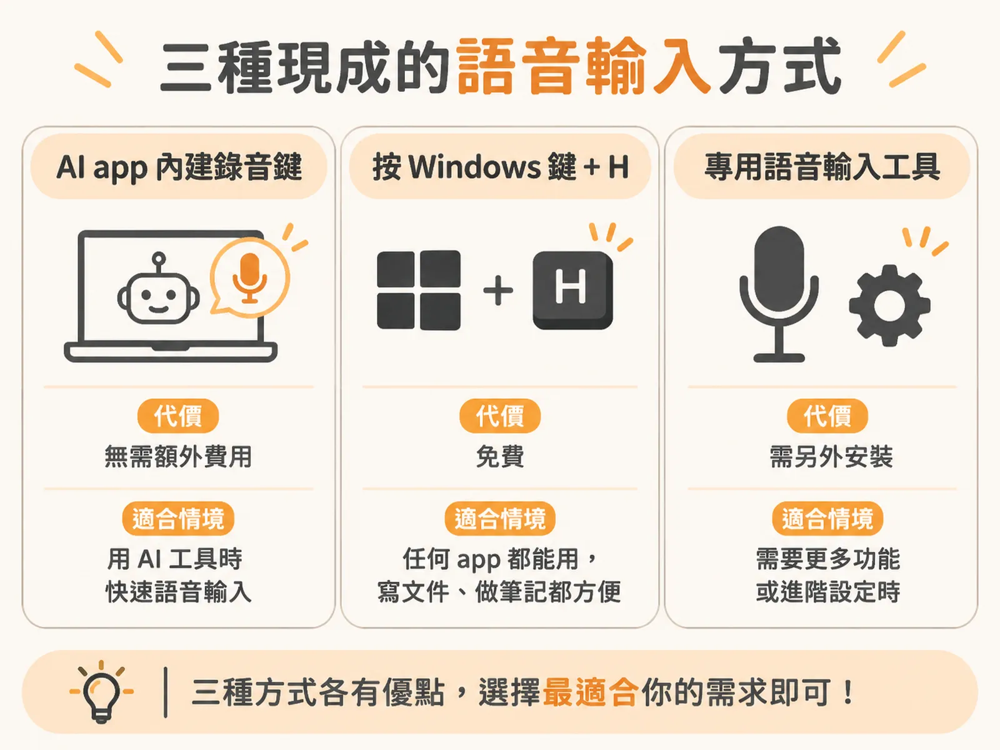
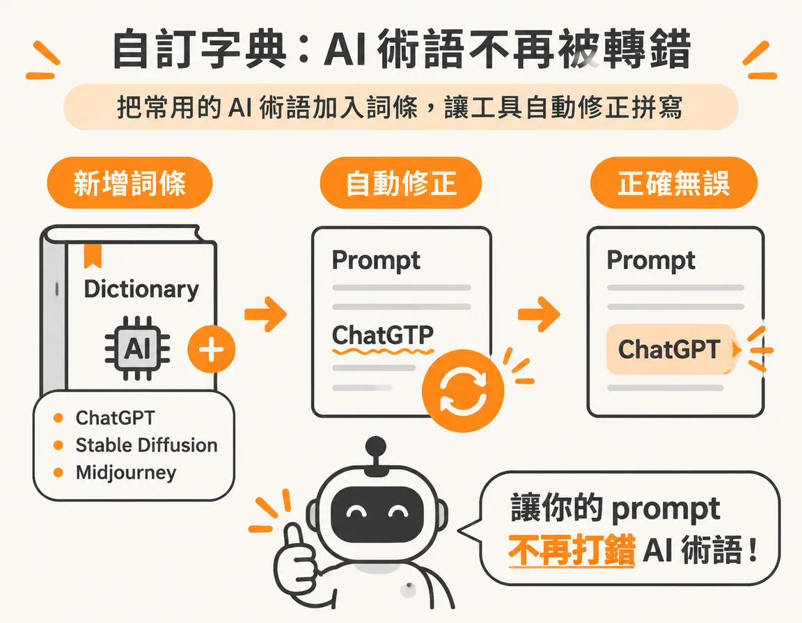
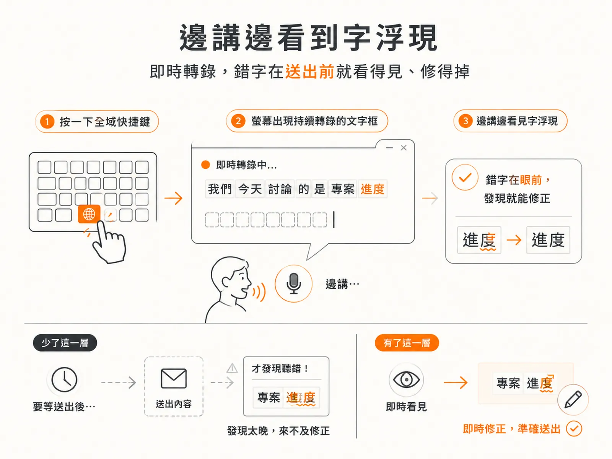

# 用語音 prompt AI agent 的驚人效果

routine 上了排程、會自己跑之後，你每天剩下的工作就是下指令這一段。

每天打開 Claude Code，第一個動作通常是打一行字：跑那條 routine、把昨天的東西整理一下、把 prompt 改幾個字再送出去。動作不難，但手一直停在鍵盤上。一天累積下來，這些字不算少。

同一件事可以改用講的。大多數任務、大多數寫 prompt 的時候，用嘴巴講比用手打合理得多。理由很單純：講話比打字快。

平均來說，用講的來 prompt AI agent，速度大約是打字的三倍。單次操作看不出這個差距，但 routine 的特性就是重複：同一條指令打十次跟講十次，省下來的是十分鐘的注意力。

## 先看 App 和系統內建的做法

很多現在的 AI app 本來就內建錄音鍵。按住它講話，app 會把你說的內容轉成文字。這條路不用裝東西也不用付錢，值得先試一輪，再決定要不要加工具。

Windows 上還有一個藏在系統裡的做法：按 Windows 鍵加 H，會叫出微軟免費的語音服務，它可以在任何 app 裡把你講的話轉成字。這招不限於 AI 工具，平常寫東西也用得到。

這幾種方式都能轉，真正的差別是轉得好不好、順不順手。App 內建的最省事，系統內建的最通用，專用工具則是替長期大量輸入的人設計的。

## 專用語音工具多出來的功能

如果語音輸入變成每天主要的輸入方式，專用工具會多給你幾件事。

第一個是字典。可以自己加條目，把常講的術語登記進去，之後工具會自動修正這些詞的拼寫。對寫 prompt 的人來說這很實際，因為 prompt 裡最常出現的，就是那些唸得出來、但每次拼都拼錯的 AI 術語。

第二個是全域快捷鍵。按一下，螢幕上會出現一個持續轉錄的文字框，你一邊講，它一邊長出字。

### 邊講邊看到字

那個文字框讓你邊講邊看見它真的在打你說的內容，快只是順帶的。少了這一層，要等送出之後才會發現它聽錯；有了它，錯字在眼前就修得掉。

## 一個付費選項：Aqua Voice

Aqua Voice 的網址是 aquavoice.com。它是要付費的工具，但比另一個比較多人知道的選項 Whisper Flow 便宜不少：Pro 版一個月 8 美元，而且有免費方案可以先試。

這種東西最後還是看順不順手，其他工具也值得試一輪。重點是選一個你願意每天開著的，功能清單長不長反而是其次。

## 怎麼開始

先把範圍縮到最小：這一週只用 app 內建的錄音鍵，把每天要跑的 routine 指令、要寫的 prompt 改用講的。如果三天後你發現自己會主動去按那個鍵，就代表摩擦真的降低了，再考慮換成有字典和快捷鍵的專用工具。

如果一直忘記用講的，那不是工具的問題，是那個情境還不夠重複。先回到 routine 本身，確認它值得每天做，再回來解決輸入方式。
