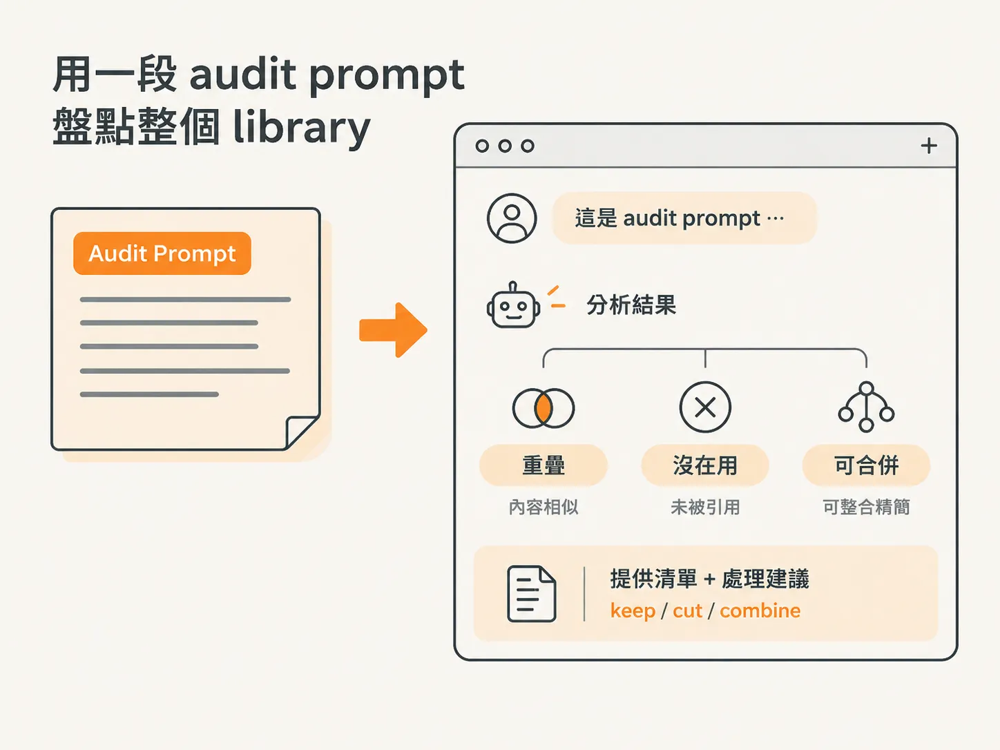

# 多少 skill 才太多：用一次 audit 整併

當你開始把自己做的 skill 存下來，又從網路安裝別人寫好的 skill，library 自然就越長越大。skills 越存越多，這大概是很多認真用 Claude Code 的人都碰過的事。

一開始，你可能只是把幾個常用指令存成 skill。沒多久，library 裡就塞滿了各種大大小小的 skill。這時，一個很自然的焦慮就會冒出來：

到底多少個 skill 才算太多？我是不是該開始刪了？

這一節要回答的就是這個問題。

## 簡單的判準：會不會讓你或 Claude 搞混

課程講者給的規則很直接：

只要它不會讓你搞混，也不會讓 Claude 搞混，就沒問題。

換句話說，**skill 的數量本身不是問題**。真正該在意的，不是「我現在有 30 個還是 50 個 skill」，而是這些 skill 有沒有開始造成混淆。

你不需要盯著某個數字提心吊膽，也不必因為 skill「看起來太多」就定期大清倉。只有當它真的讓你或 Claude 分不清楚該用哪一個，或不同 skill 之間開始互相打架時，才是該整理的時候。

這個判準，等於把焦點從「數量」移到「有沒有造成實際困擾」。不用再為數字操心，等它真的開始混亂時再清理就好。

## 該清理時，用一段 prompt 做一次 audit

當你發現 library 裡的 skill 開始互相重疊，或有些 skill 根本沒在使用，與其自己一個個翻，不如用講者示範的方式，做一次「一段 prompt 的 audit」。

做法是開一個全新的 session，貼上這段 audit prompt：

> Audit my skills. List any that overlap, go unused, or could be merged. Tell me which to keep, cut, or combine.

這段 prompt 要 Claude 做的事很清楚：列出你的 skills，標記哪些彼此重疊、哪些沒有在使用，以及哪些其實可以合併。

接著，它還會告訴你哪些該保留、哪些該刪除、哪些該整併。你拿到的會是一份清單，外加一份「keep / cut / combine」的處理建議。

講者強調，用這段 prompt 做一次 audit，可以在 **30 分鐘內完成整併**：把重疊的合起來，把沒用的刪掉。

所以，清理 library 不一定是要花掉整個週末的大工程。只要專心處理半小時，就有機會把它整理好。

## 用 context 指令看 skills 真正花掉多少 token

清理 library 的另一面，是先搞清楚它實際產生了多少成本。

很多人會擔心：我存了這麼多 skill，是不是正在默默吃掉用量？

講者示範使用 context 指令，讓你確切看到 skills 實際花掉多少 token。有了這些數字，你就能直接看見真實成本，不必再憑感覺猜 library 到底吃掉多少用量。

知道實際花費之後，你才能判斷這個 library 是否真的在消耗你的用量，也才能決定哪些地方值得優先整併。

## 把這一節收成一句

面對「多少 skill 才算太多」這個問題，可以這樣記：

只要不讓你或 Claude 搞混，就沒問題。真的開始混淆時，就開一個新的 session，貼上那段 audit prompt，在 30 分鐘內把重疊的合併、沒用的刪掉。平常想確認成本，則用 context 指令查看 skills 實際花掉多少 token。

最後，判準還是回到你自己的 library。

只要你說得出哪些 skill 在重疊、哪些其實沒在用，以及整併之後省下了什麼，這個 library 就還在替你做事，不會變成一團連自己都理不清的混亂。
