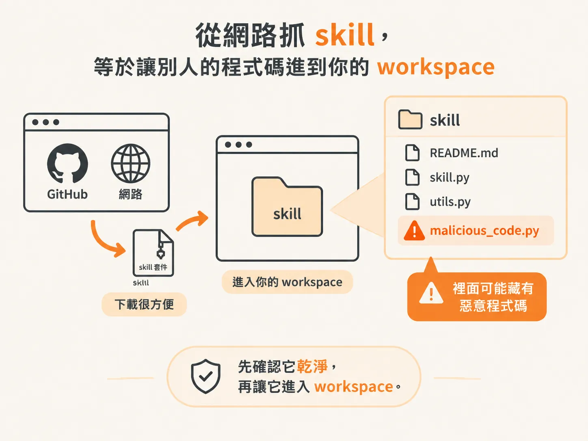
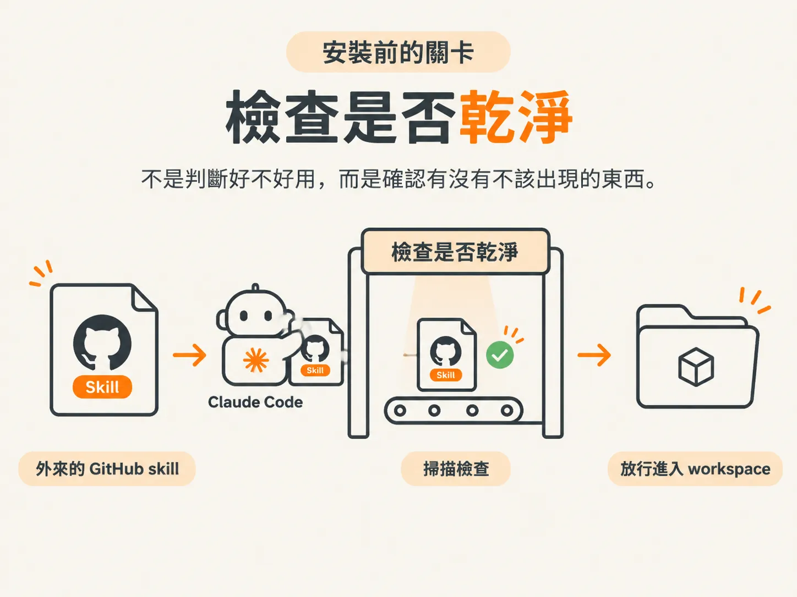
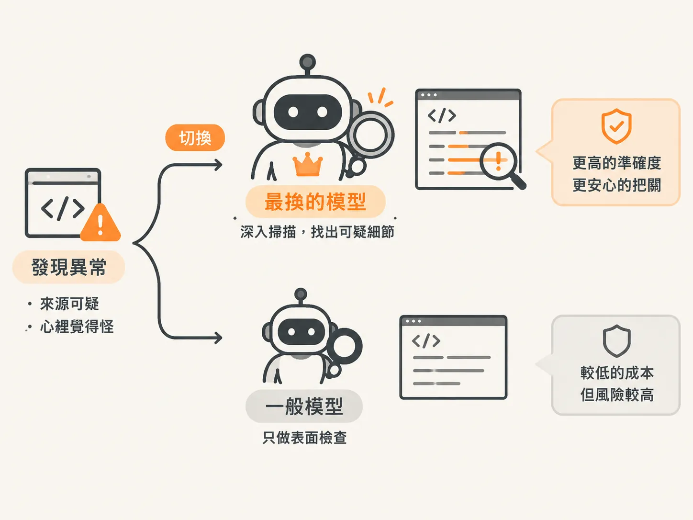
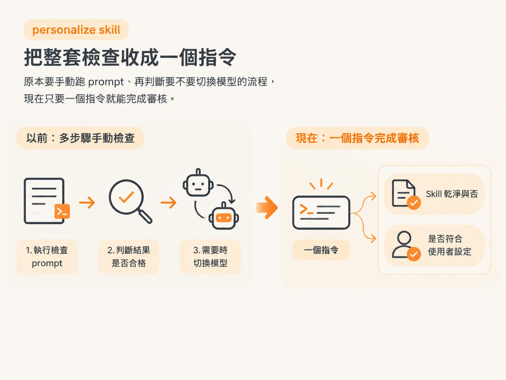

# 安裝外部 skill 前先檢查惡意碼

前面幾節談的是自己動手做 skill。

但在實際使用時，很多好用的 skill 都是別人寫好，放在 GitHub 或網路上供人下載。像講者示範的 `/last 30 days skill`，就能一次擷取八個來源，整理過去 30 天的內容。

方便歸方便，但有件事一定要先想清楚：這些 skill 不是你自己寫的。

## 從網路抓 skill，等於讓別人的程式碼進到你的 workspace

skill 一旦安裝，就會進入你的 workspace，並在 Claude Code 的環境中運作。

問題是，網路上的 skill 品質不一，有些甚至可能夾帶惡意程式碼。把來路不明的 skill 裝進去，就像把一個你不完全了解的人，請進自己的工作空間。

所以，正確的順序不是「看到喜歡的就直接安裝」，而是：

**先確認它乾淨，再讓它進入 workspace。**

## 安裝前先跑一段「檢查是否乾淨」的 prompt

講者示範的做法很直接：在安裝任何 GitHub skill 之前，先執行一段「檢查是否乾淨」的 prompt。

這段 prompt 會讓 Claude Code 在 skill 進入 workspace 前，先把內容掃過一遍，確認裡面有沒有可疑或惡意的程式碼。

這其實就是一道安裝前的關卡：

**先檢查、確認乾淨，才放行。**

這次檢查不是要判斷 skill 好不好用，重點是確認裡面有沒有不該出現的東西。

## 覺得怪，就切到最強模型把關

執行這段檢查時，有個很容易被忽略的重點：值得動用你手上最強的模型。

原因很簡單。檢查惡意程式碼，本質上是在看懂一段陌生程式碼到底做了什麼。模型越強，越有機會從看似正常的內容裡，找出可疑之處。

這是一件寧可多花成本，也不要省下來的事。

當你對某個 skill 感覺不太對勁，或它來自你不敢完全信任的來源時，就切換到最強的模型，請它負責這次把關。

## personalize skill：把整套檢查收成一個指令

每次安裝 skill 都手動執行一次檢查，久了難免會變成負擔。

講者提到，`personalize skill` 已經把這套流程打包起來。它會幫你完成同樣的檢查，而且只需要一個指令。

它不只會確認 skill 是否乾淨，也會檢查這個 skill 是否符合你的設定，也就是安裝後能不能和你的環境配合。

原本「先記得執行檢查 prompt，再判斷是否要切換模型」的流程，就能收斂成一個指令完成審核。

## 動手前，先建立這個習慣

整節其實可以收成一個原則：

任何從 GitHub 或網路取得的外部 skill，在安裝到 workspace 前，都要先確認它是乾淨的。

如果來源可疑，或你心裡覺得不太對勁，就切換到最強的模型來把關。

想讓流程更省事，則可以用 `personalize skill`，透過一個指令完成檢查。

skill 越強、越能替你做事，就越值得你在安裝前先看一眼。
