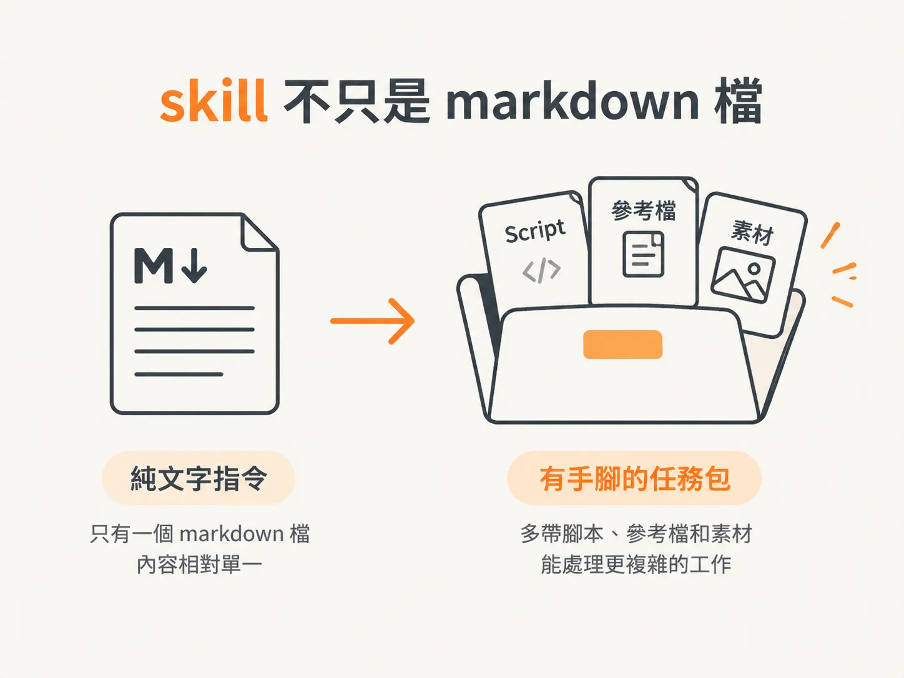
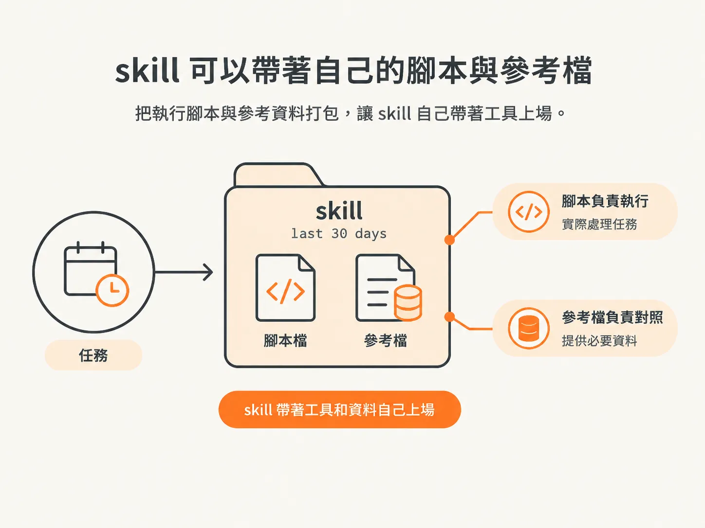
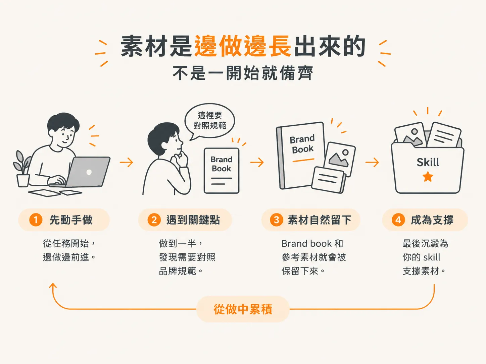
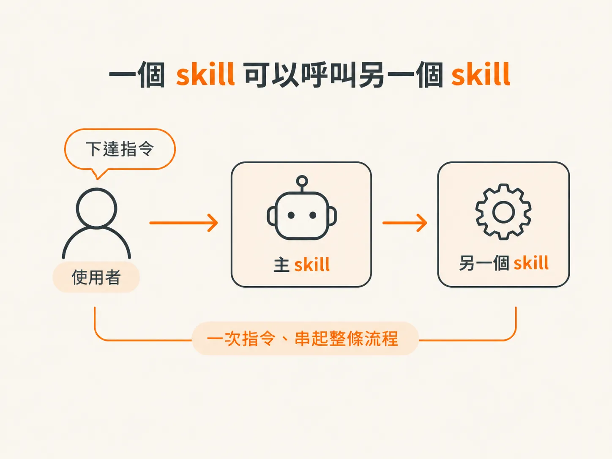

# 讓 skill 帶腳本、素材，並互相呼叫

## skill 不只是 markdown 檔

很多人對 skill 的第一印象，是一個放滿指令的 markdown 檔。

但 skill 不一定只能有一個 markdown 檔。當你讓它多帶一些腳本、參考檔和素材，它就像從一張說明紙，變成一個帶著工具出場的任務包，能處理的工作也會複雜許多。

可以先看一個簡單的判準：

如果任務只需要一句話交代，單一 markdown 檔就夠了。可是，當任務變得更複雜，或需要反覆使用固定素材時，skill 的內容也值得跟著變厚。

## skill 可以帶著自己的腳本與參考檔

一個比較「厚」的 skill，會自己帶著腳本（scripts）和參考檔（reference files）。

課程裡舉的例子是 `last 30 days` 這個 skill。它不是只靠一段文字描述「去抓最近 30 天的東西」，而是把實際要執行的腳本，以及會用到的參考檔，一起收在 skill 裡。

這樣做，等於把「怎麼做」固定下來。

腳本負責實際執行，參考檔則提供判斷時要對照的資料。兩者都跟著 skill 一起移動，你就不必每次重新交代一遍。

也因為如此，帶著腳本、參考檔和素材的 skill，才能承接更複雜的任務。它變成一個能帶著工具和資料上場的工作單位，不再只是一段提示詞。

所以，skill 除了告訴模型「該做什麼」，也把「做這件事需要哪些零件」一起備好。

## 素材是邊做邊長出來的，不是一開始就備齊

聽到「skill 要帶素材」，很容易誤會成：必須先把所有素材準備好，才能開始寫 skill。

但課程裡講的其實相反。像 brand book 這類素材，往往是在實作過程中自然長出來的。

你可以先動手做。做到某個地方，發現「這裡每次都要對照同一套品牌規範」，那份 brand book 就會被留下來，成為 skill 的支撐素材。

你不需要先規劃一份完整的素材清單，再開始工作。比較好的方式，是讓素材隨著實作逐步補齊。

所以，不要因為「素材還沒準備完整」就卡住。先做，讓 reference 和 brand book 在過程中慢慢長出來。skill 的素材庫是邊走邊累積的，不是開工前必須跨過的門檻。

## 一個 skill 可以呼叫另一個 skill

第三個力量，是 skill 之間可以互相呼叫。

課程裡的例子很具體：你的 robo skill 可以在每次執行時，把 align 拉進來。所以你下一個指令的背後，可能其實是好幾個 skill 串在一起工作。

這樣做的好處是「一次指令，串起整條流程」。

你只要讓主 skill 在需要時呼叫另一個 skill，把流程接起來，不用手動依序觸發每一個。

對想把許多重複工作串成自動化流程的人來說，這正是把零散 skill 整合起來的關鍵：下一個命令下去，就能同時帶動好幾個 skill。

## 把三件事放回你的 workspace

把這三件事合在一起看，就是 skill 從單一檔案走向「有機體」的路徑：

- 讓 skill 帶著自己的腳本和參考檔，把「怎麼做」固定下來。
- 讓 brand book、reference 這類素材邊做邊長出來，不必等到全部備齊才開工。
- 讓一個 skill 呼叫另一個 skill，用一個指令串起整條流程。

最後，判準還是要回到你自己的 workspace：

你能不能指出某個 skill 資料夾裡，哪個腳本正在替你做事？哪份參考檔正在協助判斷？又是哪個 skill 呼叫了哪個 skill，把流程接起來？

當你能清楚回答這些問題，也知道其中一環斷掉時會發生什麼事，這個 skill 就真的長出力量了，而不只是另一個 markdown 檔。
