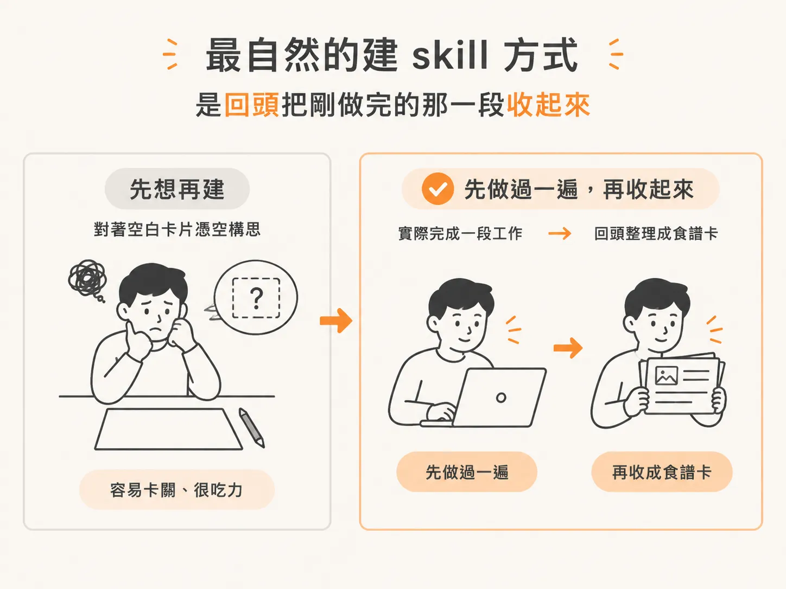
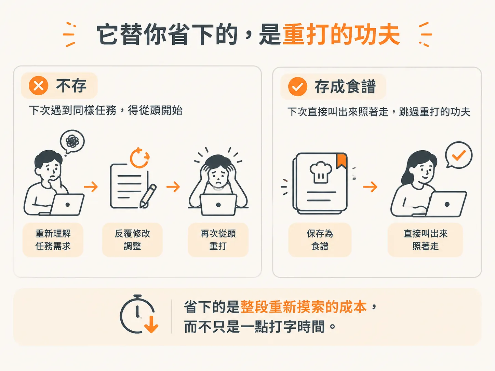
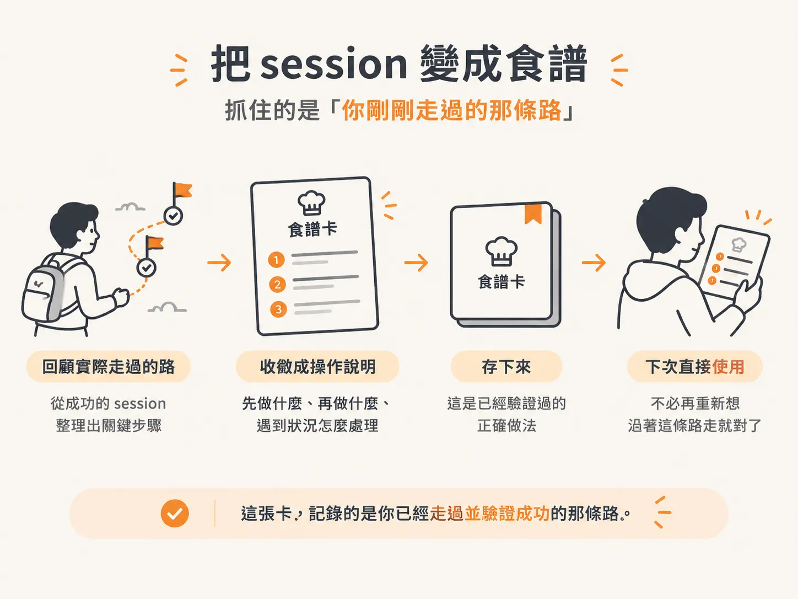

# 把一整段做完的 session 存成一張食譜

上一節提到「兩次法則」：同一個 prompt 用過兩次，就值得存成一張 skill。

但很多時候，真正值得保存的，是你剛剛和 agent 一起完成的一整段流程：從頭開始，來回修正好幾輪，最後真的把事情做好。單一句 prompt，反而不是重點。

這一節要談的，就是如何把這段完整的工作 session，直接存成一張食譜。

這其實是最自然的做法。你不必坐在那裡，憑空想像「一個 skill 應該長什麼樣子」。手上既然已經有一段剛剛成功跑完的流程，把它整理成一張卡，當然比從零開始寫容易得多。

## 最自然的建 skill 方式，是回頭把剛做完的那一段收起來

很多人想到「做一個 skill」時，腦中浮現的畫面是：先想清楚需求，再把所有指示一條一條寫下來。

這樣做當然可以，但相當費力。因為你是面對一張空白紙，試著想像一個還不存在的流程。

另一條路輕鬆得多：等一整段工作 session 做完，再把它存下來。

順序剛好相反。先寫好一張卡、再拿它去工作，是把順序弄反了；先把事情完整做過一遍，接著回頭整理「剛剛到底是怎麼做成的」，才對。

說到底，那張食譜是你已經走過一次、也確認走得通的路，憑空發明不出來。

這會讓門檻降低很多。你不需要很會「設計 skill」，只要把自己剛剛做對的事，好好記錄下來就行了。

## 為什麼「做完的 session」比空白的一張卡好寫

差別就在於：你手上有沒有素材。

對著空白頁面想一個 skill，你得同時設想整個流程、每一個步驟，以及可能卡住的地方。這些內容都是憑空推測，很容易遺漏，也可能和實際情況不符。

但一段已經做完的 session 就不一樣了。

它是一段真實發生過的對話：你提出了什麼要求、agent 怎麼回應、你在哪裡修正方向，以及最後怎麼收尾。這些細節都還留在那裡。

你要做的，不是從零創作，而是把一份「已經跑過一遍的草稿」整理成乾淨的食譜。

只要沿著剛才走過的路，把步驟順序和關鍵決定抓出來，就能整理出一張可用的卡。

這也是它被稱為「最自然」方式的原因：它順著你本來就會做的事，只是多加一個「把它存起來」的動作。

## 它替你省下的，是重打的功夫

把 session 存成 skill，到底省下了什麼？

省下的是下一次遇到同樣任務時，原本得重新輸入的那一大段內容。

想像一下，如果這次的流程沒有保存，下次再遇到同樣的事，你得重新描述需求、重新來回修正，直到結果再次調整到位。

同樣的溝通、同樣的嘗試，全部都得重打一遍。

但如果你已經把這段 session 收成一張食譜，下次就不必從頭開始。你最有效的那套工作流程，已經變成可以重複使用的東西，不需要再花力氣重新建立。

把一整段 session 存成 skill，就是讓你的最佳流程「不必額外做功，就能重複使用」。

真正省下的是整段重新摸索、重新來回調整的成本，遠不只幾秒鐘的打字時間。

這也是它值得做的地方。表面上看是在整理檔案，實際上你把一次性的努力，變成了之後每次都能直接叫出來使用的資產。

## 把 session 變成食譜，抓住的是「你剛剛走過的那條路」

真的要把 session 存成一張食譜，心態很單純：把剛剛實際走過的那條路保存下來。抽象的教學反而不是重點。

食譜之所以好用，正是因為它根據一次成功的實作寫成。先做什麼、再做什麼，以及遇到狀況時怎麼處理，都是實際發生過、也確認有效的做法。

所以，當你把 session 收成一張卡，其實是在替未來的自己留下一份「照著做就會對」的操作說明。

下次同樣的任務再次出現時，你不用重新想一遍。只要把這張卡叫出來，沿著那條已經驗證過的路再走一次即可。

這也接回前面兩節的重點：skill 就是一張食譜卡，平常安靜地放著，幾乎不佔用 context；而兩次法則則告訴你，什麼時候值得把流程存下來。

這一節補上最後一塊：最自然的保存方式，就是把一整段做完的 session 直接收成食譜。憑空寫出一張卡，反而沒那麼順。

你走過一次、驗證過一次，再把它存起來。之後每一次使用，都能省下重新輸入和摸索的功夫。
