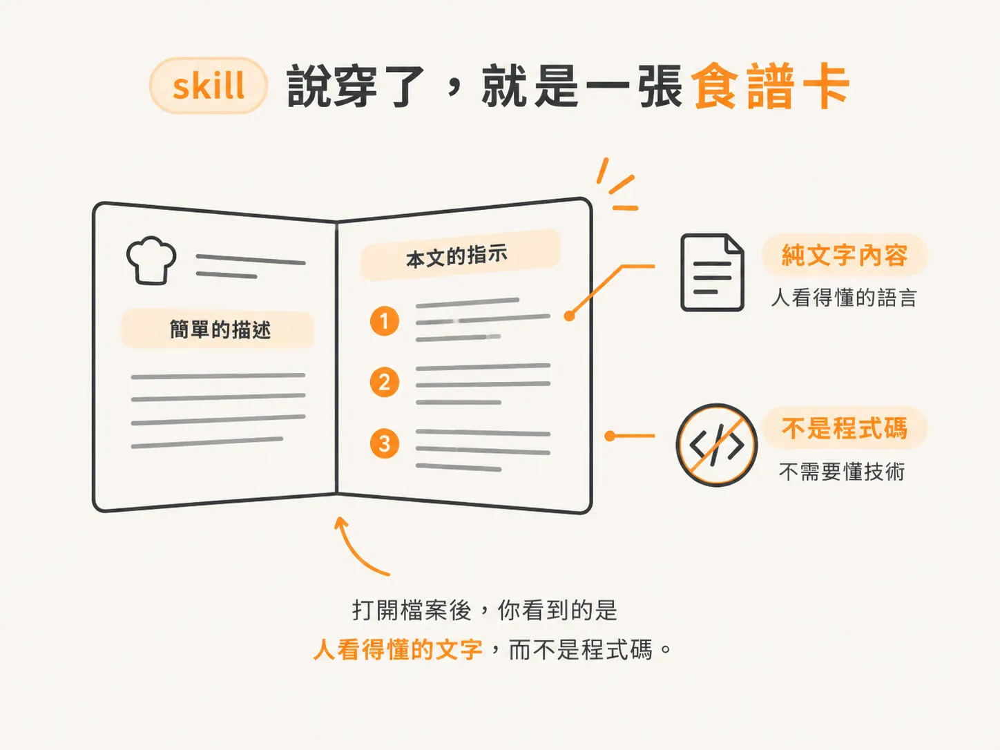
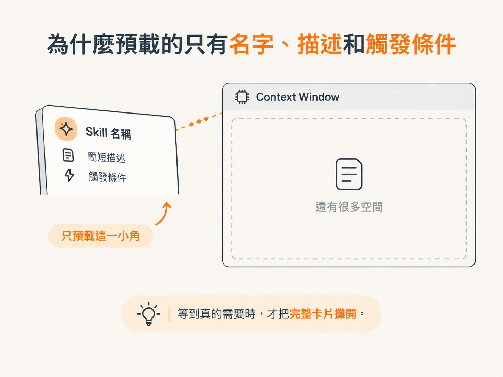

# skill 只是一張食譜卡：為什麼幾乎不佔 context

你可能遇過這種情況：

同一個提示詞，這週用了三次，下個月又用兩次。每次都得重新說明「我要什麼格式、有哪些規則、語氣要怎麼寫」。

久了難免會想：這些要求明明都一樣，為什麼不能先寫下來，需要時再叫出來？

skill 就是為了處理這件事而存在的。它是 Claude Code 裡很實用的功能，也是理解 agentic 工具怎麼運作的起點。

不過，許多人剛開始接觸時，會先卡在一個誤會：以為 skill 是很占空間的東西，放進 Claude 的「腦子」裡，就會把 context 撐爆。

其實不是。

這一節只談一件事：skill 到底是一張什麼樣的卡，以及它為什麼幾乎不佔你的 context。

## skill 說穿了，就是一張食譜卡

先把最容易想複雜的地方講清楚：

一個 skill，本質上就是一張交給 agent、讓它照著做的食譜卡。

這就像你不會把整本食譜背進腦袋，而是等到真的要煮某道菜時，再把對應的那張卡抽出來照著做。

skill 對 agent 來說，就是這種可以依序執行的操作說明。

它不是什麼黑盒，也不是特殊格式。拆開來看，它就是一個純文字的 Markdown 檔案：

- 最上面是一段描述，說明這個 skill 是做什麼的。
- 下面的本文，則是實際要 agent 遵循的指示。

就這麼簡單。打開檔案後，你看到的是人看得懂的文字，而不是程式碼。

換句話說，當你在「寫一個 skill」時，其實是在做這件事：

把一件你已經會做、也能說明清楚的事情，整理成一張別人或 agent 看得懂、能照著重現的卡片。

從這個角度看，寫 skill 的門檻其實比想像中低很多。

## 為什麼預載的只有名字、描述和觸發條件

真正讓人意外的，是 skill 到底會占多少空間。

你可能會以為，既然 skill 裡寫了很多指示，Claude 應該會先把整套內容讀進去，隨時準備使用。

其實並沒有。

Claude Code 的做法是：在你真正呼叫某個 skill 之前，只會先載入每張卡最外面的一小角，也就是：

- skill 的名字
- skill 的描述
- 它會在什麼情況下被觸發

至於卡片裡那一大段實際指示，則要等你真的叫出這個 skill 後，才會載入。

這就是為什麼 skill 幾乎不佔 context。

context window 是有限的。放進去的內容越多，能留給目前任務使用的空間就越少。

如果每個 skill 都把全文預先放進去，裝上幾個之後，光是那些「待命中的說明書」就可能把空間吃光。

改成只預載名字、描述和觸發條件，就像每張 skill 平常只占一張薄薄的標籤。等到真的需要時，才把完整卡片攤開。

## 平常很輕，是因為「用到才展開」

把前面兩件事放在一起看，就會得到一個很好記的畫面：

一堆 skill 平常只是排在旁邊的一疊卡背。你只看得到每張卡的名字和一句簡介；只有當你抽起其中一張，它才會整張攤開，把完整指示展現在眼前。

這也是為什麼你可以放心累積很多 skill，不必擔心 context 一下子被塞滿。

真正占空間的，從來不是「你有幾張卡」，而是「你當下攤開了幾張卡」。

大部分時候，這些 skill 只要安靜地待在旁邊，讓 agent 知道有哪些卡可以用、每張卡什麼時候該出場，就足夠了。

## 叫得出來，才算真的有用

一張卡寫得再好，如果抽不出來，也沒有用。

skill 的呼叫方式不只一種，這也讓「平常很輕、需要時才展開」的設計真正派上用場：

你可以直接叫出它的名字，也可以用斜線指令把它點出來；或者，讓 Claude 自己判斷現在該使用哪一張，替你做選擇。

最後一種方式，最像前面提到的食譜卡情境。

你不需要記得每一道菜的名稱，只要描述自己現在想煮什麼，agent 就會去翻那一疊卡，挑出適合的一張照著做。

而它之所以能挑對，正是因為每張卡平常都露出名字、描述和觸發條件，讓它一眼判斷哪張卡該上場。

輕量的預載，換來的是：agent 隨時知道有哪些卡可用，卻不會把整本食譜都攤在桌上。

說到底，skill 的核心就是這樣：

它是一張 Markdown 食譜卡，平常只露出名字、描述和觸發條件，幾乎不佔 context；等到真正需要的時候，才整張攤開，照著裡面的指示執行。
