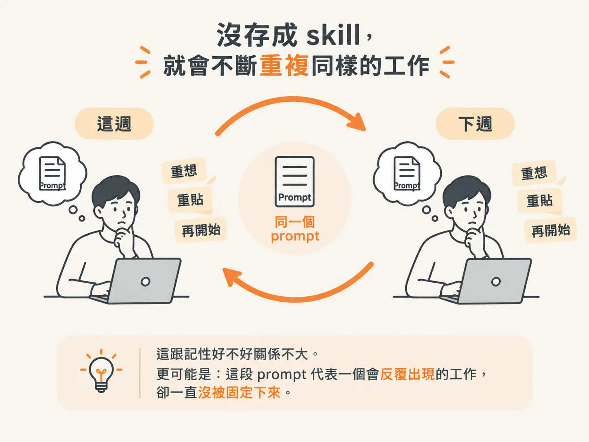
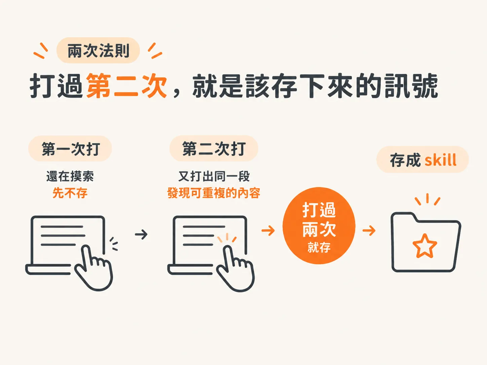
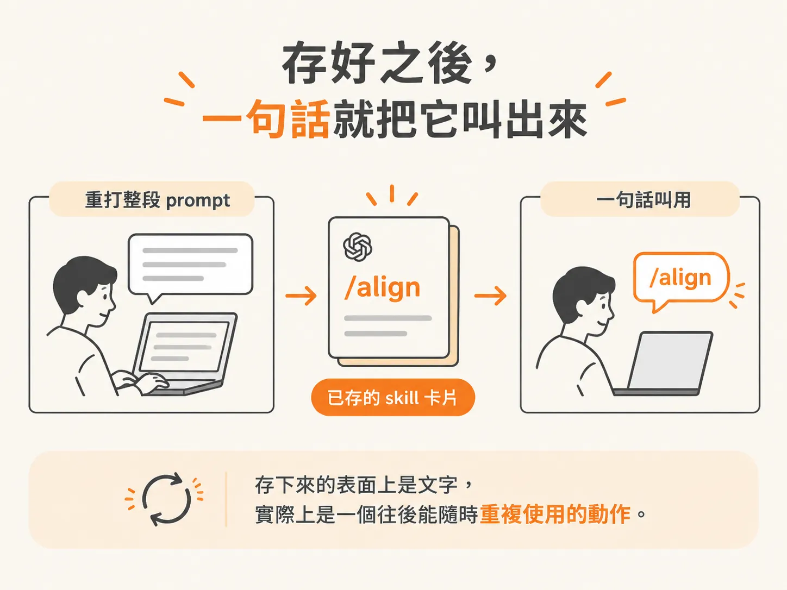

# 兩次法則：打過兩次就存成 skill

上一節把 skill 拆開來看，說明它只是一張平常幾乎不佔 context、需要時才展開的食譜卡。既然寫一張卡的成本這麼低，接下來要判斷的就是：什麼時候值得動手把它存下來。

## 先看沒存 skill 的長相

你有沒有遇過這種情況：

同一段 prompt，這週打了一次，下週又幾乎一字不差地再打一次。每次都要重新思考、重新貼上，做完就忘了，下次又得從頭來過。

這跟記性好不好關係不大。更可能是：這段 prompt 代表一個會反覆出現的工作，卻一直沒被固定下來。

## 兩次法則：打過第二次，就是該存的訊號

建立 skill 有幾個原則，其中最實用的一條，是用來判斷「什麼東西值得存下來」的**兩次法則**：

**同一個 prompt 打過兩次，就把它存成一個 skill。**

第一次打的時候，你多半還在摸索、調整內容。這時候還不一定值得固定下來。

但當你發現自己又打出同一段 prompt，就表示它已經是一個反覆出現的動作。這時把它變成 skill，才真正划算。

所以，不用等到第十次才存。**第二次，就是該存下來的訊號。**

## 存好之後，用一句話叫出它

把 prompt 存成 skill，最大的好處就是不用再重打整段內容。

之後只要用一句話叫出它：輸入這個 skill 的名字，像課程裡的 **`/align`** 一樣，打上 `/align` 就能使用。

存下來的表面上是文字，實際上是一個往後能隨時重複使用的動作。

## 例子：align skill

課程示範的 **align skill**，就是一個存下來的 prompt。

它會在任何大任務開始前，先讓 agent 提出幾個簡短的釐清問題，確認方向正確後，再花力氣開始執行。

它值得被存下來，正是因為「先對齊、再動手」是會一再使用的工作。每次重新輸入太麻煩，存成 skill，就能用一句話叫出來。

## 一句話總結

兩次法則，讓「要不要存」變成一個不用猶豫的判斷：

**打過兩次，就存成 skill；存好之後，用一句話叫出它。**

下次你發現自己又要重打同一段 prompt，先停一下——那很可能就是第二次。
