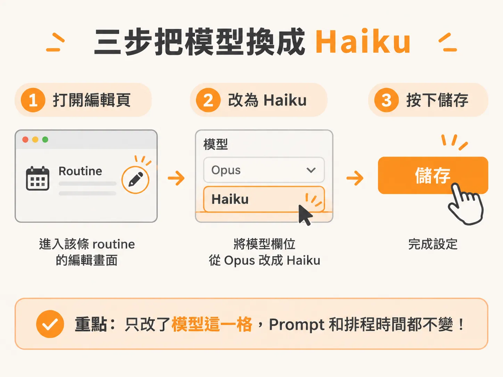
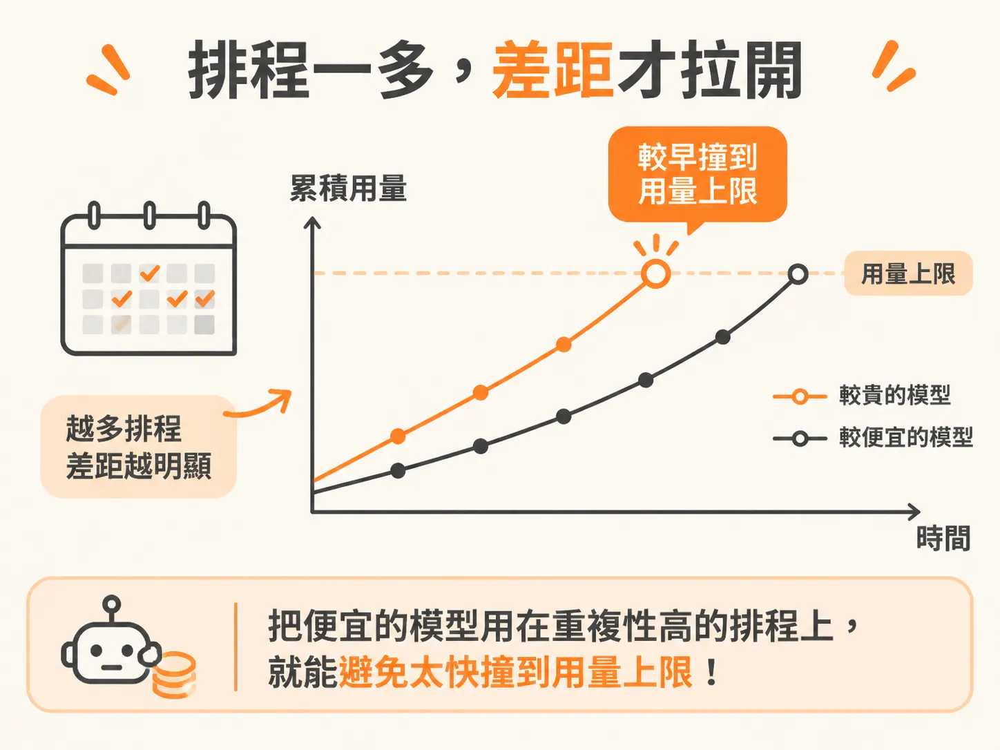

# 把排程任務的模型從 Opus 換成 Haiku

local 也好、cloud 也好，routine 排好之後，到了時間就會自己跑。單次執行時沒什麼感覺，但它會持續跑下去；累積幾天後，token 用量和額度的變化才看得出來。

排程設定好後，還要順手確認一件事：模型。

## 排程會持續跑，模型也得仔細想

這些 routine 照固定排程一直跑，所以排程任務用哪一顆模型，就要特別看一下，尤其在想省 token 的時候。

預設值通常是 Opus，也就是目前最貴的一顆。因此，像「每天提醒我該注意哪些事」這種工作量很小的 routine，也會用最貴的模型來跑。任務本身很輕，消耗卻不輕。

## 換模型只要三步

做法很直接：打開該條 routine 的編輯畫面，把模型欄位從預設值改成 Haiku（Anthropic 目前最便宜的模型），再按儲存。三個步驟，一次就完成。

調整完之後，這條 routine 每次執行都會用 Haiku。prompt 和排程時間都不用動。

## routine 變多後，差異才真正明顯

只省下一條 routine 的用量，一天、兩天看不出來。但你會持續新增 routine，一條接著一條，每條都有自己的排程，省下來的用量就從這裡開始疊。

而且省下的不只是成本。routine 跑得越密集，用量上限消耗得越快，撞到上限的時間會比預期早很多。把便宜的模型用在重複性高的排程上，就是為了不要太快撞到用量上限。

所以，每次新增一條 routine 時，多花五秒看一下模型欄位就好。預設值不一定最好，但你已經知道該改成什麼。
