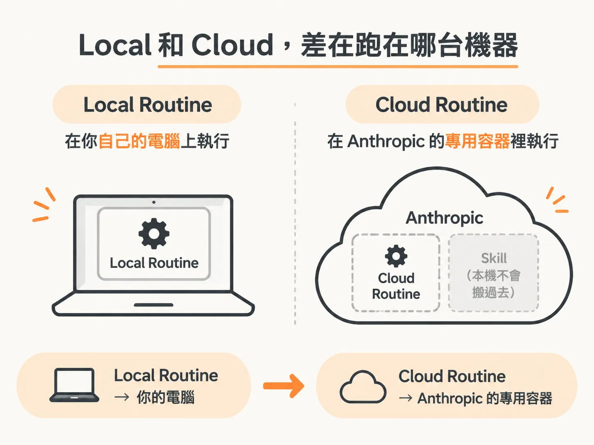
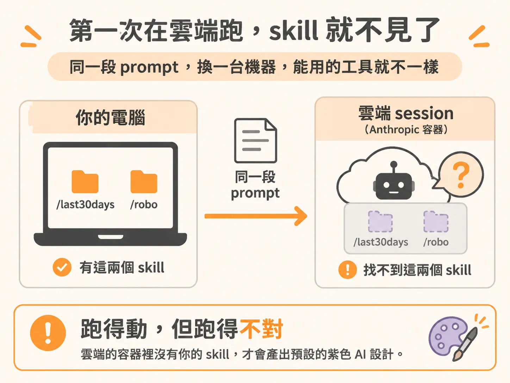
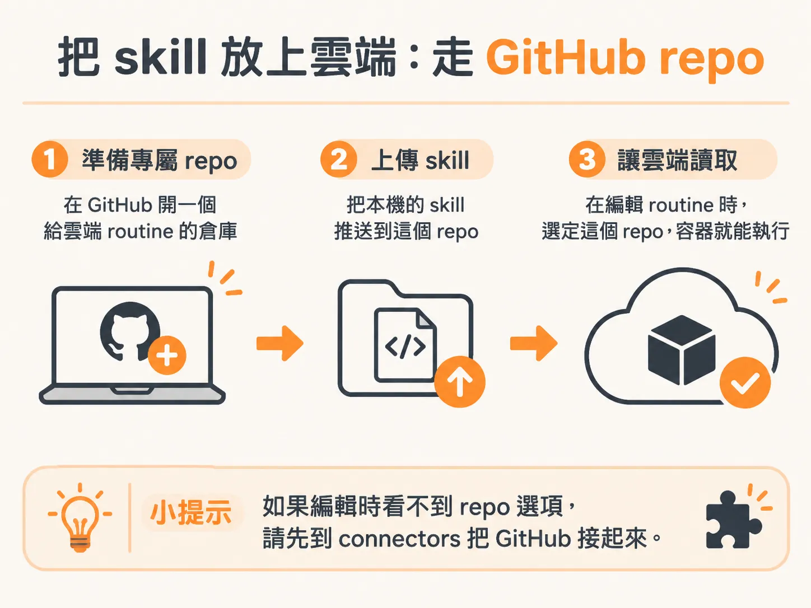

# Cloud routine：電腦關了也照跑，但你的 skill 不在那台機器上

你已經有一條 local routine，時間到就自己跑，產出也還能用。麻煩的是筆電一蓋上，它就停。你要的是半夜三點也在整理資料的那種 routine，這就得靠 cloud routine。

好處很直接：電腦關掉，它還是會跑。代價是設定多一輪，尤其是這條 routine 要用到你自己寫的 skill 的時候。

兩者的差別先看跑在哪裡。Local routine 用的是你面前這台電腦。Cloud routine 是 Anthropic 在主機上開一個容器，只給這次 session 用，跑完就收掉。

建立時從 routines 分頁開始，把要自動化的事情貼進去，標明要做成 cloud，再按 draft routine。Claude 就會照 cloud routine 的形式把它搭起來。

## 第一次跑，skill 就不見了

拿一條現成的例子試：每天產一份近 30 天 AI 趨勢與新聞的商業摘要。裡面的 `/last30days` 和 `/robo` 都裝在你本機。把 prompt 原封不動貼進 cloud routine，建得起來，手動按 run now 也會跑，session 也真的收到那段 prompt。

但看輸出就知道不對。PDF 是很普通的預設紫色 AI 設計，跟本機跑出來的樣子差很多。`/robo` 那套 design system 沒有被用到，`/last30days` 也沒有。

不是 prompt 寫壞，是那台機器的硬碟上根本沒有這兩個 skill。雲端 session 跑在 Anthropic 的容器裡，你的 skill 在你自己的電腦裡。同一段 prompt 換一台機器執行，能用的工具就不一樣。

## 把 skill 放上雲端

修法是把 skill 放到雲端也讀得到的地方。GitHub repo 就是那個地方。

回去編輯這條 routine，會看到一個可以選 repository 的欄位。這些是你 GitHub 帳號裡的 repo，本質上就是一個資料夾。實務做法是開一個專屬 repo 給 cloud routine 用，把要用的 skill 放進去。要跑 newsletter 的 routine，就把 newsletter skill 上傳到那個 repo。

如果看不到 repo 選項，代表 Claude 還沒接上你的 GitHub。到 customize → connectors，在清單裡找 GitHub，走一次單一登入把帳號接起來。這一步做一次就好。

## 什麼時候用哪一種

Local routine 只在你電腦醒著時跑，設定幾乎不用想，本機現成的 skill 全部能用。Cloud routine 在你電腦睡著時也跑，但你要先把要用的 skill 上傳到 GitHub，再在 routine 裡指定那個 repo，它才會跑出你想要的樣子。

還有一種做法完全不用 token：deterministic pipeline，步驟固定、動作固定，不經過模型判斷。

所以判斷點只有一個：這條 routine 要用的 skill，有沒有裝在要跑它的那台機器上。有，就留在 local；沒有，就先把它推上 GitHub。
