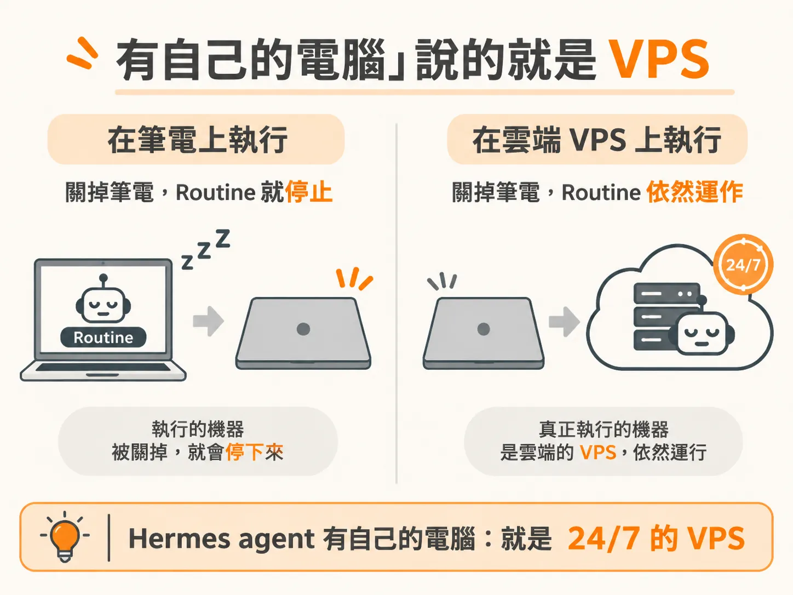
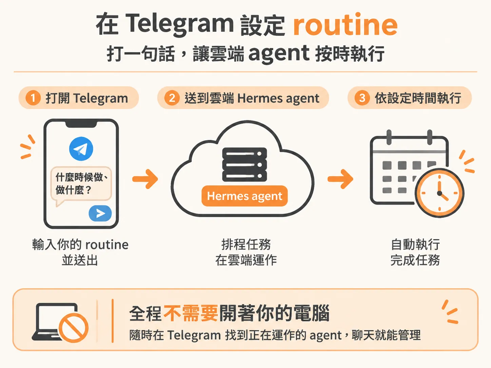
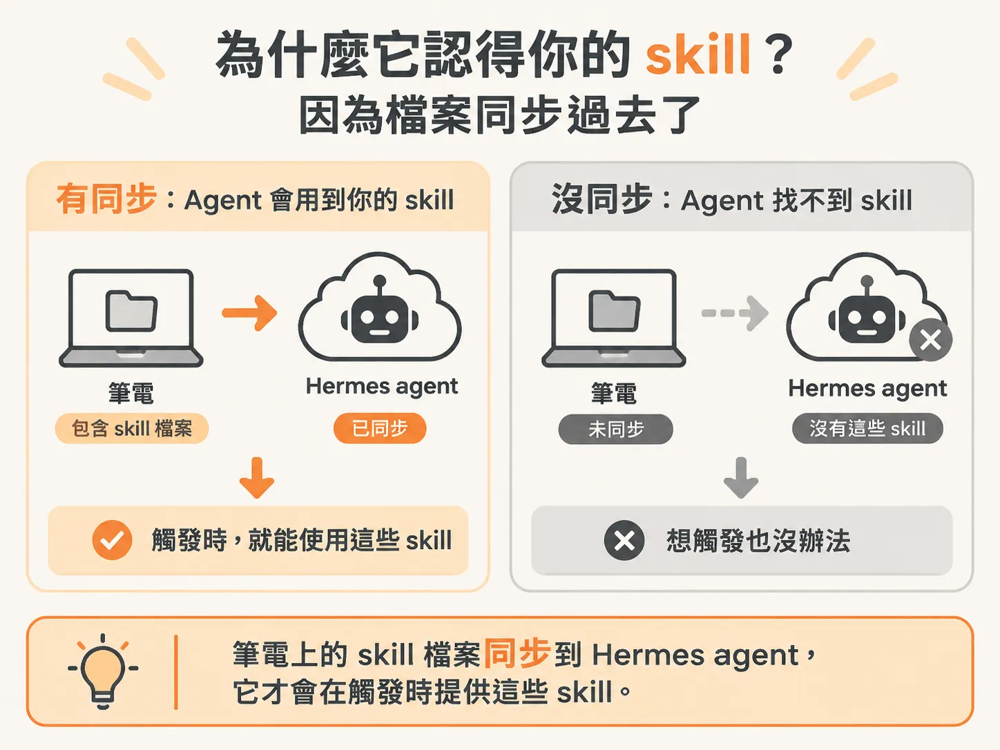

# Hermes Agent 大師課

把模型換成 Haiku，只是把每一次執行的成本壓低。要讓 routine 不中斷，還有一個更根本的問題：執行它的那台機器會不會睡著。

你在 Desktop app 上排好一條 routine，時間一到它就會跑。可是你闔上筆電出門，那條 routine 也跟著安靜下來。它沒壞，只是跟著那台機器一起睡了。

排程通常沒設錯，是那台機器關了。

Hermes agent 處理的就是這件事：它是一個真正的 24/7 agent，而且有自己的電腦。

## 所謂「有自己的電腦」，指的是 VPS

Hermes 跑在 VPS 上，virtual private server，虛擬私有伺服器。說白了，那是一台你租來、放在雲端的電腦。它不跟著你的筆電開關：筆電闔上了，它還開著。

關鍵差別在這裡：它不掛在 IDE 裡，是一台完整的機器。所以你叫它「每個星期做一次某件事」，對它來說就只是「在某個時間點執行一件事」，不需要你的電腦還醒著。

## routine 是你在 Telegram 裡打出來的

Hermes 接在 Telegram 上。要排一條每週 routine，就是在聊天室裡打一段話送出去。不用開專案，也不用切到某個排程後台填表單。

那段話就是你對 routine 的定義：什麼時候做、做什麼。送出去之後，排程就在雲端那台機器上執行，你人不在也沒關係。這個介面真正的價值，是你隨時打得到一個正在運作的 agent，聊天只是順便。

## 它認得你的 skill，因為檔案同步過去了

skill 更能說明它「是一台真的電腦」。你可以直接對它下自己寫的 skill，例如 `/robo`。Hermes 之所以認得，是因為筆電上的那些 skill 檔案被同步到 Hermes agent 上了。

這裡有個容易漏掉的地方。agent 換了一台機器，不會自動知道你在原本那台機器上累積了什麼習慣、什麼流程。skill 是檔案，檔案要搬過去，它才有東西可以觸發；沒搬，你在本機打得很順的那套做法，在雲端就是不存在。

## 三個條件要一起成立

用 Hermes 跑這類 routine，比在 cloud desktop app 上設定簡單得多。這也是它值得當成預設選項的原因。回頭看，它之所以能 24/7，是因為三個條件同時成立：

VPS 給它一台不會關的機器，Telegram 給你一個隨時打得進去的介面，同步 skill 讓它認得你原本累積的做法。

缺了任何一個，這條 routine 都會退回到「你的電腦有開才跑」。三個都在，24/7 才是真的。
