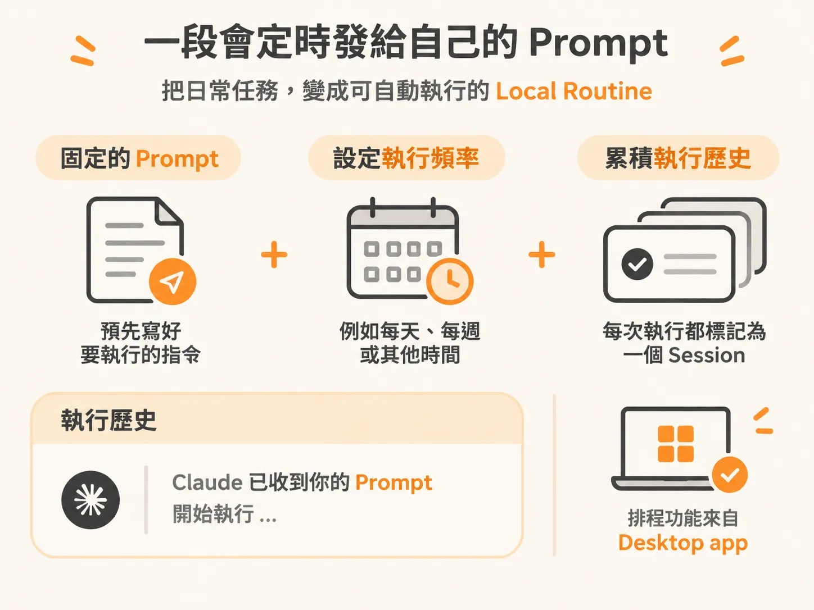
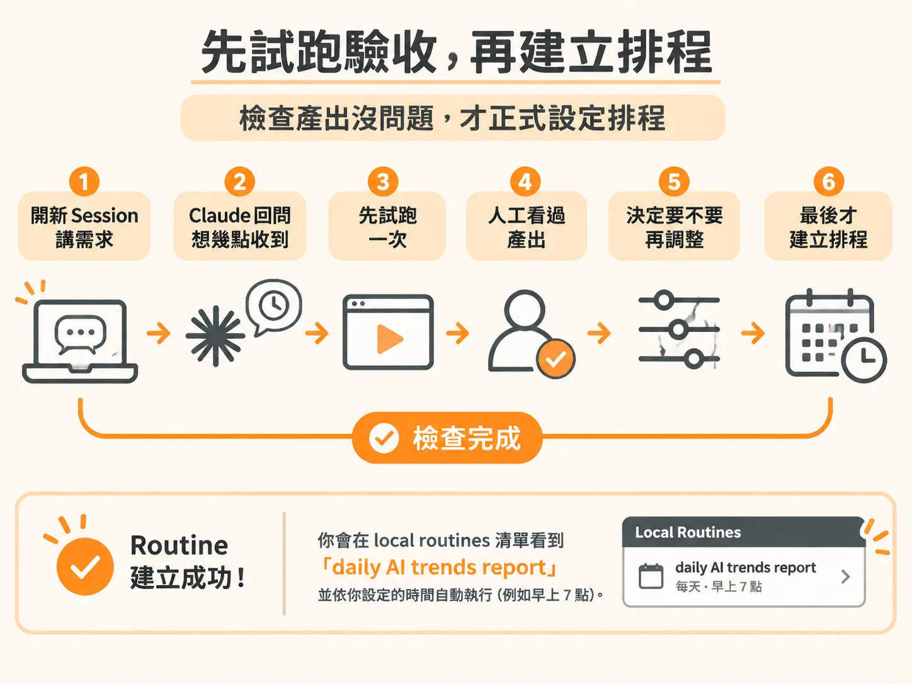
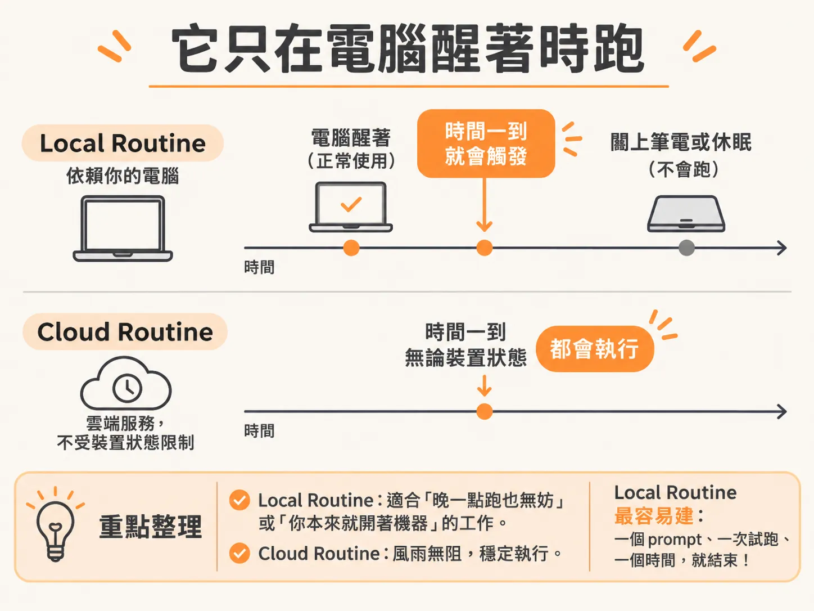

# local routine 就是它傳給自己的一段 prompt

上一段最後留下一個問題：這件事需要你的電腦開著嗎？如果答案是「需要」，而且晚一點跑也無所謂，那你需要的就是 local routine。

有一件事你每週都得做：把同一個主題的消息整理成一份報告。格式你早就知道，只是每次都得從頭交代一遍。local routine 就是把這件事接過去：那段話你只講一次，之後時間到它自己跑。

## 它就是排程任務，跑在你自己的電腦上

local routine 本質上就是排程任務（scheduled task），跑在你自己的機器上。它需要 Claude Desktop app：左邊側欄點 routines，你所有的 routine 都放在這裡。

點開其中一條，你會看到它其實就是一段 prompt。Claude 依照你設定的頻率，時間一到就把這段話傳給自己。舉例來說，有一條每日 routine 是把 YouTube 新影片轉成 Substack 草稿，排程設在每天早上 8 點。

再往下捲是執行歷史。隨便點進一次，看到的就跟平常的 session 沒兩樣：開頭是 Claude 收到自己送出的 prompt，然後開始動手。排程是 Desktop app 內建的功能，所以 local routine 一定要裝這個 app。

## 這段 prompt 不用自己寫

手動寫當然可以，但通常更快的方法是：開一個新 session，直接在對話裡請 Claude Code 幫你把 routine 建起來。

假設你要一份固定產出的 PDF 報告。你跟它說：抓這個主題最近 30 天的新聞、趨勢和討論（例如用 last30days 這個 skill），整理成短報告，再用 /robo 產出 PDF。/robo 是一套 design system，會給你一個好看的骨架，你也可以改它來符合自己的設計需求。再補幾句要求：封面要寫什麼、輸出到哪個專屬資料夾、用精簡平實的英文、不要編造數字。

平常把 skills 準備好，這裡就派得上用場：routine 可以直接把現成的 skill 折進去，不用每次重寫。

送出之後，Claude 多半會問你想幾點收到這份報告。回答完，建議順便請它現在就跑一次，這樣才有成品可以檢查。

## 先驗收，再按下排程

跑完之後它會問你，要不要直接建立排程任務。這裡最重要的一件事：先看成果，再決定。

以那份報告為例，它會給你乾淨的版面、標出來源資料的日期區間，還有頭條重點。這樣已經能用了。想要多一點視覺效果，就請 Claude 套用調整，一路調到你願意接受的樣子，最後才讓它建立排程。

建立之後它會回報 routine 已經上線。你會在 local routines 清單裡看到那條「daily AI trends report」，時間是你自己選的（例如早上 7 點），裡面就是那組指令。之後它就照你設的時間跑。

## 建完之後怎麼改

要調整一條 routine，最快的方法是回到那條 routine，打開歷史，找到最近一次 session。那場 session 跟其他 Claude Code session 沒兩樣，你可以直接照自己的意見請它改。

舉例：有一條 routine 會檢查 YouTube 頻道有沒有新影片，有就轉成 Substack 草稿。你的回饋是「每次產出後用 Telegram 通知我」。你就這樣講，順帶一句「我的帳號資料在 workspace 裡」——因為 memory 分層已經設好，Claude 找得到那些資料。它就會照著去改 routine，順便找出你的 telegram chat ID；回到設定頁一看，那條指令已經變成 routine 的一部分。

## 它只在你電腦醒著時跑

local routine 有一個關鍵限制：它只在你電腦醒著時跑。闔上筆電、機器休眠，時間到了也不會動。

所以它適合「晚一點跑也無所謂」或「你本來就開著機器」的工作。要真的風雨無阻，就得往 cloud routine 走。反過來說，local routine 也是最容易建的一種：一個 prompt、一次試跑、一個時間，就結束了。

