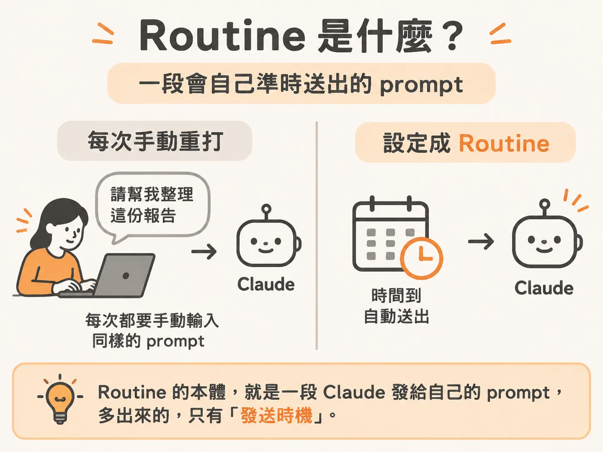
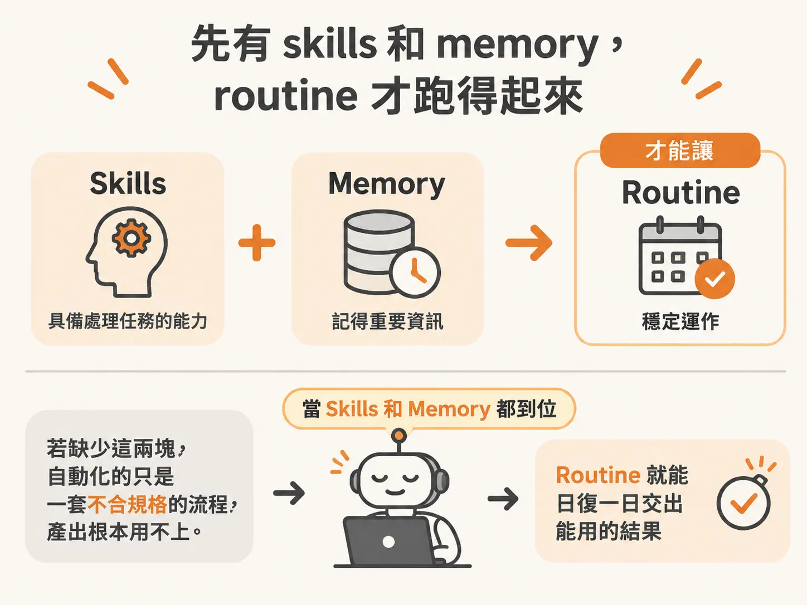
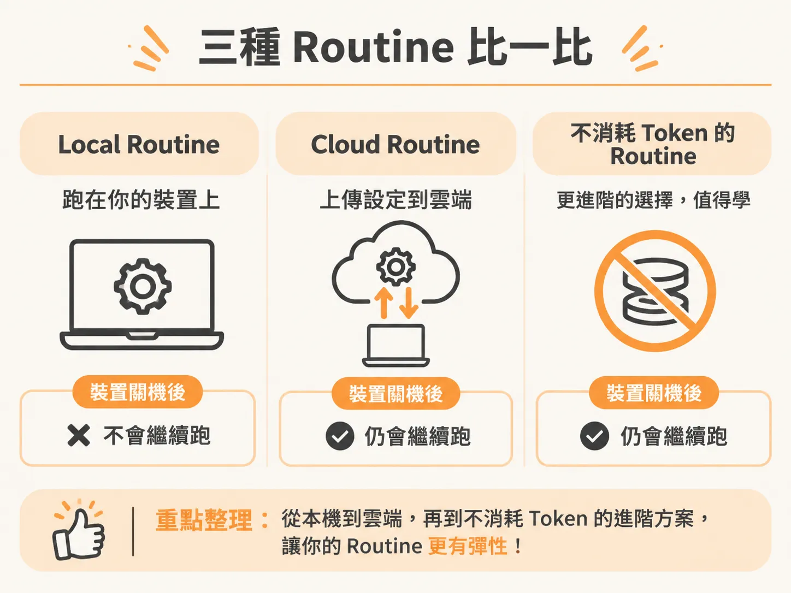

# Routines：Claude Code 在你不在的時候也自己跑

skills 你已經建好了，memory 也開始記得住你的偏好。可是每次還是得你先開口，Claude Code 才動。

Routine 改的就是這件事。它把你本來每次都得重打的那段話固定下來。時間到了，這段話會重新送進去，Claude 照著它做事。你不必在場。

所以 routine 可以想成一段 Claude 發給自己的 prompt，只多了「什麼時候發」這一層。

## 為什麼要先有 skills 和 memory

Routine 排在 skills 和 memory 後面是有原因的。

先看沒有前面兩塊會怎樣。你還沒把 skills 設好，也沒有可用的 memory，Claude Code 記不住你的聯絡人，也記不住你的偏好。在這種狀態下開 routine，只是把一套還不合規格的流程自動化。跑得再勤，產出也不會是你要的東西，只是在製造用不上的檔案。

前面兩塊到位之後，情況就反過來。routine 設定一次，之後一邊跑一邊修，Claude 就能日復一日替你工作，你不用每次重新交代背景。

## 代價：自動化越多，token 燒越多

Routine 不是免費的。你自動化的東西越多，燒掉的 token 也越多。

這件事有解。有些做法可以把這份負擔壓下來，甚至做出完全不消耗 token 的 routine。

## 一個具體的長相

假設你每週要交一份 PDF 報告或一份簡報。把這件事設成 routine，時間一到它自己就產出，你不用動一根手指。

做法其實不複雜。你只要把「你要什麼」和「什麼時候要」講清楚，剩下的重活 Claude 會做。

## 三種 routine，差別在跑在哪裡

Routine 有三種。分辨方式很直接，看它跑在哪裡：

- **Local routine**：跑在你的桌機或裝置上。
- **Cloud routine**：你把設定上傳到雲端，所以裝置關機它也照跑。
- **不消耗 token 的那一種**：比前面兩種進階，但很值得學。

要判斷自己該用哪一種，先問一個問題：這件事需要你的電腦開著嗎？答案會直接把它分到其中一邊。
