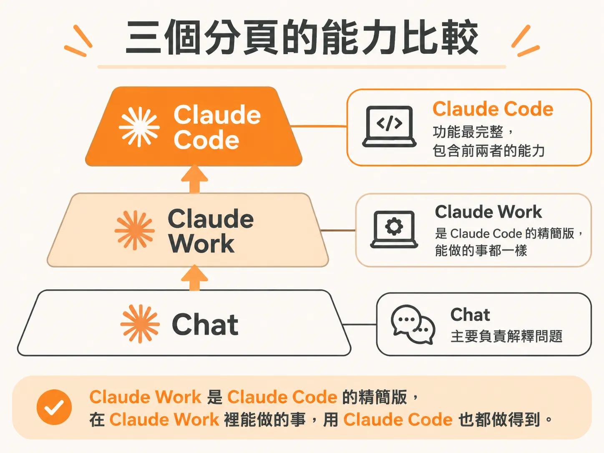
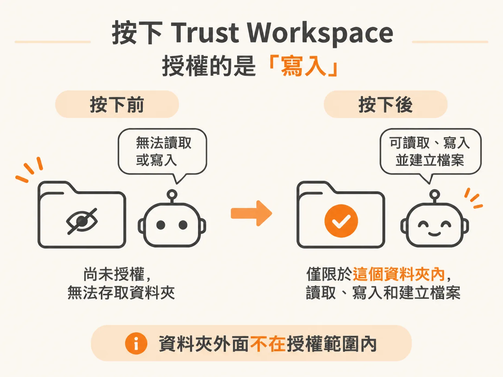
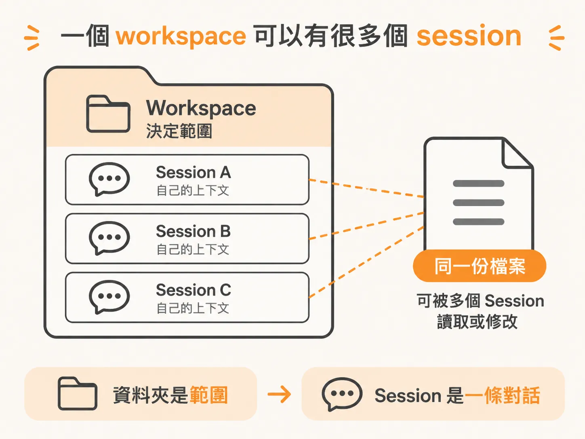
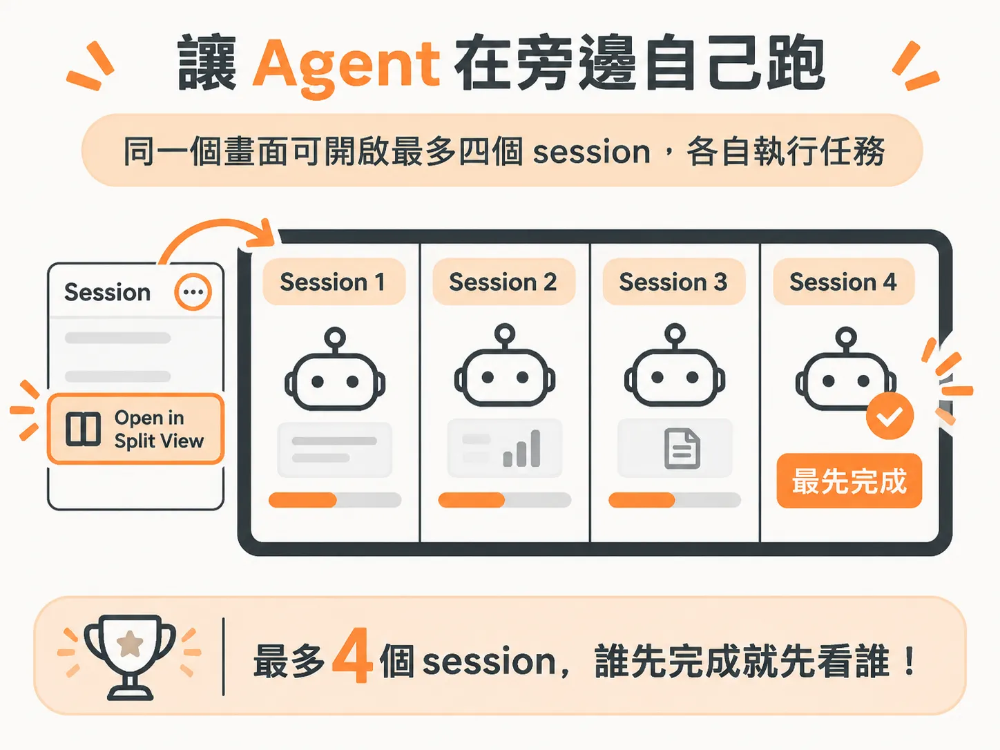

# 選一個 workspace，按 Trust Workspace，然後開 split view

desktop app 打開後就是一個聊天視窗，外觀和 ChatGPT、Gemini 或 claude.ai 的對話視窗很像。差別在左上角：那裡有三個分頁。不管你之後要跑幾個 session，第一步都一樣，先指定一個資料夾。

這篇只談 desktop app：怎麼指定 workspace、按下 Trust Workspace 授權了什麼，以及怎麼用 split view 同時跑多個 session。模型和 harness 換到別的介面也一樣，變的只有介面本身。

## 左上角的三個分頁：Chat、Claude Work、Claude Code

第一個分頁是 Chat，主要拿來解釋事情，也是三個分頁裡能力最弱的一個。作者說他很少用，因為 Claude Work 和 Claude Code 幾乎什麼都能做。

第二個是 Claude Work，很多教學裡看過。作者認為它是 Claude Code 的精簡版：在 Claude Work 裡能做的事，用 Claude Code 也都做得到。

第三個是 Claude Code，三個分頁裡功能最完整。名字裡有「Code」是因為它最初為軟體開發而設計，不過它能自動化的工作遠不只寫程式，現在早就不是只能寫 code 的工具。

如果你想要最簡單、壓力最小的體驗，從 desktop app 開始就好。代價是它也是三種介面裡功能最少的一種，後面會慢慢碰到限制。

## workspace 就是筆電上的一個資料夾

開始用的第一件事是選 workspace。workspace 就是筆電上的一個資料夾，沒別的意思。

點左上角的資料夾圖示，選 open a folder。裝置上任何資料夾都能選；示範用的是一個叫 My Workspace 的空資料夾。選好之後，左側會列出你開過的 workspace 和各自對應的 session。

選資料夾看起來只是個小步驟，卻決定了後續自動化的範圍：Claude Code 碰得到的檔案，就是這個資料夾裡的檔案。

## 按下 Trust Workspace，授予的是「寫入」權限

選好資料夾後，畫面會出現 Trust Workspace。按下去的意思是：允許 Claude Code 看這個資料夾，並給它在你這個資料夾裡寫入檔案、建立檔案的權限。

示範拿最簡單的例子來測：請 Claude Code 在 workspace 裡建一個 Hello World 文字檔，它就真的在你裝置上把檔案建出來。

這項權限之後會愈來愈重要，因為開始自動化之後，你要做的就不只是一個文字檔。你可能會在多個 session 裡大量做出簡報、影片和圖片；流程調得夠順，這個資料夾就會慢慢變成你的 operating system 或 second brain，一個可以直接提問、找資料的地方。

示範裡的 Robo 資料夾就是這樣慢慢累積出來的：圖片、影片、好幾個 markdown 檔案，總容量約 8 GB，全都是 Claude Code 建的。作者自己都不記得裡面有什麼，因為現在的模型幾乎瞬間就能掃完整份檔案清單，幾千個檔案也一樣。

所以選資料夾不是什麼行政流程，它直接決定 agent 碰得到哪些內容。

## 一個 workspace 可以有很多個 session

同一個 workspace 可以開好幾個 session。左側的 filter 用來切換目前看的專案；按 plus 就開一個新 session，左側清單馬上會多一條。

這裡有兩層要分清楚：資料夾是範圍，session 是那個範圍裡的一條對話。同一份檔案可以由多個 session 讀取或修改，每個 session 都有自己的上下文。

## split view：讓 agent 同時在旁邊執行

差別就出在這裡。Claude Code 是 agent。你請它做 deep research，它會先問幾個問題確認你想拿到什麼，然後自己跑幾分鐘，最後才把結果交出來。這段時間你只能等。

所以你可以再開一個 session 做別的事。先在左側選一個 session，點 ellipsis，再選 open in split view，它就會在旁邊同時執行。這個動作最多可以做到四次，也就是螢幕上同時看得到四個 session。

示範裡，作者把 session 一個一個開到 split view，再分別派任務。這就是 power user 同時用多個 agent 的方式：把工作分派給四個正在跑的 agent，而不是坐在那裡等一個。哪個先完成，就先去看哪個的結果。

這也是他認為 split view 能讓產出提升十倍的原因：你不再被單一任務的等待時間卡住。

## 但這也是他不把 desktop app 當作每日主力的原因

split view 好用，但版面配置不太有彈性。pane 的寬度可以調，tab 卻拖不出來，也不能重新排序。要照自己的習慣整理版面，並不容易。

所以他平常主要用 VS Code extension：session 會開在新視窗裡，可以拖到左側照自己的習慣排，也能同時對照同一個 workspace 的檔案樹。

desktop app 的優點很明確：介面最不嚇人，還能把多個 session 放進同一個畫面。缺點也一樣清楚：畫面怎麼配不由你決定。

## 順手看看另外兩個區塊：Routines 和 Customize

desktop app 還有一個好處：routine（排程任務）在這裡很好找。切到 Routines 分頁就能看到各種可設定的 routine，可以暫停、恢復，也可以用日曆檢視。不過 routine 一多，用介面管反而更麻煩。

另一個區塊是 Customize。這裡列出 Claude Code 能用的所有 skill，要手動新增也行；connector（也就是 MCP connector）同樣在這邊看得到。

但作者自己不會從這個介面新增 skill。Claude Code 像住在你電腦裡的數位員工，skill 通常直接用自然語言請它建或改就好。等 skill 累積到八、九十個，單看清單也沒什麼用；要改哪一個，直接請它去改對應的檔案還比較快。

## 先把這一層用順

desktop app 是三種介面裡最不嚇人、功能也最少的一種。它最大的價值是讓你把「資料夾 → 權限 → session」這個流程完整走一遍：選一個資料夾、按下 Trust Workspace、開幾個 session，再用 split view 讓它們同時跑。

流程熟了之後，desktop app 還有兩個區塊值得看：Routines 和 Customize。一個管「會自動執行的工作」，一個管「agent 能用的能力」，也是這個介面最早開始不夠用的地方。

之後換到 VS Code extension，資料夾、模型和 harness 都沒變，差別只是你終於可以自己安排版面。
