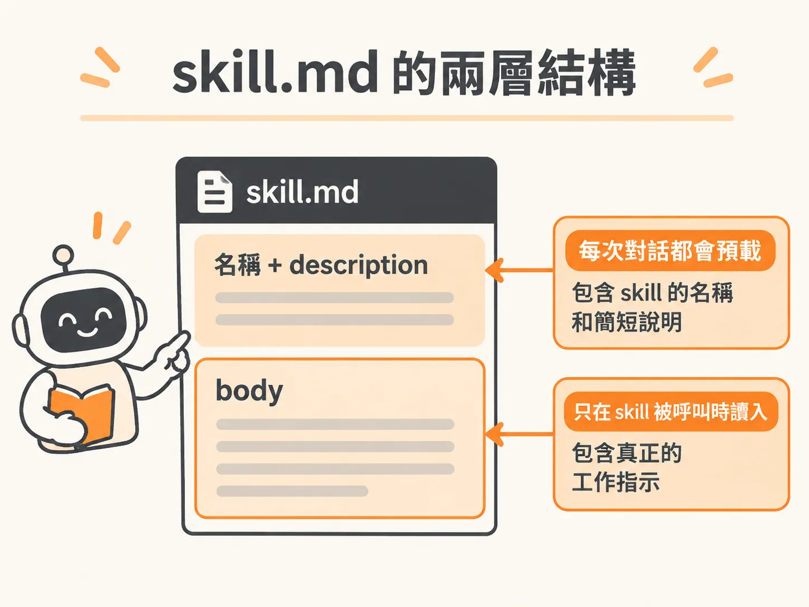
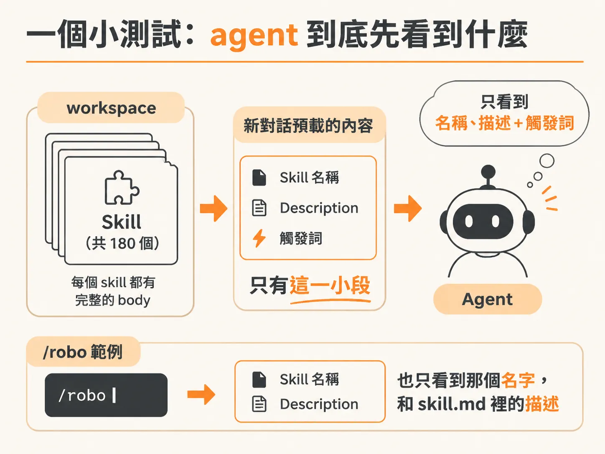
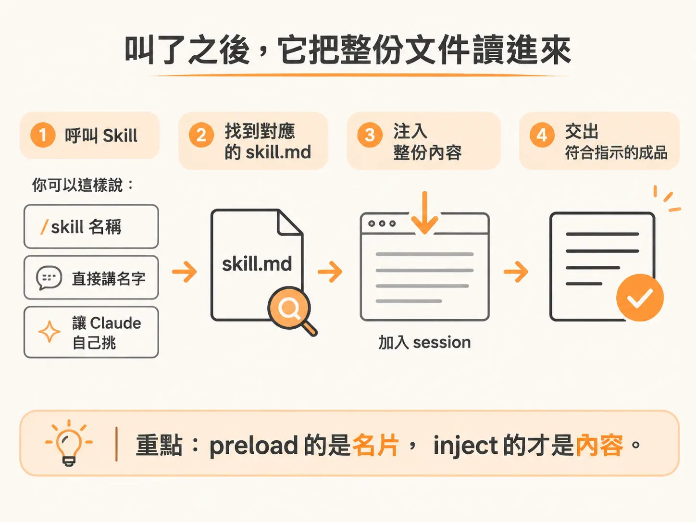

# Skill 是 agent 替你保管的食譜卡

你應該有這種經驗：同一段指示，這個 session 打完，換一個對話又要重打一次。改個專案、換個任務，整段再來一遍。

課程一開始就把 skills 擺在很高的位置。它是 Claude Code 裡最有用的一樣東西，講者每天都在用，也是最快讓你看出這些 agentic coding 平台能耐的一條路。不過在看它實際跑起來之前，先把定義講清楚，因為它比想像中簡單。

## 一份你自己不必寫的食譜卡

skill 可以想成一張 agent 替你保管的食譜卡。它就是一份寫下來的文件。agent 要去做某件工作時，照著卡片上的指示做。

形式很樸素：它就是一個純文字檔，更精確地說，一個 markdown 檔。

## 檔案長什麼樣：上面說明、下面內容

每個 skill 的檔案開頭都有一小段，交代它的名字和 description。游標移到 description 上，介面會告訴你：這段描述會被加進每一個 request，agent 靠它決定什麼時候該載入這個 skill。

再往下是 body，也就是真正的工作指示。這一段不會自動載入你的 session，只有在這個 skill 被呼叫的時候才會讀進來。

課程投影片本身就是例子。你看到的那些畫面，全部是講者自己做的 `/robo` skill 產出的。打開那個 skill 的 body 會發現它相當長，因為它專門拿來做設計，一路調到對準那批投影片。

## 檔案放在 workspace 的 .claude

打開 IDE 看，skills 預設住在一個叫 `.claude` 的資料夾裡。你在 Claude Code 裡建立 skill，預設就放在這個資料夾底下。

講者的 `.claude` 裡有好幾個 skill，而且沒有一個是他自己寫的，全是他的 agent 建的。這也是這一段最該記住的事：寫 skill 不是你的工作。

那個 `robo` 資料夾底下的 `skill.md`，內容就是前面說的食譜卡。

## 一個小測試：agent 到底先看到什麼

想確認它真的知道自己有哪些 skill，可以開一個全新的 session，請它列出這個 session 預先載入了哪些 skill，還有預載的確切文字。

結果分成兩塊。第一塊是整段文字被塞進 session 的 memory 檔，那是 memory 模組的事，這裡先跳過。第二塊才是重點：它把 workspace 裡 180 個 skill 列了出來，但沒有把 180 份 body 全部載進來。

它看得到的只有每個 skill 的名字、description，加上觸發詞，沒有別的了。每個新對話真正預載的就只有那一小段，180 個 skill 共用同一份。再看 `/robo`，它確實只看到那個名字，和我們剛剛在 `skill.md` 裡讀到的那段描述。

## 三種叫法

要用一個 skill，不只一種叫法。

直接說出名字就行，例如「run the robo skill」。因為那段 description 本來就預載在對話裡，agent 認得出你在講哪一個。

想直接一點，打一個斜線加上 skill 名字。或者你根本不用指名，把要做的東西講清楚，讓 Claude 自己挑。

## 叫了之後，它把整份文件讀進來

打斜線會列出所有指令，包含自己的 skill 和 Claude Code 內建的。打 `robo` 就直接叫出那個 skill，接著你照平常下指令，例如做一張 sample one-slider，跟課程觀眾打聲招呼。

接下來發生的事才是 skill 的重點：它會去找那個 skill、讀 `skill.md`，把整份文字注入這個 session。這樣它才真的拿到我們為這批投影片建的那套設計系統。然後它照著做出投影片，用上 skill 指定的字型、dot matrix 設計，還有配色和視覺。

preload 的是名片，inject 的才是內容。

