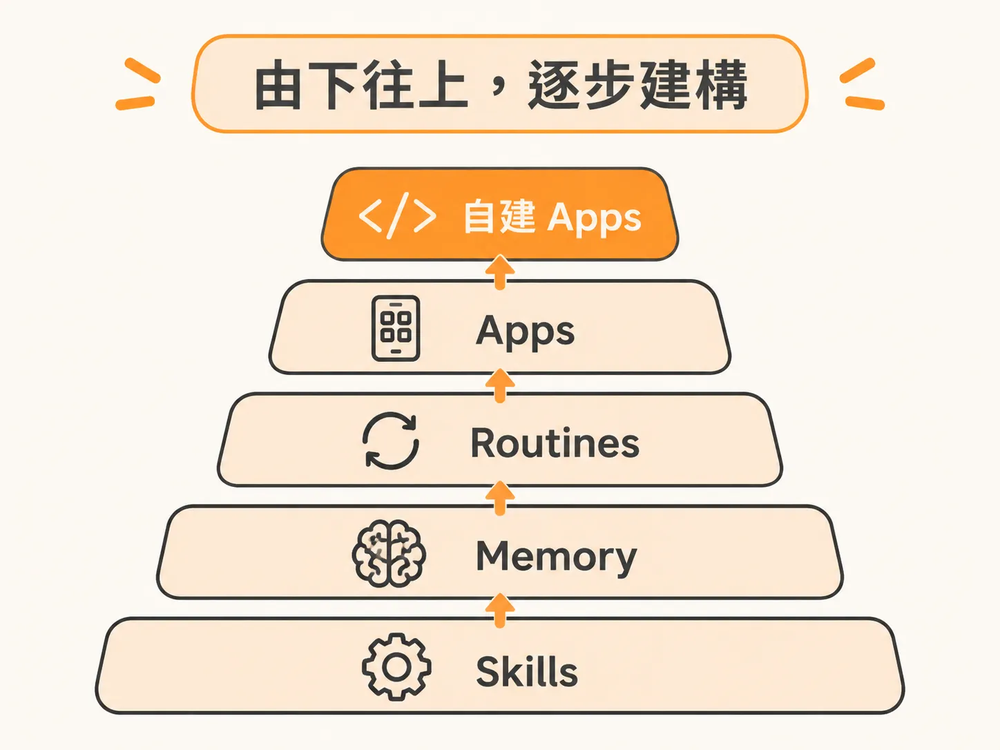
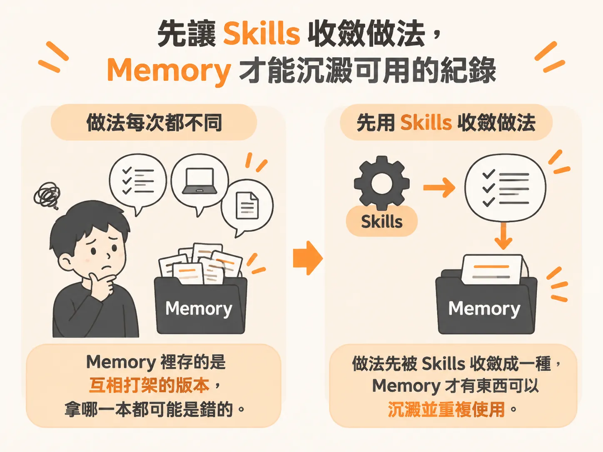
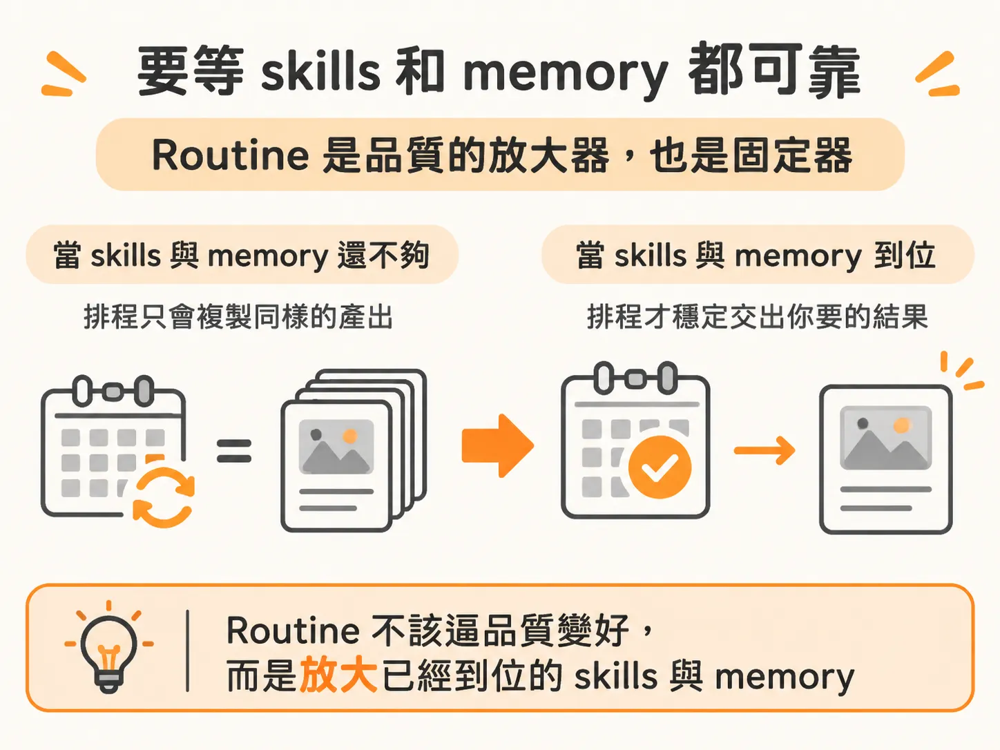
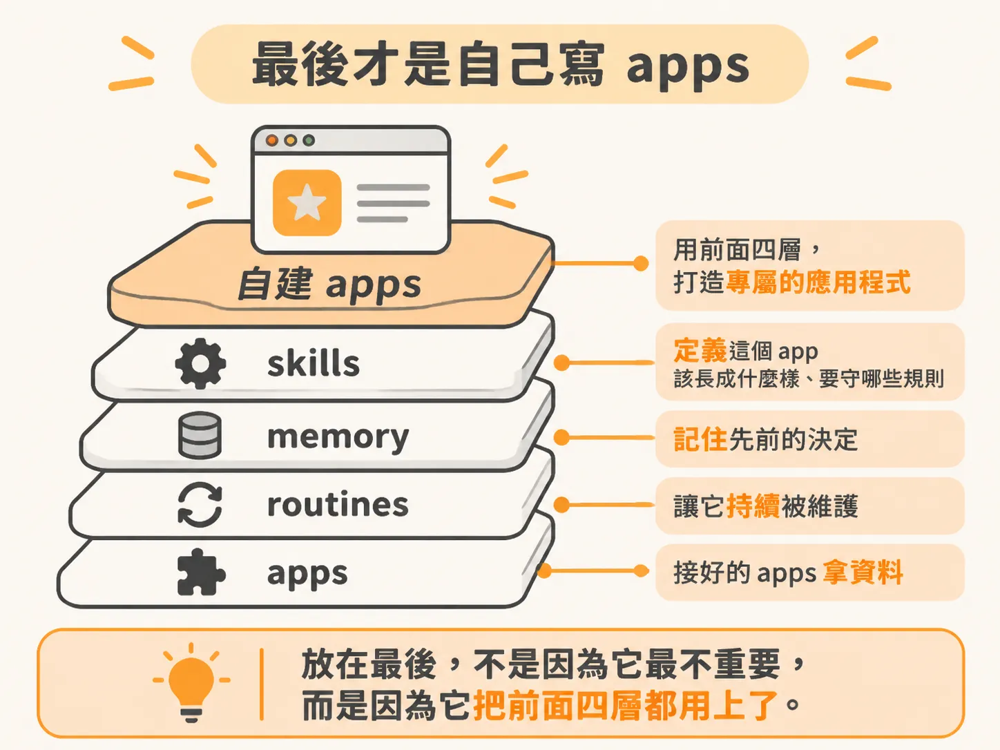

# 由下而上，這是我推薦的做法

你大概已經走到這一步：手上有幾個自己寫的 skill，也在用分層的 memory，下一個念頭就冒出來了：「是不是該來排 routine 了？」

先停一下。順序錯了，你不會馬上發現。你會先排好一條 routine，它每週準時跑，然後每週產出一份你要花時間修的稿子。自動化沒有讓事情變少，只是把錯誤變成固定產能。

課程講得很直接：這套東西要 bottoms-up 學，由下往上堆。順序是 skills、memory、routines、apps，最後才是你自己動手寫 app。

## 先把順序記下來

這五層各自是什麼，用「你新聘一位數位員工」的比喻最好懂：

- **skills**：他筆記本裡的那些 recipe cards、instruction cards，讓他記得某件特定任務怎麼做。
- **memory**：一個檔案櫃，放著你們一起做過的對話與專案，需要時再取出來。
- **routines**：他的行事曆與排程，讓工作在你不看著的時候也自己發生。
- **apps**：你每天真正在用的那些工具與應用程式。
- **自建 apps**：用 agent 的能力，做出原本不存在的東西。

重點不是背名詞，是背「誰站在誰上面」。

## skills 在最底層，因為它是其他一切的地基

課程的說法很重：skills 是 foundational to everything，agent 有了好的 skills，才開始往上長 memory。

用數位員工的角度想會更清楚。你給新人的不會是「你要努力」這種話，而是一疊 instruction cards：這件事我們這樣做、那份報表照這個格式、這個客戶要這樣回。沒有這疊卡片，他每做一件事都要回來問你，或者自己發明一套做法。

所以 skills 省下的不只是 token 或打字時間。它先把「做對的樣子」固定下來，後面三層才有共同的基準可以對齊。

## memory 排在 skills 之後

課程把因果接得很清楚：先把 skills 弄好，agent 才會 builds up memory，才會有一份關於你的業務、你的工作的知識庫。

memory 的價值在於「這件事以前怎麼做的」可以取回來用。但如果同一件事每次的做法都不一樣，你的檔案櫃裡存的就是幾個互相打架的版本，拿哪一本都可能是錯的。skills 把做法收斂成一種，memory 才有東西可以沉澱。

反過來也一樣。memory 沒有 skills 墊在下面，它只是一個越長越大的紀錄，不是知識庫。

## routines 要等 skills 和 memory 都可靠

再往上才是排程。課程特別用了 reliable 這個字：等 skills 和 memory 檔案都可靠了，才可以設 routine，才拿得到符合你期待的那種產出水準。

這句話的重點在順序，不在 routine 本身強不強。routine 會把你當下的水準放大，而且固定下來。水準是八十分，你得到每週一份八十分；水準是四十分，你得到每週一份四十分，還附帶一個「看起來有在做事」的錯覺。

所以 routine 不該是你拿來逼品質變好的工具。品質要先在 skills 與 memory 裡成立，routine 才有東西可以放大。

## apps 是讓它 24/7 的那一層

到這裡，agent 已經知道怎麼做、也記得你的事，只差最後一段：它碰不到你真正在用的工具。

課裡也講到，我們很多工作都繞著實際在用的 applications 或 tools 打轉，把這些接起來，就是讓 agent 24/7 替你工作的那一層。

缺這一層的症狀很好認：agent 每次都等你自己貼資料。你把報表內容複製給它，它整理好，你再貼回去。整條流程看起來有在跑，中間那兩個手動動作就是你。

這一層排在 routines 之後，是因為接工具不難，難的是接上去之後它做得對不對。skills 和 memory 還沒到位就去接 connector，你只是把不穩定的輸出接進更多系統。

## 最後才是自己寫 apps

課程最後一句是：因為這些 agent 已經這麼強，你其實可以自己做 applications。

放在最後，不是因為它最不重要，而是因為它把前面四層都用上了。你會用 skills 定義「這個 app 該長成什麼樣、要守哪些規則」，用 memory 記住先前的決定，用 routines 讓它持續被維護，用接好的 apps 拿資料。

前面四層空著，你做出來的東西會是一個沒有上下文的 demo。

## 用一週檢查你停在哪一層

不要問「我學到第幾課」，問「哪一層是空的」：

- 同一件事每次都要重新解釋做法 → skills 還沒寫。
- agent 記得今天，下週重開就變新同事 → memory 沒有在累積。
- 做得對，但都要你開口才會發生 → 該上 routine 了。
- 每次都要你手動搬資料 → apps 那層沒接。
- 想做的東西市面上沒有 → 可以開始自己寫。

從最下面那一格補起。下面補好了，上面那層才站得住。
