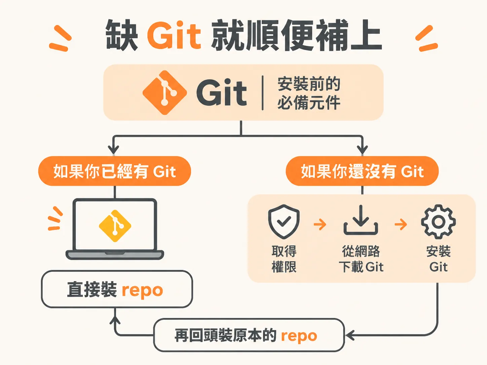

# 把 GitHub 連結貼進 Claude Code，叫它安裝這個 repo

你看到一個工具很想用。它不是 app，也沒有官方 connector，頁面上只有一個 GitHub 連結。

這種情況只會越來越多。新出的 agent 工具很多都放在 GitHub 上，README 寫在那裡，code 也放在那裡。課程把它形容成「世界的 Google Drive，只是給 code 用的」，而且正在慢慢變成「給 AI agent 用的 Google Drive」。你不需要是 developer，但遲早會碰到它。

安裝這件事已經被壓縮成一個動作：複製 URL，貼給 Claude Code，叫它裝。

## 三秒鐘的動作：複製 URL，貼上，說 install

課程拿一個叫 VideoUse 的工具示範。它是給 agent 用的自動剪片工具。要裝它，你不用先讀懂 repo 裡有什麼，只要複製這個 GitHub 連結的 URL，貼給 Claude Code，然後說「install this repo」。

repo 是 repository 的簡寫，就是一個裝 code 的資料夾，概念上像一個分享給全世界的 Google Drive 資料夾。你不需要會操作它，Claude 會。

## 它不會悶著頭裝：先讀 README，再判斷安不安全

貼上之後，畫面會開始跑。它先去看這個 repo 的 README，把整個東西讀一遍，判斷裡面安不安全。

「貼 URL」這個動作真正的價值就在這裡。Claude 會先把說明讀完、確認過，才動手；你不需要先看懂那段安裝腳本在幹什麼。README 裡通常寫了這個工具要做什麼、需要什麼、怎麼跑，Claude 讀完才有辦法告訴你它準備做什麼。

## 缺 Git 就順便補上

第一次裝的時候，Claude 很可能會先告訴你：你需要一個叫 Git 的軟體，如果你還沒裝的話。

Git 是 open source，是世界上信任度最高的軟體之一；要從 GitHub 抓檔案，就得靠它。以前你得自己上網找安裝檔、跑完一整套 setup；現在你只要給它權限，讓它從網路上把 Git 抓下來、裝到你的電腦。

課程示範的那次，他的電腦本來就有 Git，所以 Claude 直接跳過這一步，把東西裝好，順便給了一段這個工具在幹嘛的簡介。

## 裝之前先問一句：這對我有用嗎

課程建議你裝另一個東西：一個叫 personalize 的 skill。它本身只是一個 markdown 檔，裡面寫的是給 Claude Code 的指示。

指示的內容是這樣：之後你裝任何 GitHub repo 之前，先依你自己的 workspace 和你實際在做的工作，檢查這個工具是不是 fit for purpose。

用法是把 URL 貼給 Claude Code，然後打 `/personalize`。它會給你三件事：這個工具在做什麼、對你自己的 setup 適不適合（課程用 take rate 這個說法），以及跟你手上已有的東西比起來，它該擺在哪裡。

差別在這裡：你不是盲目地把一個新工具塞進越來越大的 workspace，而是帶著一點判斷把它加進來。等你 workspace 慢慢成形，這個差別會越來越明顯。

## 下一批工具去哪裡找

star-history.com 是一個 GitHub 專案排行榜，依 GitHub stars 顯示哪些專案正在 trending。

star 就是對一個 open source repo 按讚、收藏。按了之後，別人在這類網站上就比較容易看到它。課程建議把這個網站 bookmark 起來，等你養成用 Claude Code 的習慣，就會常常回來看。

## 弄壞它一次

把 `/personalize` 那一步跳過，直接貼 URL 叫 Claude 安裝。看看它給你的回應少了什麼：沒有「這對你有沒有用」的判斷，也沒有「它該放在你現有工具組的哪個位置」。少了這兩件事，你就只是在把東西往資料夾裡堆。

下一篇把 `/personalize` 拆開來看。它只是一個 markdown 檔，卻是你按下 install 之前唯一的煞車。
