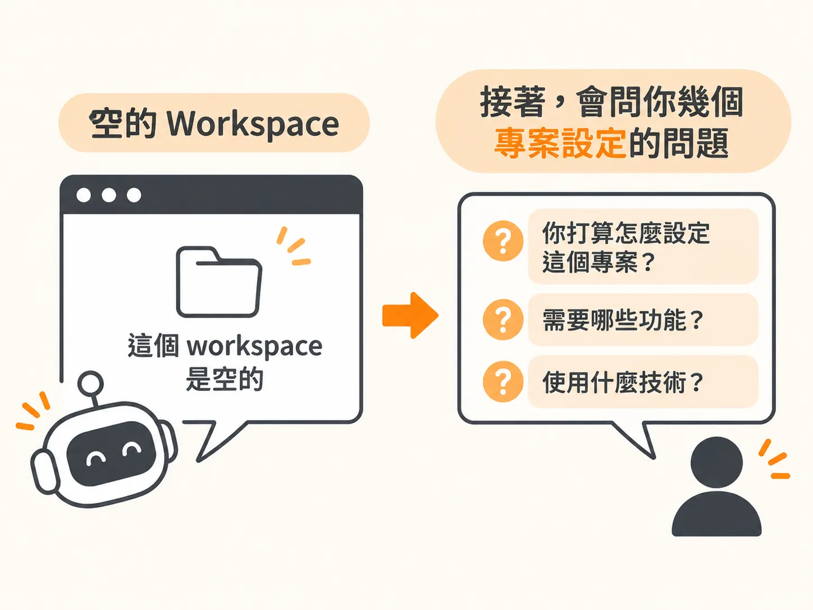
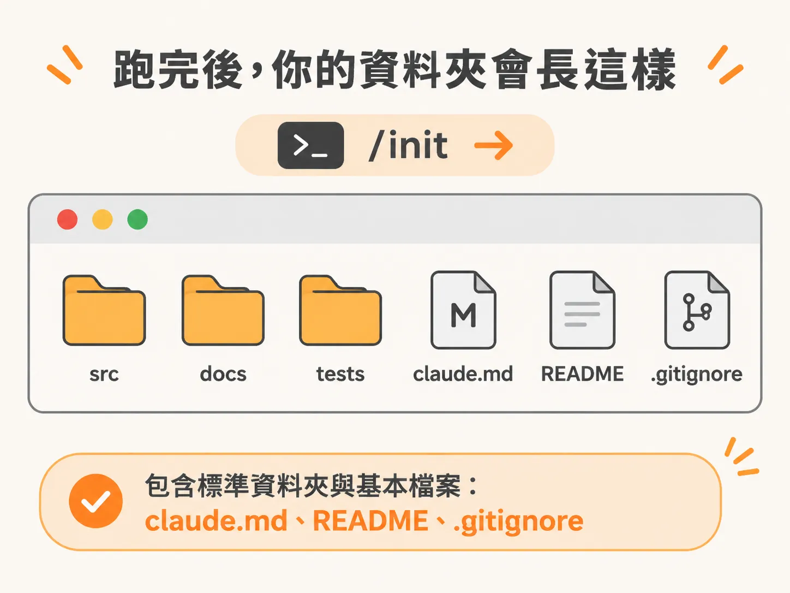

# 用 /init 把 workspace 設定好

你在 VS Code 裡打開一個空資料夾，左邊的 Explorer 一片空白。Claude Code 的側邊欄開著，游標在輸入框裡閃，但你不知道第一句話該打什麼。

不用想。這個空白資料夾本來就是起點。你只要先做一件事：讓 Claude Code 在這個資料夾裡留下第一批檔案。

做法是開一個新的 session，直接打 `/init`。

## `/init` 做的是先看，再問

`/init` 會啟動 Claude Code 的初始化流程，第一件事就是去看你現在打開的 workspace。

如果你打開的資料夾裡已經有一批現成的文件，例如你既有的商業文件，它會把這些檔案翻過一遍，然後給你一份概觀，外加一份「怎麼設定才妥當」的建議。所以它先讀你手上已經有的東西，讀完才問你問題。


第一次用 agentic 工具的人，常會被它的輸出量嚇到，因為它相當囉唆。你會看到它顯示自己思考了多久、當下正在做什麼，還會看到 `bash` 和 `glob` 這類指令跳出來。這些指令你不一定要懂，重活是 Claude Code 在扛；它們就是終端機指令，讓 Claude Code 讀你的檔案、分析你的檔案，需要時甚至搬動檔案。

## 空資料夾，它會問你幾個問題

輪到你的情況時，它會先告訴你這個 workspace 是空的，接著問你幾個問題：你打算怎麼設定這個專案。



這裡的答案沒有標準格式。你可以直接把你正在做的事講給它聽，也可以補上你的業務或工作內容，它就是靠這些資訊生出一份 `claude.md`。

## 想快點開始，就直接要預設檔案

如果你現在只是想跟著做、想最快開始，那就跳過那些描述，直接要它先產生預設的檔案與資料夾。把這個要求送出去，它就會把 workspace 搭好。

跑完之後，這個資料夾裡會出現幾個標準資料夾，加上幾份基本檔案：一份 `claude.md`、一份 README，還有一份 `.gitignore`。



先要預設版本不會留下什麼爛攤子：就算它現在就把檔案生出來，之後要改也很容易，Claude Code 改這些檔案的速度很快。第一次不用把答案想得很完整。

## 回到 Explorer 看它長出什麼

它跑完之後，切回 Explorer，你會看到裡面多了不同的資料夾和檔案。

想確認這些東西是真的存在你的電腦上，就在 Explorer 上按右鍵，選 Reveal in File Explorer，它會直接把你電腦上的檔案總管打開。你會看到這些就是硬碟裡的檔案，不是某種雲端上的假象。

現在檔案還不多。但當你越來越常把 Claude Code 當隊友、甚至當成一整隊 AI agent 來用，這個資料夾會被你的 context 慢慢填滿，那些內容就是 Claude Code 之後拿來替你做出成果的原料。

## 真正重要的是 CLAUDE.md

整個 workspace 裡，有一份檔案特別重要：`claude.md`。

它是 Claude Code 每次開啟新 session、每次開始對話時，都會特別去找的檔案。

作者給的例子很直接。打開這份檔案，在裡面加兩行：

<!-- derived -->
```md
我叫 Jay。
我住在雪梨。
```

按 Ctrl+S 存檔。然後開 Claude Code，問它：「我叫什麼名字，我住哪裡？」

一般的聊天機器人不會知道答案。但因為你把這段 context 放進了 `claude.md`，每一次開啟新的 session 時，它都會先預載這整個文字檔，包含你剛剛加進去的那兩行。


這就是為什麼這個檔案值得你先認識。同樣的機制在整門課裡會反覆出現，而且一次比一次挖得深。

## 這一步做完，你拿到什麼

你現在會開新的 session 進 Claude Code，也知道 VS Code 這邊怎麼操作。

先不要急著把 `claude.md` 寫滿。讓它先存在，讓 `/init` 幫你把資料夾的骨架撐起來，剩下的內容之後每次對話都會有機會補。

下一篇就把這份檔案拆開來看：為什麼你還沒打第一句話，它已經被讀進去了。
