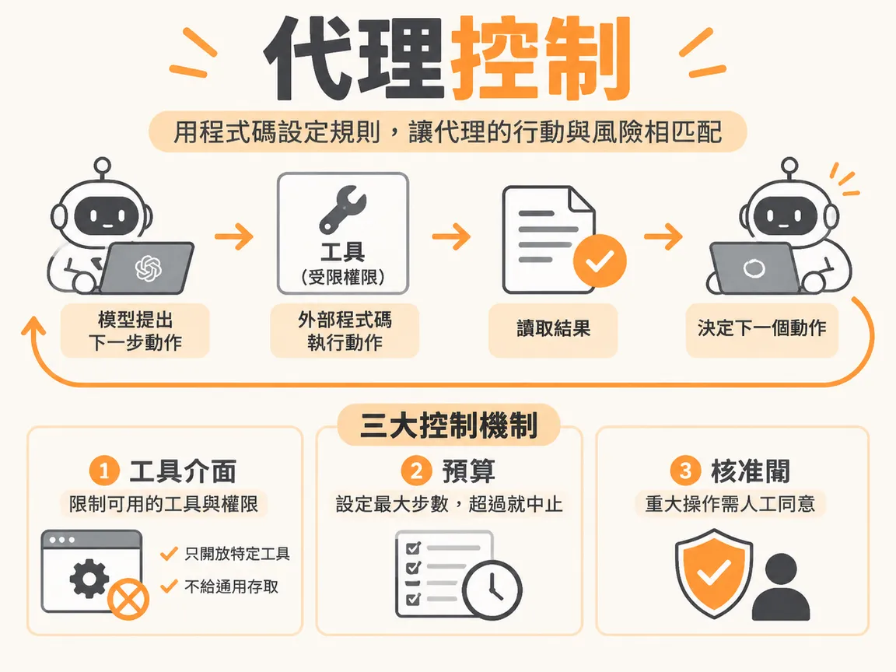

# 代理控制

## 主張

代理系統的控制機制必須直接寫進外部程式碼中，絕不能只寫在給模型的提示詞裡；同時，控制力道必須與操作可能帶來的風險後果完全匹配。

## 為什麼成立

代理系統（Agent）具備採取行動的能力。它的運作方式是一個迴圈：模型先提議下一步要執行的動作，接著由外部程式碼——也就是「工具」——去實際執行，模型讀取執行結果後，再決定下一個動作。

這就像一位能力很強但剛報到的實習生，手上拿著公司的系統密碼。如果模型說錯話，頂多只是一段文字錯誤；但如果模型按錯退款，卻是公司的真實資金流出。

因為被惡意引導或出錯的模型隨時可能忽略提示詞中的指示，所以不能依賴文字規勸。外部程式碼必須實施三種具體控制：

1. **工具介面**：限制模型能呼叫的工具種類與權限，只提供特定任務專用的工具（例如只能折抵單筆訂單），不給通用的資料庫存取權限。
2. **預算**：設定硬性上限，例如限制一個任務最多只能執行幾個步驟。模型無法保證自己一定會停下來，當步數耗盡時，外部程式碼必須強制中斷迴圈，並將工作轉交給真人。
3. **核准閘**：遇到重大操作時，系統必須暫停並強制取得人類簽署同意。

## 適用範圍

此原則適用於所有能夠呼叫外部工具、改變系統狀態的代理型 AI 架構。落實時需根據風險等級來決定放行程度：

- **低風險操作**：例如讀取顧客自己的訂單記錄，風險極低，應直接放行，不需人工介入。
- **中小額操作**：例如小額補償，由程式碼自動檢查邊界條件（確認訂單歸屬與金額上限），只要合規就自動執行。
- **高風險或不可逆操作**：例如大額退款，必須觸發核准閘，停下來等待人工專員確認。

## 反例

如果沒有讓控制與風險匹配，系統會走向兩個極端：

- **過多自由**：給予模型無限制的通用存取權限，而且沒有設定終止預算。一旦模型受到誘騙或判斷錯誤，沒有程式碼能攔住它，破壞範圍就會擴散到所有串接的後端系統。
- **過少自由**：防衛過度，就連讀取資料等低風險動作都要求人類核准。這會讓系統運作極度緩慢；負責審核的人員也會因為工作量過大而感到疲乏，最後未看先審、盲目按下核准，導致把關機制完全失效。

## 進階

在真實產品中，代理型操作往往處於混合架構的最後一環。以客服工單為例：

1. **預測型家族**先將工單分類為「外送遲到」。
2. 跨過接縫後，**生成型家族**根據規則起草回覆內容與承諾的補償金額。
3. 最後交給**代理型家族**執行退款工具。

在回覆送出給顧客之前，後端程式碼必須先執行邊界檢查，確認金額在規定上限之內。因為代理型是最新、風險最高的架構，在混合系統中必須特別清楚定義接縫處的邊界與核准閘，確保自動化操作不脫軌。
