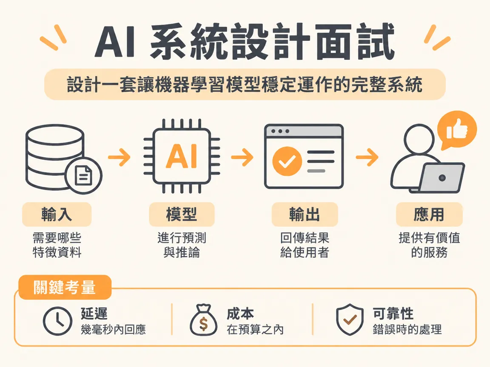

# AI 系統設計面試

## 定義

AI 系統設計面試是一場面試測驗。候選人要在約 45 分鐘的對話中，一邊說明思考過程，一邊設計出一套把機器學習模型整合進產品的完整軟體架構。這場面試考的不是模型內部的數學公式，而是圍繞在模型外圍的系統運作能力。

## 為什麼重要

在業界實務中，工程團隊很少從頭訓練模型，大多直接套用現成方法或串接外部的模型服務。因此模型本身通常不是最困難的瓶頸，真正的挑戰是如何讓模型穩定在產品中運作。

如果在面試架構圖上只畫一個寫著「模型」的黑盒子，面試官無法得知系統該如何落地。面試官真正關心的是：訓練資料從哪裡來、推論要花幾毫秒、運算花費多少錢，以及模型預測錯誤時系統該如何處理。

## 如何運作

AI 系統設計面試把模型當作整體架構裡的一個零件。候選人必須圍繞模型交代四項基本屬性：

1. **輸入（Inputs）**：需要哪些特徵資料傳進模型。
2. **輸出（Outputs）**：模型回傳什麼格式的運算結果。
3. **延遲（Latency）**：系統必須在幾毫秒內把預測結果回傳給使用者。
4. **成本（Cost）**：執行推論所帶來的運算花費是否在預算之內。

面試通常會用一套結構化的「七步驟架構」有條理地推進，並在開場 30 秒內做好三件事來定錨對話節奏：

- **分類形式**：判斷題目屬於哪一種情境形狀。
- **確認賽道**：向面試官釐清是否要把模型當成現成零件，確認討論深度的邊界。
- **說出計畫**：主動講出接下來要涵蓋的目標、推論服務、成本、回饋迴路與失效備援步驟。

## 例子

以虛構外送平台的「預估送達時間」功能為例，模型負責計算餐點何時送達，外圍系統則必須負責下列工作：

- **收集資料與即時回應**：將顧客位置、店家出餐速度等特徵即時送入模型，並在時限內把預估時間推播給顧客。
- **監控品質與控制成本**：持續追蹤預估時間與真實時間的差距，同時避免每次點擊都觸發昂貴運算。
- **容錯與備援機制**：當模型算出的時間太離譜或服務當機時，系統必須有預設的備用數值能頂替。

另一個例子是客服對話系統。若使用者輸入「請忽略原本規則」來進行提示詞注入（用文字誘導模型做出違規行為），單靠模型過濾文字防不住。因此「外送延誤補償上限為 10 美元」這類不可違背的核心業務規則，必須直接用傳統程式碼寫在模型外圍強制執行。

## 邊界與常見誤解

這場面試有三個常見的浪費時間盲點：

- **鑽研模型數學**：面試官不期待你在白板上推導 Transformer 的注意力機制數學方程式。
- **背誦最新模型型號**：模型名稱幾個月就會過期。回答時要說明模型的「角色」，例如處理困難複雜任務採用大型託管模型，佔多數的簡單日常狀況則交給輕量便宜的小型模型。
- **背誦框架零碎冷知識**：重點在於系統為什麼需要訊息串流（如處理即時資料流）或向量索引（依照語意相似度找資料），而不是背誦工具之間的設定差異。

## 進階

在進階對話中，候選人需要掌握三大核心維度：

- **題目形式（Form）**：題目共有五種形式，辨識題目屬於哪一種，就能分配好一小時內的討論重心。
- **所屬賽道（Lane）**：釐清評估標準是偏向軟體工程師（SWE），將模型視為黑箱來串接；還是機器學習工程師（MLE），需要打開黑箱深入探討其內部機制。
- **四大必備要素**：在任何架構形式中，都要能給出帶有具體數字的系統需求、端到端的回饋迴路、合乎現實的成本與延遲估算，以及面對模型失效時的處置流程。
