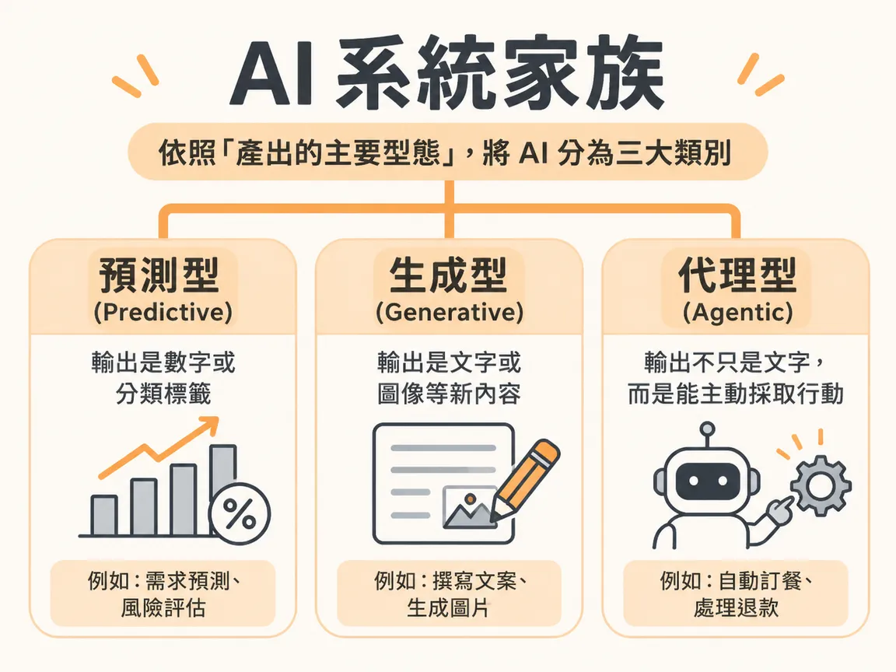

# AI System Families

## 定義

AI 系統家族是依照系統「產出的主要型態」，將 AI 分成的三大類別：
- **預測型（Predictive）**：輸出是數字或分類標籤。
- **生成型（Generative）**：輸出是文字或圖像等新內容。
- **代理型（Agentic）**：輸出不只是文字，而是能主動採取具體行動。

## 為什麼重要

當面對「替公司導入 AI」這種模糊需求時，很多人會直接跳進某個特定模型，這會顯得思考格局太狹隘。

先列出這三個家族就像「端出選項菜單」，能讓團隊快速看清所有可能性，展現廣度；接著從中挑出一個方向並替它辯護，則展現出決斷力。清楚定義家族，才能為後續的技術架構與設計重心打好骨架。

## 如何運作

劃分家族的依據，是看模型對外交付的成果是什麼：

1. **判斷與給分**：如果系統的核心任務是分析現有資料並給出一個數值或類別，它就屬於預測型。
2. **創作與撰寫**：如果系統的核心任務是產生人看得懂的新文案或回覆，它就屬於生成型。
3. **執行與操作**：如果系統被賦予操作權限，可以直接呼叫外部功能或修改資料庫狀態，它就跨入了代理型。

在架構設計時，通常要用大約 30 秒快速攤開這三大家族的選項，再從中選出最合適的方向深入設計。

## 例子

在外送平台的業務場景中，三大家族有非常明確的對應功能：

- **預測型**：外送送達時間（ETA）預估、首頁餐廳排序推薦、促銷優惠券濫用風險評分。
- **生成型**：回答顧客問題的客服助理、自動整理顧客評價的評論摘要、幫餐廳撰寫文案的餐點描述生成。
- **代理型**：能直接幫顧客將餐點加入購物車並按下結帳的點餐助理。

## 邊界與常見誤解

常見的誤解是以為一個系統只能「非黑即白」地屬於某一個家族。

事實上，現代系統經常跨家族混合。例如一個客服助理本質上是生成文字的「生成型」，但如果它被賦予了自動替顧客「發放小額退款」的權限，退款是一項牽涉金錢的實際行動，這時它就具備了「微型代理」的特質，稍微偏向了代理型系統。

另一個誤解是把菜單上的每個家族功能都聊一遍。攤開家族選項的目的是快速確立方向，在菜單上停留太久反而會被視為缺乏決斷力。

## 進階

當生成型系統融合了代理能力時，系統的架構重心必須立刻跟著調整：

- **情境組裝（Prompt 建構）**：系統必須透過檢索增強生成（RAG）從資料庫撈出訂單紀錄與最新規定，整合成提示詞送給模型。
- **模型路由（Model Routing）**：為了節省營運成本，簡單諮詢交給便宜的小模型，複雜行動才交給大型模型。
- **行動護欄（Guardrails）**：代理型功能涉及實體操作（如退款），所有金額上限與權限規則必須直接寫死在程式碼邏輯中，絕不能單靠給模型的文字指示來把關。
