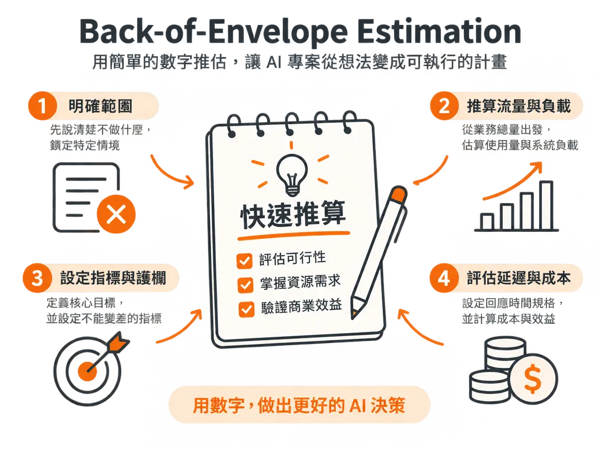

# Back-of-Envelope Estimation

## 問題

在設計 AI 系統時，最常見的失誤是設定一個模糊的目標，例如「打造一個什麼問題都能解決的助手」。因為需求太過模糊，工程團隊無法評估系統需要承受多大的負載、會花費多少運算成本，也無法確認這套系統到底能替公司帶來多少效益。

## 前置條件

在開始推算數字前，必須先完成「刪除範圍」。也就是先大聲說出這一版明確「不做什麼」（例如先不做語音對話、不支援其他語言、不處理超過一定金額的退款），只鎖定特定情境（例如低風險的第一線例行文字工單）。

## 步驟

1. **推算流量與系統負載**：從核心業務總量出發，推估可能引發的使用比例。算出每天的對話次數，再乘以每次對話平均需要的模型呼叫次數，最後換算成每秒的請求次數。
2. **設定品質指標與護欄指標**：決定系統的核心目標（例如未轉接真人的解析率），同時設定一個不能變差的護欄指標（例如顧客滿意度），避免系統因盲點而誤判成果。
3. **訂定延遲規格**：設定使用者等待回應的時間上限，包含首字時間（模型吐出第一個文字片段的時間）與完整回答時間，並評估是否採用串流技術同步顯示文字。
4. **建立商業成本論證**：比較真人處理的基準成本與模型的單次花費，計算系統每日消耗的預算，以及成功分流後能替公司省下的總人力費用。

## 例子

以電商客服為例，推算過程如下：

* **負載推估**：假設每天有 500,000 筆訂單，其中 8% 會聯繫客服，相當於每天 40,000 次對話（平均每 2 秒 1 次）。若其中 60% 是第一線工單（24,000 次），且每次對話平均呼叫 10 次模型，系統每秒大約承受 5 次模型呼叫。
* **指標設定**：目標設定為成功解決 50% 的第一線工單，相當於每天自動結案 12,000 筆，並以顧客滿意度作為護欄指標。
* **延遲目標**：首字時間設定在 1 秒左右，簡短回答的完成時間約 5 秒，前端配合串流傳輸以減少等待感。
* **成本效益**：真人處理一張工單約需 4 美元，而模型處理一次對話約花費 13 美分。接待 40,000 次對話的模型成本約為 5,000 美元；但解決 12,000 筆工單可省下 48,000 美元真人成本，模型帳單約只有省下人力成本的十分之一。

## 失敗模式

* **單看單一品質指標**：若只看未轉接真人的解析率，當顧客因為體驗太差而憤怒放棄對話時，系統記錄上看起來也會像「成功解決」，造成嚴重誤判。
* **忽略失敗時的累加成本**：如果一次對話以失敗收場、最後仍轉交真人，成本會變成模型的 13 美分再加上真人的 4 美元。長期評估時，必須改用「每個被正確解決的問題所花費的總客服成本」來檢驗。

## 進階

推算時的所有假設都要主動大聲說出來。就算假設的 8% 客服率實際上是 4% 或 12%，整體負載依然落在每天數萬次對話的區間，不會推翻整體的架構選擇。

更高等級的工程思考還會進一步質疑需求與看清上下游關聯：例如在 App 內設計一個清楚的即時訂單狀態畫面，可能根本不需動用 AI 模型就能消除大量諮詢；或者意識到回答訂單位置的品質，核心其實取決於預計送達時間（ETA）預測系統是否準確，兩者必須互相搭配。
