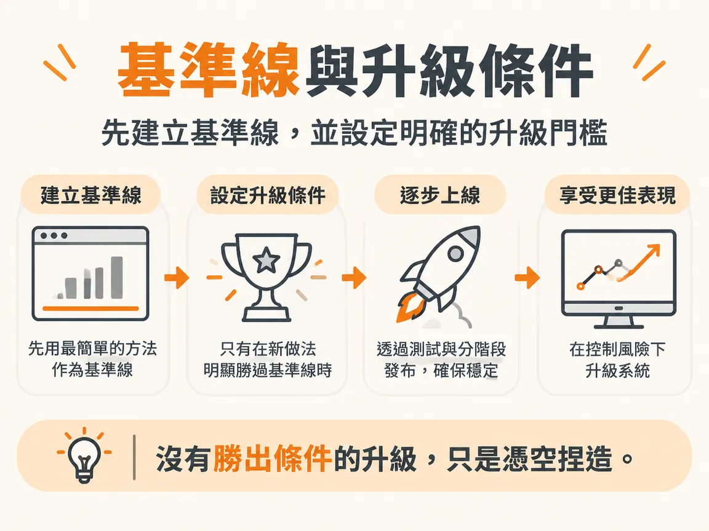

# 基準線與升級條件

## 主張

設計 AI 系統時，永遠要先給出能運作的最簡單做法，也就是基準線（baseline）。

後續如果要換成更複雜的模型，不能憑感覺，必須先訂出明確的觸發條件，證明新模型真的贏過這條基準線。

## 為什麼成立

工程設計要分清楚「個人偏好」與「架構決策」的差別。

如果開口就說「我要用這個新模型」，這只是個人喜好。合格的架構決策，是先說出簡單的基準線，並強調「只有在新做法在測試資料上明顯勝過基準線時，我才會採用」。

因為越複雜的模型，越容易帶來額外的維護負擔、延遲與運算花費。如果最簡單的平均值或基本設定就能達標，系統就沒有理由承擔升級的風險與成本。

## 適用範圍

不同類型的 AI 任務，基準線與升級條件都有固定的對照方式：

- **預估型系統**：例如預估外送抵達時間，基準線是該餐廳在該時段的「歷史平均值」。升級條件是決策樹模型在未參與訓練的保留訂單（held-out orders）上，預測表現明顯勝過歷史平均。
- **生成式系統**：例如企業客服助理，基準線是雲端第三方提供的託管大型語言模型（hosted LLM），搭配寫得清楚的提示詞（prompting）。升級條件是模型在語氣或輸出格式未達標時才做微調（fine-tuning）；若缺乏公司內部事實，則改用檢索（retrieval）技術補足資料。
- **代理型系統**：例如負責小額退款的退款代理（refund agent），基準線是使用單一模型並掛載兩到三個工具函式。升級時必須具備嚴格邊界，設定好執行步數上限、運行時間與花費額度。

## 反例

最常見的錯誤，是一開始就直接提出昂貴或複雜的模型，卻沒有對照組。

例如在設計客服助理時，一遇到回答缺乏事實，就直接決定花力氣微調模型。這不僅用錯工具，也跳過了提示詞與檢索這兩道更簡單的基準線。另一個反例是預測外送時間時直接指定決策樹，卻無法說明它比歷史平均進步了多少。

沒有附帶勝出條件的升級，只是憑空捏造，並不是嚴謹的系統架構。

## 進階

當新模型達到升級條件時，也不能直接全量上線，而必須經過三階段發布：

1. **離線測試**：用歷史資料驗證新模型。如果新版本沒有勝過目前的線上版本，流程立刻停止，完全不上線。
2. **即時流量測試**：先採用影子部署（shadow deployment），讓新模型在背景接收真實流量運算，藉此檢查程式會不會崩潰或回應太慢，但依然回傳舊版答案給使用者。確認穩定後，再透過 A/B 測試比較兩者成效。
3. **漸進式發布**：先對少數使用者開放新模型，逐步擴大比例，並設定明確的數值指標，一旦出現異常就自動回滾（rollback）退回舊版，同時持續監控現實環境變化導致準確度下滑的資料漂移（drift）。

嚴格把守升級條件也能直接守住成本。如果沒有設下門檻與分流路由器，讓所有請求都無條件升級打向昂貴的大型語言模型，系統每天的帳單費用可能會直接暴增數倍。
