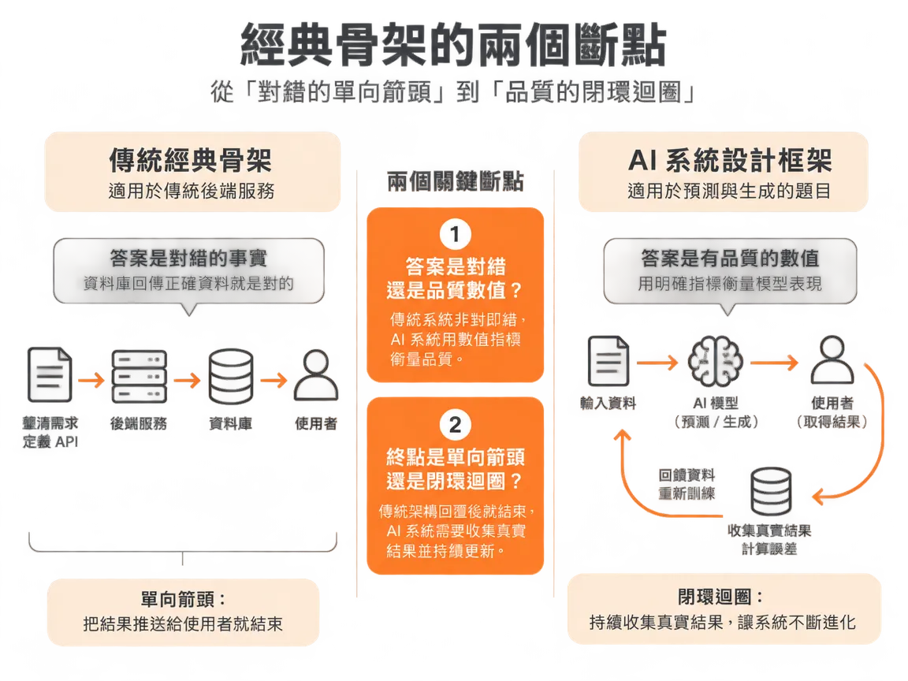

# 經典骨架的兩個斷點

## A 是什麼

傳統經典骨架是軟體工程師在面試系統設計題時最熟悉的思考套路。

面對傳統系統題目時，大家通常會先釐清需求、定義 API（應用程式介面，也就是系統對外溝通的管道），接著畫出後端服務與資料庫，花大半時間討論如何應付龐大流量。當系統成功把查詢結果推送到使用者螢幕時，整套回答就結束了。在這種架構下，答案正確與否是單純的客觀事實：資料庫回傳了正確的資料行就是對的，沒回傳就是有 bug（程式錯誤）。

## B 是什麼

AI 系統設計框架是為了解決機器學習題型所發展出的七步思考套路。

模型是從過往歷史範例學習規律的程式，它不可能百分之百完美。因此這套框架不再把答案當成單純的對或錯，而是在開頭就將系統品質定義成具體的數值指標。此外，它也不會在系統回傳答案後就停筆，而是延伸出後續的資料收集與維運機制，讓系統能隨著真實世界的變化持續更新。

## 關鍵差異

傳統骨架在面對 AI 題目（例如預估外送餐點何時送達）時會碰壁，主要原因就在於兩個關鍵斷點：

1. **第一個斷點：答案是對錯事實，還是品質數值？**  
   在傳統系統中，資料庫查出的資料非對即錯。但在 AI 系統中，模型只有一部分時候是正確的，品質是一個「數值」（例如平均誤差要在幾分鐘以內）。後續所有架構選擇都圍繞著這個數字展開，因此一開始就必須先達成共識。
2. **第二個斷點：終點是單向箭頭，還是閉環迴圈？**  
   傳統架構把資料推送到顧客螢幕就收工。但在 AI 題目中，真正的結果發生在系統回覆之後（例如餐點實際送達的真實時間）。架構圖不能只有一條指向使用者的單向箭頭，必須形成一個「閉環迴圈」，把真實結果記錄下來、計算誤差，並送回系統重新訓練模型。如果缺少這個迴圈，當現實世界的交通型態改變時，模型的表現就會悄悄退化且無人知曉。

## 何時用哪個

* **使用傳統經典骨架**：當題目屬於傳統後端服務、答案具有絕對的對錯標準（例如電商結帳儲存訂單、資料庫查詢），且系統行為不會因為外在世界隨時間演變而自動衰退時使用。
* **使用 AI 系統設計框架**：當題目包含預測與生成功能（例如外送時間估算、推薦動態），且面試官追問「你怎麼知道估算夠準」或「下個月環境改變時系統會發生什麼事」時，就必須使用這套補齊兩個斷點的框架。

## 進階

AI 設計框架的七個步驟中，第二步（定義成功）補上了第一個斷點，及早訂出衡量品質的數值目標；第六步（維持系統運作）則補上了第二個斷點，建立閉環機制記錄輸入、輸出與真實結果。

在第六步的閉環中，為了讓模型安全更新，必須落實「三階段上線」：
1. **離線測試**：用歷史資料驗證新模型是否勝過舊版，沒勝過就直接淘汰。
2. **即時流量測試**：使用影子部署（讓新模型在背景接收真實流量運算，但不把結果回傳給使用者）檢查延遲與崩潰，確認穩定後再以 A/B 測試比較成效。
3. **漸進式發布**：先開放少數流量，並設定自動回滾指標以防異常，同時持續監控資料漂移（外在環境改變導致準確度下降的現象）。

此外，閉環有時會引發「放大偏見的反饋迴圈」，例如推薦系統展示釣魚標題，使用者點擊後系統誤以為使用者喜歡，進而推薦更多釣魚標題。這時就必須在模型外設立獨立的防護規則予以過濾或調降權重。
