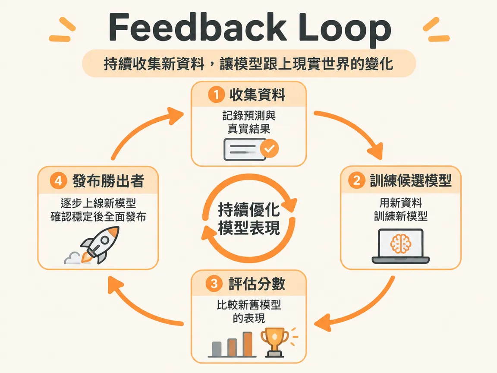

# Feedback Loop

## 問題

傳統軟體的程式碼在下一次部署前，行為固定不變。但機器學習模型是從過去的資料學習規則，模型結構固定後，外面的世界卻持續在變。

這種模型預測品質隨著時間逐漸下滑的現象，稱為「漂移」（drift）。漂移發生時完全不會跳出錯誤訊息，伺服器照常回傳成功代碼，輸出內容卻越來越不可靠。如果不主動建立更新機制，系統就無法從漂移中復原。

## 前置條件

啟動回饋迴圈前，必須先完成一項關鍵檢查：

- **檢查資料管線**：沿著資料管線往回查，確認管線運作正常。資料管線故障所產生的異常特徵，外表看起來和漂移一模一樣。如果管線損壞卻盲目重新訓練，只會白白浪費運算資源。

確認資料管線沒有故障後，才能開始執行回饋迴圈。

## 步驟

回饋迴圈包含四個標準步驟：

1. **收集資料**：把系統做出的每一筆預測與輸入特徵記錄下來。等現實世界產生真實結果後，兩者整合成帶有答案的訓練標籤。
2. **訓練候選模型**：啟動訓練工作，使用收集來的新資料訓練出一個新模型，這個新模型稱為「候選模型」（candidate）。
3. **評估分數**：拿一組線上模型與候選模型都沒看過的近期資料，同時為兩者打分數並進行比較。
4. **發布勝出者**：將評估後表現較好的模型推上線。上線初期只切換一小部分流量進行測試，確認運作穩定後再全面接手。

## 例子

外送平台的外送時間預估模型，最初使用去年冬天的歷史訂單資料訓練完成。

上線幾個月後，平台進軍新城市、餐廳旁新開了體育場帶來人潮，加上夏季高溫拖慢外送員車速，舊模型產生的預估誤差越來越大。

團隊透過回饋迴圈記錄夏天的實際配送時間，重新訓練出候選模型。在近期測試資料的比對中，候選模型的準確度超越舊模型，團隊便先撥出少量流量給候選模型，驗證穩定後順利完成更新。

## 失敗模式

- **未查管線就直接重訓**：發現預測品質下滑時，沒有先檢查資料管線，直接耗費運算資源重新訓練，最後依然學到錯誤的特徵。
- **以為上線分數永久有效**：誤以為模型剛上線的高分可以一直維持，沒有設計自動記錄與收集資料的機制，導致漂移發生時沒有新資料可用於復原。
- **直接全量發布新模型**：訓練出新模型後一次換掉舊模型，若新模型在未預期的場景表現不佳，會直接衝擊所有線上使用者。

## 進階

在整個回饋迴圈中，收集特徵與預測紀錄的成本極低，因為讀取與寫入資料庫的費用遠低於千分之一美分。真正昂貴的環節在於訓練新模型與呼叫模型推論的運算帳單。

回饋迴圈通常會搭配生產環境的「品質衡量子系統」一起運作。當品質監控發現分數下滑時，系統就能提早自動觸發這個四步驟迴圈，在使用者察覺異常前完成模型替換。
