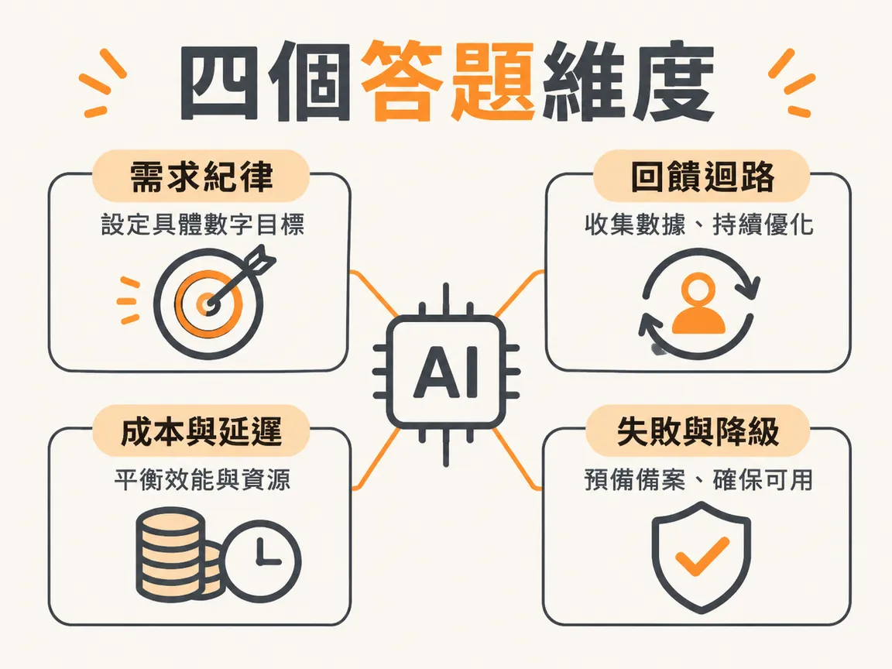

# 四個答題維度

## 主張

設計任何 AI 系統時，不能只停留在「用大語言模型讓系統變聰明」這種抽象描述。無論面對何種題目情境或工程角色，回答架構時都必須完整交代四個關鍵維度：訂出具體數字的需求紀律、串起端到端的回饋迴路、掌握成本與延遲的現實落差，以及坦誠面對失敗並規劃降級機制。

## 為什麼成立

這四個維度成立的原因，在於 AI 系統與傳統系統有根本上的不同：

- **傳統成功不等於 AI 成功**：傳統系統回傳 HTTP 狀態碼 200 就代表成功；AI 模型即使正常回傳 200，回答內容依然可能是憑空捏造的錯誤，語氣卻聽起來非常肯定。
- **指標決定架構**：如果沒有明確數字（例如首字延遲控制在約 1 秒內、對話成本低於 13 美分），就無法決定是否該用串流輸出或建立快取。
- **需要持續修正**：模型無法單靠一次請求定好壞，必須靠回饋迴路捕捉品質訊號（例如餐點實際送達時間、顧客後續是否轉接真人客服），將數據帶回未來的訓練與評估。
- **資源落差巨大**：呼叫一次雲端大語言模型（耗時約 2 秒、成本約 1 美分），比起從資料庫讀取資料（耗時約 2 毫秒、成本約一百萬分之一美元），慢了約 1,000 倍且貴了約 10,000 倍。若無分流與快取現實感，系統在真實環境會無法運作。
- **主動防禦失敗**：在被追問前主動指出模型可能出錯並提供降級機制，最能證明設計者擁有實戰經驗。

## 適用範圍

適用於所有 AI 系統設計面試與架構規劃。無論題目屬於既有系統切入 AI、打造全新 AI 產品，還是走軟體工程師（將模型視為黑箱串接）或機器學習工程師（深入模型內部）的評估路徑，這四個維度都是共通的驗收骨架。

## 反例

如果忽略這四個維度，系統設計會出現以下盲點：

- **需求模糊**：只宣稱「做一個自動客服」，卻沒說明需要自動解決多少比例的例行問題，導致後續無法驗收。
- **流程斷頭**：把模型生成文字回傳給使用者後流程就結束，沒有記錄後續真實結果來反哺模型。
- **無視成本延遲**：將所有請求無差別送往大型模型，沒有為高頻問題（如退款政策）建立快取，也沒有將流量路由分流給小模型。
- **粉飾太平**：假設模型永遠不會出錯。當外送時間模型算不出來或嚴重逾時時，系統只能乾等卡死，而不會自動降級顯示餐廳歷史平均外送時間。

## 進階

在面試開場前 30 秒的「說出計畫」階段，就能主動將這四個維度列為討論大綱：先挑出功能並設定量化目標，接著討論推論服務與成本考量，串起端到端回饋迴路，最後說明模型失效時的安全降級機制。

當討論模型選型時，應以「角色分工」代替追求最新型號名牌：說明最困難的問題由託管的大型模型處理，而佔約 80% 的日常簡單請求則路由到較小、更便宜的模型，並透過真實流量測試驗證這項分流比例。
