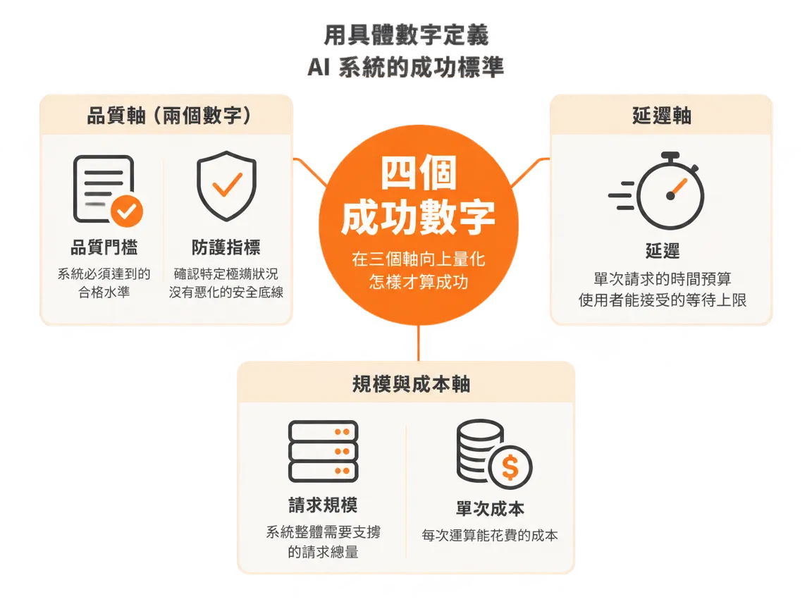

# 四個成功數字

## 定義

四個成功數字是在規劃 AI 系統時，用來在三個軸向上量化「怎樣才算成功」的關鍵指標。

這四個數字分別是品質門檻、防護指標、延遲，以及規模與成本。

## 為什麼重要

如果只用口頭描述目標，大家的想像往往不同。討論越往後走，修正方向的代價就越高。

一開始就把標準換成具體數字，能讓團隊對目標達成共識。後續挑選模型和規劃架構時，才能緊扣標準，不會漫無目的發散。

## 如何運作

四個數字分布在三個不同的軸向上：

1. **品質軸（包含兩個數字）**
   - **品質門檻**：系統必須達到的合格水準，用來確認基本表現過關。
   - **防護指標**：確認特定極端狀況沒有惡化的安全底線。
2. **延遲軸**：單次請求的時間預算，也就是使用者能接受等待的時間上限。
3. **規模與成本軸**：系統整體需要支撐的請求總量，以及單次運算能花費的成本。

## 例子

以外送平台的「送達時間預估系統」為例，在結帳畫面顯示時間的情境下，四個數字可以這樣設定：

1. **品質門檻**：平均送達時間誤差要壓在 5 分鐘以內。
2. **防護指標**：嚴重延遲的訂單比例絕對不能上升。
3. **延遲**：客人停留在結帳畫面等待，系統必須在約 100 毫秒內算出結果並顯示出來。
4. **規模與成本**：整套系統每天大約要支撐處理 500,000 筆訂單。

## 邊界與常見誤解

常見的誤解是以為品質只要看一個「平均準確率」就好。如果只盯著品質門檻，模型平均表現看似合格，但可能嚴重延誤的訂單比例卻大幅增加。這就是為什麼品質軸必須搭配「防護指標」來把關邊界條件。

另一個誤解是以為只要模型算得準就代表成功。如果模型非常準，但運算時間超過延遲預算，或者系統無法負荷整體的訂單規模，系統在真實環境中依然無法上線。

## 進階

在完整的 AI 系統設計開場中，四個成功數字不是獨立存在的。通常會先辨識系統所屬的家族（例如預測型、生成型或代理型），並明確切出範圍（哪些要做、哪些不做），接著才端出這四個數字。範圍界定清楚之後，這四個數字才能發揮準確的定錨效果。
