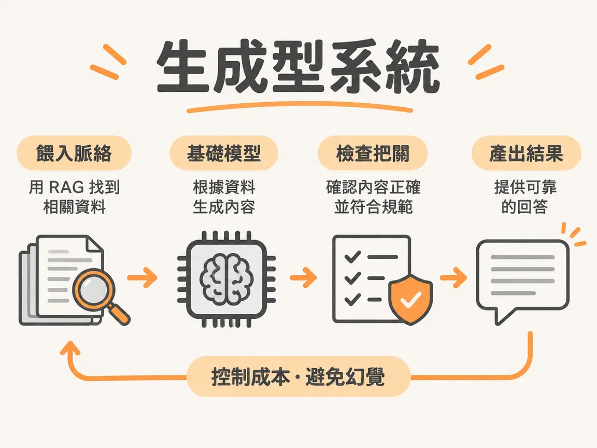

# 生成型系統

## 定義

生成型系統是以基礎模型為核心，負責產出文字或內容的軟體系統。

基礎模型是經過大量資料預先訓練好的大型 AI 模型。因為模型本身不認識企業內部的最新資料，所以需要一套外圍軟體系統配合，負責補足資料並檢查回答。

## 為什麼重要

基礎模型雖然懂很多知識，卻不知道剛剛發生的最新狀況，例如今天剛成立的訂單細節。

如果不加控制直接使用，模型可能會給出聽起來自信滿滿、事實上卻完全錯誤的答案，這種現象稱為「幻覺」。此外，模型的計費方式很敏感，如果任由模型隨意閱讀長篇大論或滔滔不絕，使用費用會非常昂貴。因此，圍繞在模型外圍的軟體系統至關重要。

## 如何運作

外圍的軟體系統主要負責三項核心工作：

1. **餵入脈絡**：使用「檢索增強生成」（RAG）技術。系統會先從內部文件中找出相關段落，再把這些資料餵給基礎模型，讓模型根據事實來生成回答。
2. **控制成本**：模型通常是按照 token 計費。一個 token 大約等於四分之三個英文字詞。送出的參考資料越長、模型輸出的回覆越長，花費就越高，因此系統必須精準控制文字量。
3. **抓出錯誤**：系統必須在模型產出內容後進行檢查，確認回答符合公司規定，並核對檢索到的參考資料是否真的能支持回答裡的說法，及時攔截幻覺。

## 例子

- **客服工單回覆**：客戶的餐點外送遲到並提出申訴。生成型系統會根據外送遲到條款與訂單記錄起草一封回覆草稿，並在送出前檢查內容是否符合公司的補償政策。
- **影音推薦說明**：在串流影音平台上，系統排好影片清單後，在作品旁邊附上一句說明推薦理由的短文，這句短文就是由生成型系統產生的。

## 邊界與常見誤解

- **常見誤解：必須自己從頭訓練模型**。從零開始訓練基礎模型需要耗費好幾個月，還要投入龐大資料與專用晶片。正確做法是直接挑選現有的基礎模型，搭配清楚的指令與檢索機制。
- **常見誤解：串流技術能降低成本**。串流技術能讓文字像打字一樣逐字浮現，改善使用者的等待體驗，但發送與產生的 token 總數沒有變，因此無法降低費用。
- **任務邊界**：生成型系統的任務是「輸出內容」。如果任務是判定工單類別或輸出分數，屬於預測型系統；如果要實際執行退款操作，則屬於代理型系統。

## 進階

生成型系統沒有通用的現成指標可以直接評估好壞。因為同一個問題可以有多種不同寫法的好答案；相反地，一段語氣親切的文字，背後可能偷偷答應了違規的退款。

評估機制必須自行設計，常見做法包括：

- **黃金資料集**：準備一份固定的測試題目清單，每道題目旁明確列出好答案必須具備的行為特徵。
- **LLM 評審**：指派另一個模型來替回答打分數，並由人工抽樣審查打分結果，同時檢驗回答品質與評審模型的可靠度。
