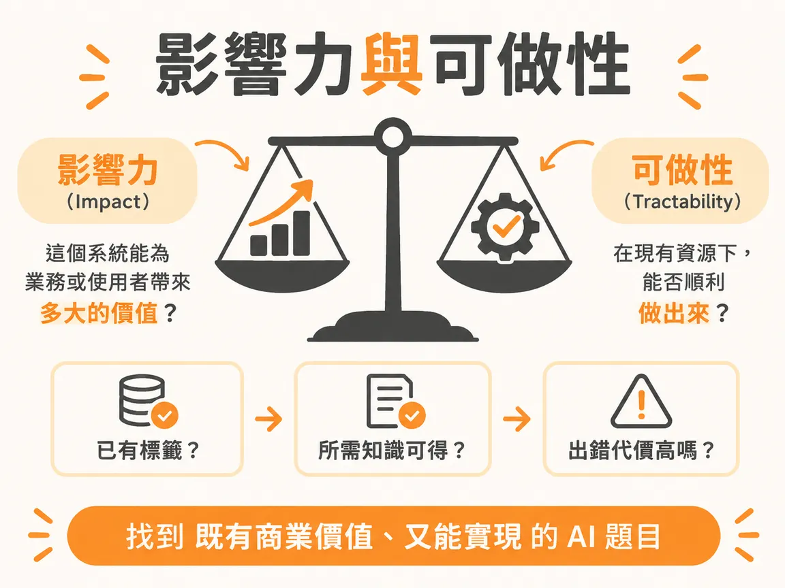

# Impact and Tractability

## 定義

「影響力與可做性」（Impact and Tractability）是挑選 AI 題目時使用的兩個核心評估維度。

* **影響力（Impact）**：指這個系統做出來之後，對公司業務或使用者到底有多重要、能帶來多少具體價值。
* **可做性（Tractability）**：指在現有的資料、時間與條件限制下，實際上把這個系統做成功的可行度。

## 為什麼重要

面對範圍很大的 AI 題目時，如果直接跳進某個特定模型，會顯得視野太狹窄；但如果對著一大堆選項看很久，又會顯得優柔寡斷。

使用影響力與可做性作為標準，可以幫助你在列出候選方向後，迅速篩選出最有商業價值且現實中做得出來的題目，展現主導決策與深思熟慮的能力。

## 如何運作

在評估題目時，影響力通常可以直接看它對業務的核心程度或能否折算成具體金額。至於可做性，則可以用三個關鍵問題來檢驗：

1. **標籤是否已經存在？**
   標籤就是帶有正確答案的歷史範例，模型必須靠這些資料來學習與測試。如果系統能自動累積標籤，可做性就很高。
2. **所需的知識是否隨手可得？**
   系統運作時需要的背景資訊與商業規則，公司內部是否已經掌握並能直接取得。
3. **出錯的代價有多高？**
   系統一旦判斷錯誤，會造成多嚴重的損失。如果出錯代價很低，推出第一版系統的風險就小得多；如果出錯代價極高，上線的難度就會大幅提升。

## 例子

以外送平台為例，可以用這兩個尺度與三個問題檢驗不同方向：

* **預估送達時間（ETA 預測）**：影響力大，因為關係到每一筆訂單。可做性極高，因為每次外送完成都會記錄實際時間，若每天有 50 萬筆訂單，就會自然產生 50 萬筆新標籤。
* **客服助理**：影響力高，因為工單處理成本能直接折算成金額。可做性也很高，需要的知識（如訂單系統與內部政策文件）都在公司內部，且第一版可以只回答問題而不執行操作，降低出錯風險。
* **點餐代理人（Agentic）**：自主運作且替用戶做決定。一旦點錯餐或重複下單，責任與信任問題目前還沒有成熟解法，出錯代價高，因此是現階段可做性最弱的起手選項。

## 邊界與常見誤解

* **常見誤解：只選影響力最大的題目就好。**
  有些題目雖然想像空間極大（例如完全自動幫用戶點餐結帳的代理人），但因為出錯代價極高且信任機制不成熟，目前的可做性很低，立刻選它很容易在落地時卡關。
* **常見誤解：做決定後就不能改。**
  選定一個最佳選項並辯護後，同時要準備好第二順位（例如首選客服助理，第二順位放 ETA 預測）。主動將轉向的權力留給對方或面試官，既展現決斷力，又保留彈性。

## 進階

在評估生成型系統（如客服助理）時，可做性通常可以透過縮減功能範圍與架構設計來進一步提高：

* **控制功能範疇**：第一版系統只負責「檢索事實並回答問題」，暫時不讓模型「替使用者執行操作」，就能大幅降低出錯風險。
* **核心技術搭配**：可做性高的生成型專案，往往能自然導入「檢索」（retrieval，先找出正確事實）與「護欄」（guardrails，設定系統嚴格邊界）這兩大關鍵技術組件，讓系統在安全可控的範圍內發揮影響力。
