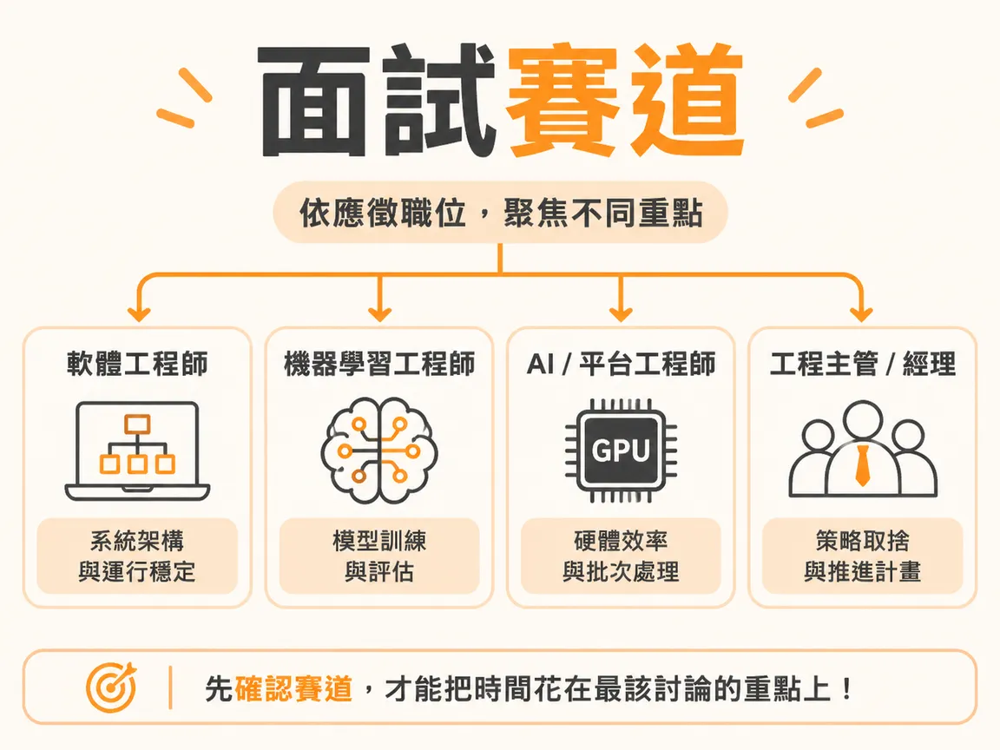

# 面試賽道

## 定義

面試賽道是指在 AI 系統設計面試中，依據應徵職位所決定的守備範圍。

公司為特定職位安排的一整套面試流程稱為面試組合（loop）。不同職位的 loop 會有不同的評量重點，應徵的角色決定了面試時該把模型當成黑箱，還是該打開黑箱深入探討。

## 為什麼重要

面試時間非常有限，通常只有約一小時。

因為評分標準是根據應徵角色量身打造的，所以一旦偏離賽道，即使說出許多艱深的技術細節，面試官也不會為此加分。甚至會因為聊了不相干的細節，排擠掉展示該角色核心能力的寶貴時間。

## 如何運作

依照應徵的角色不同，深入討論的重點完全不同：

- **資深軟體工程師（Senior Software Engineer）**：把模型視為一個「黑箱」。不需要拆解模型內部，面試官想看的是圍繞在模型外圍的架構，例如資料流向、即時推論服務（serving，也就是用模型回應即時請求）、系統容錯與運行成本。
- **機器學習工程師（ML Engineer）**：必須把黑箱打開。需要深入說明模型選擇、特徵工程、訓練流程與評估指標。
- **AI 或平台工程師（AI / Platform Engineer）**：核心放在硬體效率。例如 GPU 使用率（昂貴晶片在付費時間內實際執行運算的比例）與批次處理（batching，把多個請求合併處理以提升效率）。
- **工程主管或經理（Manager）**：著重在自研或採購（build versus buy，自己打造還是買現成服務）的取捨，以及分階段推出（phased rollout，先開放給少數使用者測試）的策略。

如果在面試開頭無法確定守備範圍，可以直接詢問面試官：「我應該專注在模型本身的深度，還是即時推論服務的架構？」來定錨討論範圍。

## 例子

在設計「客服工單分類系統」的題目中，應徵軟體工程師時主動提問確認賽道，面試官往往會回答：「請先假設模型已經存在。」

這句話代表模型訓練不在這場考核範圍內。面試者就可以放心把模型當成黑箱，把整整一小時的火力集中在即時推論架構、容錯機制與硬體成本上。

## 邊界與常見誤解

最常見的失誤就是軟體工程師一頭栽進模型訓練細節。例如在設計文件助理時，花了 15 分鐘滔滔不絕討論微調（fine-tuning，使用自有資料對既有模型做額外訓練），反而排擠了核心推論架構的展示時間。

把模型當黑箱也不代表能完全忽視它。仍然必須清楚交代黑箱的介面與邊界限制，包含輸入與輸出是什麼、回應速度允許有多慢，以及容許出錯的頻率。

另外，不要把時間浪費在推導模型底層數學（如注意力機制）、背誦特定模型型號，或是比較工具框架的零碎冷知識（例如 Kafka 與 Kinesis 的設定差異），面試官在意的是系統為什麼需要這項組件。

## 進階

在面試開場前 30 秒，即可主動透過「分類形式、確認賽道、說出計畫」三步驟掌控全場面試節奏。

在賽道中討論模型選型時，建議以「模型扮演的角色」回答，而非最新型號：說明最棘手的問題會交給外部託管的大型模型，而多數簡單問題則交給低成本的小型模型。

無論在哪個賽道，穩健的 AI 系統設計都要交代四個維度：具體數字需求、端到端回饋迴路、真實成本與延遲估算，以及模型失效時的因應機制。
