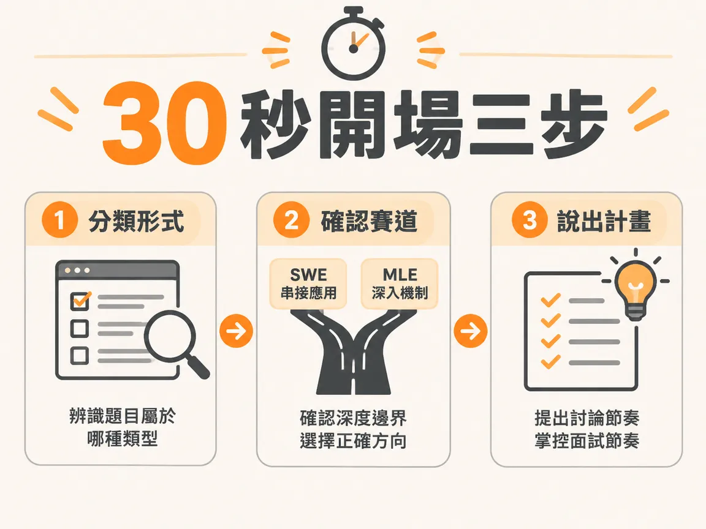

# 30 秒開場三步

## 問題
許多人在 AI 系統設計面試一開始，花費大量時間鋪陳，甚至一頭栽進不加分的技術細節裡。白板上一筆都還沒畫，時間就已經被浪費，面試雙方也缺乏共識，不知道接下來的一小時要如何分配。

## 前置條件
在面試官拋出題目、白板還沒動筆的開場前 30 秒使用。你需要先理解面試有不同的題目形式，以及不同的專業分工賽道（例如偏向軟體工程師的串接，或是偏向機器學習工程師的底層機制）。

## 步驟
- **第一步：分類形式（Classify the form）**：辨識題目屬於哪一種情境形狀。辨識出形式，就能決定這一小時該把時間花在哪裡。
- **第二步：確認賽道（Confirm the lane）**：主動向面試官確認深度邊界。確認是走軟體工程師（SWE）路線把模型當黑箱串接，還是走機器學習工程師（MLE）路線需要打開黑箱深入內部。
- **第三步：說出計畫（State the plan）**：清楚講出接下來的討論節奏，列出預計涵蓋的架構步驟，主動掌控全場節奏。

## 例子
面試官拋出題目：「請在我們的客服工單系統中加入 AI 功能。」
這時可以依照三步在 30 秒內開場：
- **分類形式**：指出工單系統已經存在，題目問的是 AI 該切入哪裡，屬於五種題型中的「形式三」。
- **確認賽道**：主動提問後，面試官明確表示「先假設模型已經存在」，確認不需要跳進模型訓練的細節。
- **說出計畫**：告訴面試官：「我會先挑出第一個 AI 功能並設定量化目標，接著涵蓋推論服務（serving）、成本考量、端到端的回饋迴路，最後討論模型失效時的因應機制。」

## 失敗模式
- **推導模型數學**：多數大型語言模型採用 Transformer 架構，但直接在白板上推導注意力機制的數學方程式無法換來分數。
- **執著模型型號**：死背最新模型的具體型號，但模型名字幾個月就會過期一次。
- **糾結框架冷知識**：背誦 Kafka 和 Kinesis、或 Pinecone 和 pgvector 的零星設定差異，卻沒有說明系統為什麼需要訊息串流或向量索引。

## 進階
想在後續設計中穩住方向，對話必須隨時扣住四個維度：帶有具體數字的系統需求、端到端的回饋迴路、符合現實的成本與延遲估算，以及坦誠面對模型可能的失敗狀況。

過程中若面試官追問模型選擇，用「模型扮演的角色」回答而非報出最新型號：最困難的問題交給外部託管的大型模型，佔絕大多數的日常簡單問題則交給低成本的小型模型處理。
