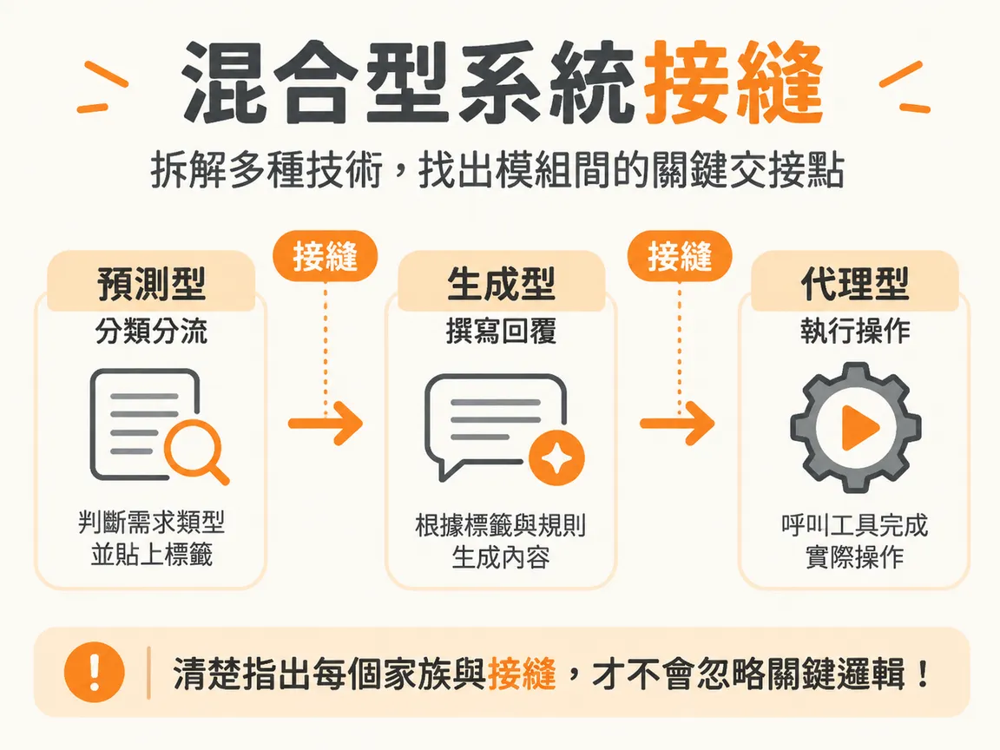

# 混合型系統接縫

## 問題

真實世界的 AI 產品很少只靠單一技術完成，通常會把多個不同技術混在一起。如果在面對這類系統時，把所有功能統稱為同一種型態（例如全都當成代理型），就會忽略前端分流與內容生成的獨立邏輯，也無法在有限的時間內說清楚設計重點。

## 前置條件

在分析系統前，需要先根據模型的輸出型態，辨識它屬於哪一個問題家族：

- 輸出數字或標籤：屬於第一家族（預測型）。
- 輸出文字或內容：屬於第二家族（生成型）。
- 執行具體操作或工具呼叫：屬於第三家族（代理型）。

## 步驟

面對橫跨多個家族的混合型系統時，依序執行以下三個步驟：

1. **點出看到的每一個家族**：把整個流程拆開，清楚指出哪一段是預測型、哪一段是生成型、哪一段是代理型，避免混為一談。
2. **說出系統之間的接縫**：「接縫」就是前一個家族的輸出變成下一個家族輸入的交接點。具體說明模組之間如何傳遞資訊，並說明接縫一旦出錯會造成什麼影響。
3. **主動確認深入討論的範圍**：因為時間有限，無法平均深談每一個模組。點出整體架構與接縫後，主動詢問對方希望深入哪一個家族。

## 例子

以處理「外送餐點遲到 50 分鐘並要求補償」的客服工單為例，整個流程會依序穿過三個家族與兩道接縫：

1. **第一家族（分類分流）**：分類器判定工單類別為「外送遲到」，信心分數為 0.94。如果分數低於門檻，系統就轉交人工處理。這個分類標籤隨後跨過第一道接縫。
2. **第二家族（內容生成）**：語言模型參考遲到條款起草回覆，並通過合規檢查，在回覆中承諾補償額度。此時回覆訊息暫時等待，補償額度跨過第二道接縫。
3. **第三家族（代理執行）**：代理系統以工具呼叫提出補償。後端程式碼檢查訂單確實屬於該客戶且金額在上限內，檢查通過後才正式發放補償並寄出回覆。

## 失敗模式

- **忽略接縫處的錯誤骨牌效應**：如果第一道接縫的分類標籤出錯，後續的內容生成與執行就會整批走進錯誤流程。
- **統稱單一家族而漏掉核心邏輯**：把包含分流、草稿、退款的完整系統直接統稱為代理型，會遺漏前端分流的門檻設定與生成內容的獨立審查。
- **沒有主動確認範圍**：未與對方確認深談重點，試圖在有限時間內講完三個家族，導致每個模組都講得不夠深入。

## 進階

不同家族的成熟度不同，溝通與設計的重點也有差異：

- **第一家族（預測型）**：架構與 A/B 測試已是業界成熟標準，重點在於說明特徵與標籤定義等細節。
- **第二家族（生成型）**：檢索增強生成（RAG）與大型語言模型評審仍在持續演進，重點在於解釋每個決策背後的考量，以及如何設計專屬評估方式。
- **第三家族（代理型）**：技術最年輕，重點在於控制機制。重大或不可逆的操作必須設計嚴格的核准閘，必要時需等待人工確認，避免造成無法挽回的後果。
