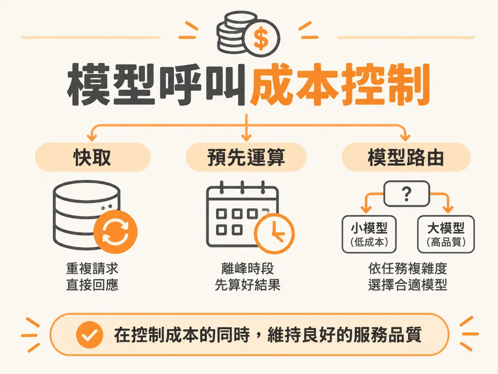

# Model Call Cost Controls

## 定義

模型呼叫成本控制（Model Call Cost Controls）是 AI 系統架構中的一套機制。它用來決定系統在什麼時候值得呼叫模型，以及該把請求交給哪一個模型，避免昂貴的模型運算費用拖垮整個系統。

## 為什麼重要

在傳統軟體中，查詢資料庫的成本極低，讀取一次的花費遠遠低於千分之一美分。

大型語言模型（LLM）完全不同。模型每產生一次回答，大約就要花費一美分，兩者的成本相差了三個數量級（也就是一千倍）以上。當使用者人數增加時，看似微小的單價會迅速放大成天文數字。因此，成本不能留到帳單寄來才想辦法補救，它本身就是系統架構設計的一部分。

## 如何運作

控制成本的核心，在於決定「多久付費一次」以及「付錢給哪一個模型」。架構上主要透過三種做法：

1. **快取（Caching）**：把模型回答過的內容儲存下來。只要收到完全一樣的請求，系統就直接回傳先前存好的答案，不再重複呼叫模型。
2. **預先運算（Precomputing）**：不在使用者打開頁面等待時即時呼叫模型，而是利用離峰時間的背景排程提前算好，並把結果存入資料庫。
3. **模型路由（Routing）**：在前端加入輕量的小型路由器，把簡單任務分派給便宜的小型模型，只有複雜問題才交給費用昂貴的大型模型。在把流量切給小型模型前，必須先確保其輸出品質符合要求。

## 例子

假設美食 App 中，每家餐廳頁面都要顯示一段「顧客評論摘要」，而 App 每天有一千萬次頁面瀏覽：

- **即時呼叫**：如果使用者每打開一次頁面，系統就呼叫模型產生一次摘要，每天光是模型費用就要大約 10 萬美元。
- **預先運算**：平台上的餐廳實際上只有 5 萬家，評論摘要每天只需要更新一次。改用夜間排程每天替每家餐廳跑一次模型並存進資料庫，每天花費瞬間降到約 500 美元，成本直接省了 200 倍。

在客服助理中，模型路由也能大幅省錢：「我的訂單在哪裡？」這類單純詢問交給小型模型處理，成本只有大型模型的十分之一以下；複雜的「退款爭議」才分派給昂貴的大型模型。

## 邊界與常見誤解

常見的誤解是：導入 AI 時，一開始就想藉由「微調（Fine-tune）」或「自架模型」來省錢。

事實上，導入 AI 的第一步應該是寫出高品質的提示詞（Prompt），並使用供應商的託管 API（Hosted API）驗證輸出成果。如果提示詞就能達到品質標準，額外微調只是增加不必要的成本。此外，微調只能改變模型的語氣或輸出格式，無法教會模型公司內部的私有事實。

另一個誤解是以為自架開源模型一定比較便宜。自架是依 GPU 運行時數計費，無論機器忙碌或閒置都必須照常付費。只有在流量龐大且極為穩定的情況下，每次呼叫分攤下來的平均成本才會降低；如果流量忽高忽低且常有閒置，自架往往比呼叫託管 API 更貴。

## 進階

在評估是否要從託管 API 轉向自架或微調時，純粹取決於工程與成本效益的精算，通常只在兩種情境下進行：

1. **高用量且任務明確單純**：例如將大量客服訊息分類為 12 種特定問題。這種狹窄範圍的任務非常適合微調後的小型模型，既能維持高準確度，又能顯著壓低單次呼叫成本。
2. **高度敏感資料**：受限於法規或資安限制，顧客資料不能傳送給外部 API 供應商時，團隊才必須在自有的 GPU 上自架與微調模型。

透過快取、預先運算與模型路由過濾即時請求，並依規模評估自架或微調，團隊才能在享受模型能力的同時，將架構的支出限制在合理範圍內。
