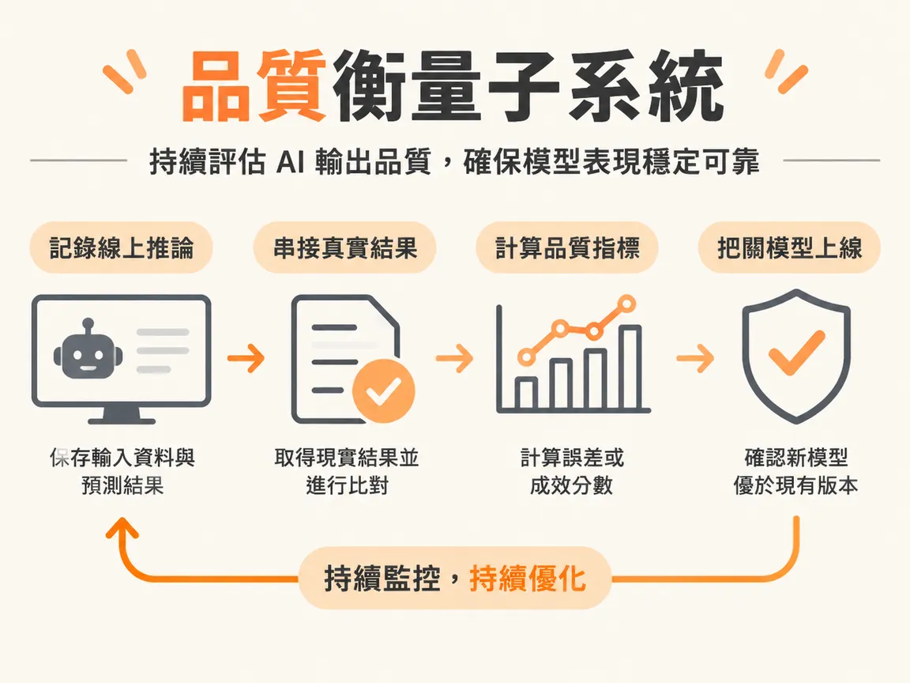

# Quality Measurement Subsystem

## 定義

品質衡量子系統（quality measurement subsystem）是 AI 系統架構中的一個專門元件，負責在正式上線的生產環境中，持續為模型產生的輸出結果打分數。

傳統軟體的結果通常只有「對」或「錯」，例如查訂單編號時，要嘛查到、要嘛查不到。但在 AI 系統中，輸出結果的好壞並非非黑即白，而是一個「連續的光譜」，因此架構中必須加入這個專門的子系統來衡量品質。

## 為什麼重要

傳統軟體監控最重視速度，例如檢查系統處理請求的延遲時間。但是，系統處理速度再快，也無法證明輸出的答案品質到底好不好。

AI 系統即使順利回傳成功的訊號，內容也可能是偏差的預估或錯誤的回答。因為模型的輸出有好有壞，如果沒有品質衡量子系統持續評估，團隊就無法確認模型目前的表現水準，也無法判斷新訓練的模型是否有資格替換舊模型上線。

## 如何運作

品質衡量子系統必須在一開始就設計進系統架構中，而不是上線之後才補做。它的運作流程如下：

1. **記錄線上推論**：系統在每次做出線上預測時，將當時的輸入資料與模型產生的預測結果完整記錄下來。
2. **串接真實結果**：等待事後收集到現實世界的真實資料，將它與先前的預測結果串接比對。
3. **計算品質指標**：依據不同維度（例如不同城市或不同時段）計算誤差或成效分數。
4. **把關模型上線**：每一次新訓練出來的模型，平均誤差必須證實優於現有模型，才具備上線資格。

## 例子

不同業務情境面對的問題不同，品質衡量子系統需要追蹤的具體指標也完全不同：

- **外送時間預估**：模型預估餐點 32 分鐘送達，實際配送花了 38 分鐘，兩者相差 6 分鐘。子系統會持續記錄這些差距，並回報各區域與時段以分鐘為單位的平均誤差。
- **內容動態牆**：評估指標通常是「點閱率」，也就是展示給使用者的內容中，實際被點擊的比例。
- **客服助理**：評估核心是「解決率」，也就是在完全不需要轉接真人客服的情況下，問題成功被排解的對話比例。
- **防詐欺模型**：為每筆交易計算風險分數，並依據設定的門檻分數（閾值）來標記可疑交易。

## 邊界與常見誤解

- **誤以為連線正常就代表結果正確**：傳統系統出錯時會拋出錯誤代碼，但 AI 系統可能順利完成請求，卻給出偏離事實的內容。單靠傳統的系統健康監控，無法發現品質問題。
- **誤以為延遲低等於品質好**：回應速度只代表效能，不代表答案可靠。評估品質時，不能只看延遲數字，必須挑選具體的業務品質指標。
- **誤以為可以在上線後再補救**：如果架構一開始沒有記錄輸入與預測的設計，事後就無法將真實結果與預測比對，導致品質衡量完全無法運作。

## 進階

在防詐欺等分類任務中，品質衡量子系統需要面對「精確率」與「召回率」的拉鋸：

- **精確率**：被系統標記為詐欺的交易中，實際上真的是詐欺的比例。
- **召回率**：所有實際發生的詐欺案件中，系統成功抓出來的比例。

如果調高判定為詐欺的分數界線（閾值），被標記的交易變少，精確率通常會上升，但召回率會下降。這代表誤擋正常付款的次數減少了，但同時會有更多真正的詐欺交易漏網過關。品質衡量子系統必須具體呈現這些指標，協助團隊在兩者之間取得平衡。
