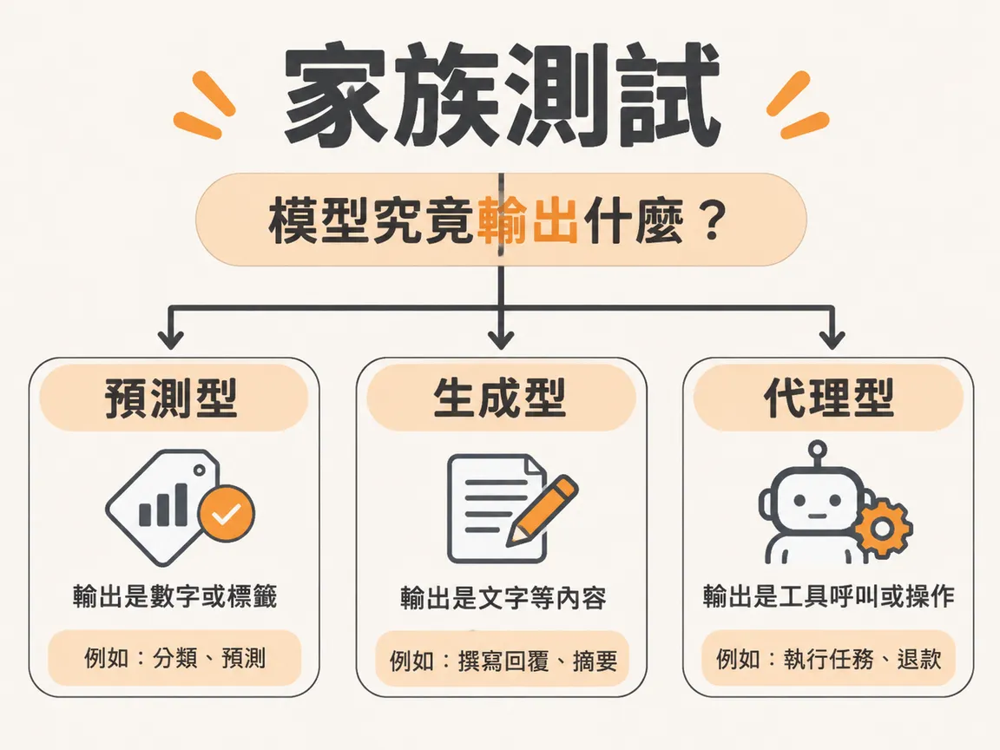

# 家族測試

## 問題

在設計 AI 系統時，如果誤判題目的本質，就會選錯整體架構。例如系統明明只需要做商品排序，卻一路規劃成複雜的聊天機器人。

## 前置條件

準備好要解決的業務需求情境。不要先看自己打算使用什麼模型（例如大型語言模型），而是把焦點放在系統最終要產出的結果。

## 步驟

1. **問關鍵問題**：問自己「模型究竟輸出什麼？」，不要看模型的技術種類，只看它的輸出成果。
2. **對應三大家族**：
   - 如果輸出是**數字或標籤**，屬於**預測型系統**。
   - 如果輸出是**文字等內容**，屬於**生成型系統**。
   - 如果輸出是**工具呼叫或實際操作**，屬於**代理型系統**。
3. **拆解混合流程**：如果系統同時做很多事，依序點出每個環節屬於哪一個家族，並劃出模組交接的「接縫」，確認彼此如何傳遞資訊。
4. **鎖定深入重點**：在時間有限的討論或面試中，確認要優先深入探討哪一個家族的子系統。

## 例子

外送平台處理一則「餐點遲到 50 分鐘並要求補償」的客服工單：

1. **第一家族（預測型）**：分類模型閱讀文字後，輸出「外送遲到」的標籤與信心分數 0.94。如果信心分數太低，就轉交人工。
2. **第二家族（生成型）**：標籤跨過接縫後，語言模型根據政策草擬一段回覆文字，並檢查內容是否合規。
3. **第三家族（代理型）**：回覆中承諾的金額跨過第二道接縫，系統以工具呼叫向後端發出補償請求，經檢查確認後正式發放退款並送出回覆。

如果單純預估餐點還要「32 分鐘」送達，因為輸出是數字，這項任務就是標準的第一家族（預測型）。

## 失敗模式

- **以模型種類當作分類依據**：看到大型語言模型（LLM）就直接認定是生成型。如果讓 LLM 閱讀客訴後只輸出一個「客訴類別」，它的實質輸出依然是標籤，本質上仍是預測型任務。
- **把混合架構統稱為單一家族**：把包含分流、回覆與退款的整套系統直接統稱為代理型，容易忽略前端分流錯誤會把整張工單導向錯誤流程的接縫風險。

## 進階

三個家族的技術成熟度不同，設計時要展示的防護重點也不同：

- **預測型系統**：技術最成熟，業界已有標準的漏斗架構與 A/B 測試，核心難點在於標籤定義等細節。
- **生成型系統**：處於發展階段，常搭配檢索增強生成（RAG）與模型評審，核心難點在於如何設計專屬的評估驗證機制。
- **代理型系統**：領域最年輕，涉及直接執行操作，必須設計明確的限制與核准閘（approval gates），在重大或不可逆的動作發生前等待人工確認。
