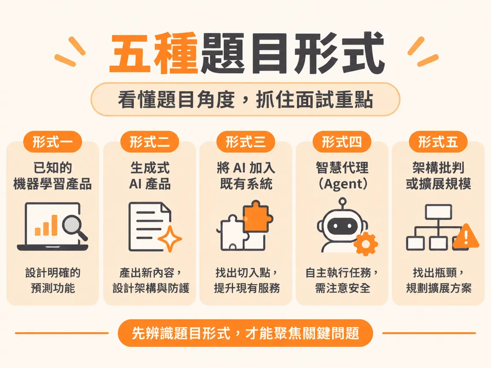

# 五種題目形式

## 定義

「五種題目形式」是 AI 系統設計面試中，題目拋過來時呈現的五種不同樣貌。

它描述你在面試第一分鐘接收問題時的切入角度，決定了接下來這一小時要把討論重心放在哪裡。

## 為什麼重要

很多人走進面試，不管拿到什麼題目，都套用同一套方法回答。

如果面試官問的是「如何在現有系統加進 AI」，你卻一頭栽進模型訓練與數學推導，就會為錯誤的問題給出看似精美的設計。

在開場三十秒內看出題目屬於哪種形式，能避免走偏，直接把時間花在面試官真正在乎的核心上。

## 如何運作

AI 系統設計的題目形式一共有五種：

1. **形式一：已知的機器學習產品**。目標是設計明確的機器學習功能，例如訓練模型從歷史資料中找規律。時間主要花在資料來源、特徵計算、模型訓練以及評估指標。
2. **形式二：生成式 AI 產品**。核心是讓模型產出新內容。重心不在特徵工程，而是整體架構：如何找對參考文件、設計給模型閱讀的提示詞，以及防護安全機制。
3. **形式三：將 AI 加入既有系統**。面對已經存在的業務流程，任務不是從零造模型，而是找出哪個環節最值得切入，並排出優先順序。
4. **形式四：智慧代理（Agent）**。模型能自己決定下一步並呼叫工具執行動作。因為動作會影響真實世界，重心在於安全控制、權限邊界，以及何時交給人工審核。
5. **形式五：架構批判或擴展規模**。面試官直接給出一張現有架構圖，要你找出流量暴增時哪裡會先壞掉。重點在於抓出瓶頸，並照危險程度由大到小剖析。

## 例子

同一家外送平台面試，可能抽到截然不同的形式：

- **形式一**：「請替 App 設計外送抵達時間預估系統。」這是標準的預測系統，關鍵在特徵與模型。
- **形式三**：「這是我們的客服工單系統，請把 AI 加進去。」這題考驗商業判斷，必須先界定範疇，決定先做哪個最有價值的功能。
- **形式四**：「讓客服助理能替客人發放小額退款。」模型呼叫工具直接動到真實金錢，設計重點是退款權限與人工審批機制。

## 邊界與常見誤解

- **誤解一：題目形式等於模型的輸出類型**。模型類型按輸出可分為預測型（數字或標籤）、生成型（內容）與代理型（行動）。形式一、二、四確實各自對應這三類，但形式三（融入系統）與形式五（架構批判）可能同時涵蓋任何一種模型。形式代表提問的角度，不是模型本身。
- **誤解二：形式有難易度之分**。這五種形式沒有高低之別，純粹代表作答重點的分配方向不同。
- **誤解三：開場要背出最新模型名稱或底層數學**。在白板上推導數學或背誦工具的零碎設定並不會加分。模型名稱幾個月就過期，應該改用模型扮演的「角色」來說明架構。

## 進階

辨識出形式後，可以在開場三十秒內完成三步定錨：

1. **分類形式**：向面試官點出這題屬於哪一種形式。
2. **確認賽道**：釐清面試深度。例如確認是否能把模型當成黑箱，還是需要探討模型內部細節。
3. **說出計畫**：主動列出接下來的討論節奏，包含推論服務、成本、回饋機制與失效應對。

無論面對哪一種形式，扎實的設計都要交代四個維度：帶有具體數字的系統需求、端到端的回饋迴路、符合現實的成本與延遲估算，以及模型出錯時的因應機制。
