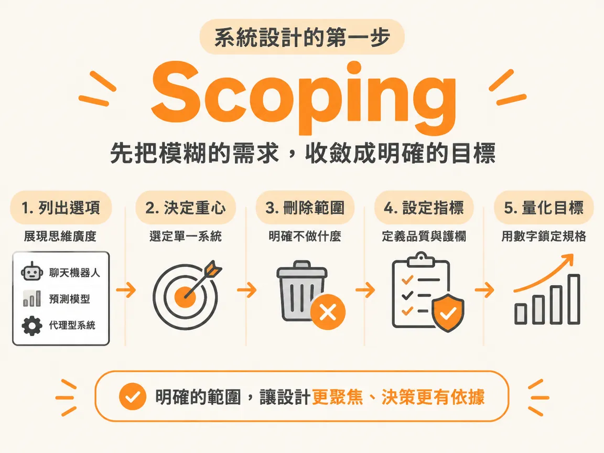

# Scoping

## 定義

定義範圍（Scoping）是指在動手畫系統架構圖之前，把一句模糊的需求，收斂成一個目標清晰、有具體數字且邊界明確的單一系統。

在一般 45 分鐘的系統設計面試中，定義範圍大約佔前 8 分鐘。到了第 8 分鐘，你就需要確定要做哪一個單一系統，並釐清它的限制條件與關鍵數據。

## 為什麼重要

面試題目通常會故意出得非常模糊，刻意抽掉三個關鍵資訊：

1. **具體功能（Feature）**：沒有說明要做什麼功能，「使用 AI」可以代表上百種完全不同的系統。
2. **衡量指標（Metric）**：沒有說明怎樣才算表現更好，缺乏成功的評判標準。
3. **模型家族（Family）**：沒有界定模型的產出型態。預測型模型輸出數字或分類標籤；生成型模型輸出文字或圖像；代理型系統則是能主動採取行動。

主動補齊這些空缺是評分的第一道關卡。面試官在過程中主要觀察兩個訊號：

* **廣度**：你能不能看出可以應用不只一種 AI 系統。
* **決斷**：你能不能從多個選項中挑出一個，並清楚說明理由。如果只列出許多點子卻遲遲不作決定，在面試官眼裡，設計就還沒正式開始。

## 如何運作

一個標準的範圍定義會依序走完五個動作，前四個動作框定問題，第五個動作則用具體數字定義成功：

1. **攤開技術家族選項**：先列出所有可行的模型形態，展現思維廣度。
2. **決定設計重心**：兼顧影響力與可行性，選定單一系統切入並說明理由。
3. **大聲刪除範圍**：主動明確說出這一版「不做什麼」，防止需求無限制膨脹。
4. **設定衡量指標與護欄指標**：除了定義核心品質指標，還要搭配一個不能隨之惡化的護欄指標。
5. **把範圍化為具體數字**：主動說出假設，用流量、延遲、解析率與財務成本來鎖定規格。

## 例子

以每天處理 50 萬筆訂單的美食外送平台為例，範圍可以這樣收斂：

* **刪除範圍**：這一版只做英文文字對話，以及處理「我的訂單在哪裡」這類低風險的第一線例行工單。退款功能限制在 10 美元以內，超過上限就轉真人。語音對話與其他語言因為成本和回應時間要求過高，全部排除在外。
* **流量估算**：假設每天 50 萬筆訂單中有 8% 產生客服聯繫，每天就有 40,000 次對話。其中 60% 屬於第一線工單（每天 24,000 次）。若每次對話平均呼叫 10 次模型，系統每秒大約承受 5 次模型呼叫。
* **品質指標**：目標是未轉接真人的第一線工單解析率達到 50%（每天解決 12,000 筆），並以「顧客滿意度」作為護欄指標。
* **延遲與成本**：等待模型吐出第一個字的「首字時間」設在 1 秒左右，完成時間約 5 秒並搭配前端串流顯示。真人客服處理每筆工單約需 4 美元，模型每次對話花費約 13 美分。每天 40,000 次對話的模型花費約 5,000 美元，但解決 12,000 筆工單可省下約 48,000 美元真人成本，產生清晰的商業論證。

## 邊界與常見誤解

* **誤解一：試圖打造「什麼都能解決」的助手**。這種模糊定位會讓工程團隊陷入泥淖。優秀的設計必須大聲說明這一版不碰哪些功能。
* **誤解二：只看單一解析率**。顧客可能因為體驗太差而直接放棄對話，這在紀錄上看起來也像「已解決」。因此不能只看解析率，必須加上顧客滿意度作為護欄指標。
* **誤解三：只給方向而不給數字**。例如只說「衡量使用者滿意度」，這只是方向而非可驗證的目標。所有的流量負載、解析目標與延遲標準都必須轉換成數字。

## 進階

資歷深淺會直接反映在開場面對模糊問題的處理深度：

* **中階工程師**：通常直接回答做聊天機器人，衡量滿意度，缺乏選項對比、取捨理由與量化規格。
* **資深工程師**：能主動走完列出選項、決定重心、砍掉範圍與數據化等完整步驟。
* **Staff 等級工程師**：除了完成資深工程師的步驟，還具備兩個更高維度的判斷：
  1. **質疑需求**：思考是否在 App 內設計即時訂單狀態畫面，就能在不用模型的情況下消除大量客服需求。
  2. **看見上下游關聯**：意識到回答訂單位置的品質取決於預計送達時間（ETA）預測系統，發現兩者是相輔相成的上下游關係。

此外，在財務評估上還必須計算失敗成本。若對話失敗仍需轉交真人，該次對話的成本就是模型費用加上真人費用（13 美分加上 4 美元）。因此長期評估時，必須以「每個被正確解決的問題所花費的總客服成本」為基準。
