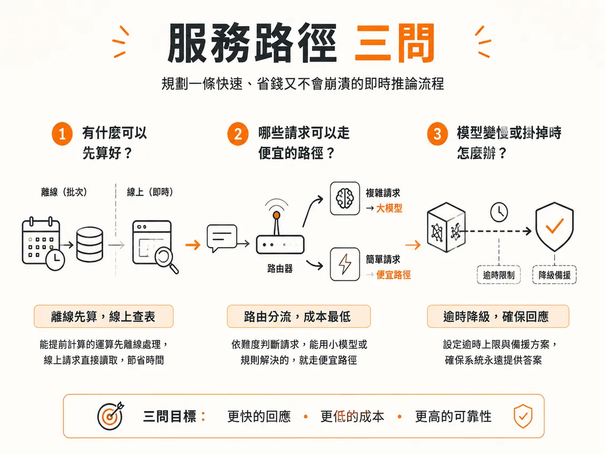

# 服務路徑三問

## 問題

當使用者送出請求時，AI 系統如果每一次都從頭計算、呼叫最龐大的模型，很容易因為延遲太高而當機，也會讓營運成本飆高。服務路徑三問要解決的問題，就是如何規劃一條既快速、省錢又不會隨便崩潰的即時推論流程。

## 前置條件

- 已經選定好要使用的模型與基準線（baseline，指最簡單且能運作的基礎做法）。
- 知道系統對延遲時間的要求（例如回應時間必須壓在 100 毫秒以內）。

## 步驟

規劃服務路徑時，依序回答以下三個關鍵問題：

1. **第一問：有什麼可以先算好？**  
   檢查哪些運算不必等到使用者發出請求才做。將系統拆成離線與線上兩部分，利用離線的批次排程作業（例如每晚固定執行的運算程式）提前算好資料。當線上請求進來時，系統只要直接查表讀取，就能省下寶貴的即時運算時間。

2. **第二問：哪些請求可以走便宜的路徑？**  
   在架構前端加入一個路由器（router，用來判斷請求並引導去向的中繼元件）。路由器會評估請求的難度，如果小型模型就足以回答，就把請求送往成本最低的路徑；只有複雜的任務才交給昂貴的大模型。

3. **第三問：模型變慢或掛掉時怎麼辦？**  
   不能假設模型永遠正常。在架構圖上，每一個指向模型的連線都必須設定防護：
   - 設定逾時限制（timeout，等待模型回應的最高上限時間）。
   - 設定降級備援方案（fallback，當主力模型失敗時代替出場的安全備案），確保系統立刻給出替補答案。

## 例子

在設計外送或餐飲推薦系統時，這三問的具體落地方式如下：

- **離線先算**：系統透過每晚執行的批次作業，預先算好每家餐廳的平均數據。使用者打開 App 時直接讀取結果，不必當場重新計算。
- **便宜路由**：系統每天面對 1,000 萬次請求，透過路由器判斷，只將其中 20% 的複雜請求送給呼叫一次要 1 美分的大型語言模型，其餘交給便宜路徑處理。每天的模型成本可控制在 20,000 美元左右。
- **逾時降級**：系統將逾時限制設在 100 毫秒內。如果模型超過時間未回應或直接斷線，系統立刻啟動降級方案回傳歷史平均值，使用者畫面上依舊能看到數值，不會卡住或跳出錯誤。

## 失敗模式

- **所有事情都在線上即時算**：沒有離線預先計算，使用者一多就會造成連線塞車、反應變慢。
- **所有請求都打給大模型**：沒有加裝路由器進行分流，若 1,000 萬次請求全送往大型語言模型，成本會暴增五倍，讓產品在商業上無法持續營運。
- **缺少逾時與降級防護**：模型一旦當機或變慢，前端沒有備用答案可回傳，導致使用者端整個畫面卡死或出現崩潰錯誤。

## 進階

在 45 分鐘的系統設計面試或架構評估中，服務路徑（即第五步）是架構的核心，通常需要分配約 12 分鐘詳細說明。如果遇到生成型或代理型（agentic）架構的題目，這部分的討論比重還需要進一步拉高。此外，三問中所省下的開銷與防護策略，也直接對應到架構最後必須盤點的兩份清單——成本帳本與故障帳本。
