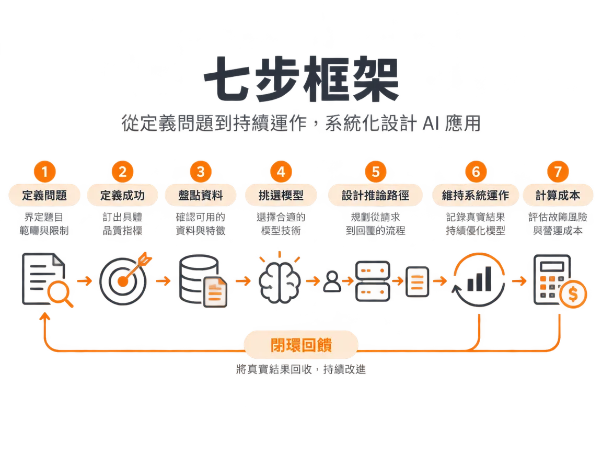

# 七步框架

## 問題

設計傳統軟體系統時，工程師通常先開需求、畫出資料庫與伺服器架構，最後把結果傳給使用者就結束了。因為傳統程式只要資料庫回傳正確就是對的，錯了就是臭蟲（bug）。

但在人工智慧（AI）系統中，這種傳統思考骨架會在兩個地方斷裂：

1. **品質無法非黑即白**：模型是從過往資料學習的程式，只在部分時候正確。它的表現是一個數值，必須提早取得共識。
2. **真正的結果發生在系統回覆之後**：系統給出預測後，現實世界才會發生真實結果。如果沒有把真實結果收回系統，隨著世界改變，模型就會悄悄變差。

## 前置條件

在開始規劃之前，必須先做好兩件事：

- **指明系統體系**：先確認題目屬於哪種系統體系，並對照已知的類似產品，避免憑空捏造。
- **設定基準線（baseline）**：先準備好一個能運作的最簡單做法。後續提出任何複雜模型，都必須證明自己能勝過這個基準線。

## 步驟

為了補齊傳統設計的兩個斷點，AI 系統設計必須依序走完七個步驟：

1. **定義問題（Frame the problem）**：界定題目範疇與限制。
2. **定義成功（Define success）**：為品質訂出具體數值指標（例如平均誤差與延遲時間），補齊第一個斷點。
3. **盤點資料（Map the data）**：確認有哪些資料與特徵可以使用。
4. **挑選模型（Pick the model）**：選擇合適的模型技術。
5. **設計推論路徑（Design the serving path）**：規劃使用者發出請求、模型運算到傳回答案的線上即時路線。
6. **維持系統運作（Keep it working）**：記錄請求與真實結果，形成閉環（close the loop）重新訓練模型，補齊第二個斷點。所有更新須經過「三階段上線」：
   - **離線測試**：用歷史資料驗證，沒勝過舊版就中止。
   - **即時流量測試**：先以影子部署（shadow deployment，在背景接收真實流量運算但不回傳）測試穩定性，再做 A/B 測試。
   - **漸進式發布**：對少數使用者推出並逐步放量，設定自動回滾條件，監控因現實變化導致模型準確度下滑的資料漂移（drift）。
7. **計算成本（Count the costs）**：列出「兩本帳」：
   - **故障帳本**：列出最容易壞的三種情境與防護手段。
   - **成本帳本**：以單次呼叫成本乘上預估用量。

## 例子

以「外送送達時間估算」為例：

系統在結帳頁面給出預估送達時間。第二步先訂出標準：「平均誤差小於五分鐘，延遲在 100 毫秒內」。第五步設計後端如何即時算出時間並傳給客人。第六步則在餐點真正送達時，把實際時間記錄下來，比對預估誤差，並將這筆真實資料送回訓練庫。第七步計算成本：若每天有 1,000 萬次請求，透過路由器將 20% 分流給每次 1 美分的大型語言模型，每天成本是 20,000 美元；如果沒有在第五步做好路由器分流，成本就會暴增五倍。

## 失敗模式

- **第一步拖太久**：若在定義問題卡了 20 分鐘，後面最重要的推論路徑就會失去討論時間。
- **沒有建立閉環**：架構圖停在回傳答案，無法捕捉現實結果，導致模型隨外在環境退化卻無人知曉。
- **反饋迴圈失控**：例如推薦系統推了釣魚標題，使用者點擊後系統誤以為使用者喜歡，進而推薦更多釣魚標題。這時必須在模型外設立防護規則強制調降權重。
- **沒有準備備援**：遇到路徑服務斷線或沒有設置分流路由器，導致系統直接崩潰或帳單暴增。

## 進階

在標準 45 分鐘的面試或技術對話中，時間分配是成功的關鍵：

- **第一步**：必須在第 3 分鐘左右收尾。
- **第五步**：核心架構所在，應分配最多時間（約 12 分鐘）。
- **最後 2 分鐘**：保留給討論與提問。
- **題型彈性調整**：預測型題目著重第三步與第四步的資料標籤；生成型與代理型題目則把重心放在第五步。
- **時間壓縮策略**：即使時間被壓縮到 10 分鐘，也沒有任何一步可以被跳過。此時應把整體對話濃縮並圍繞在第一步、第五步與第七步。
