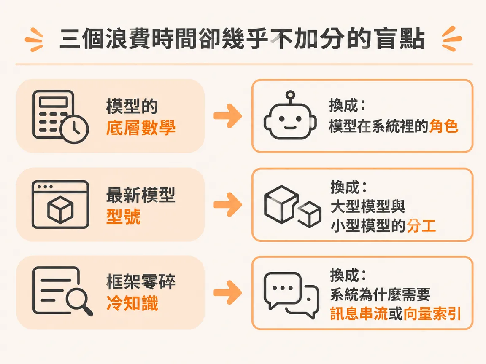
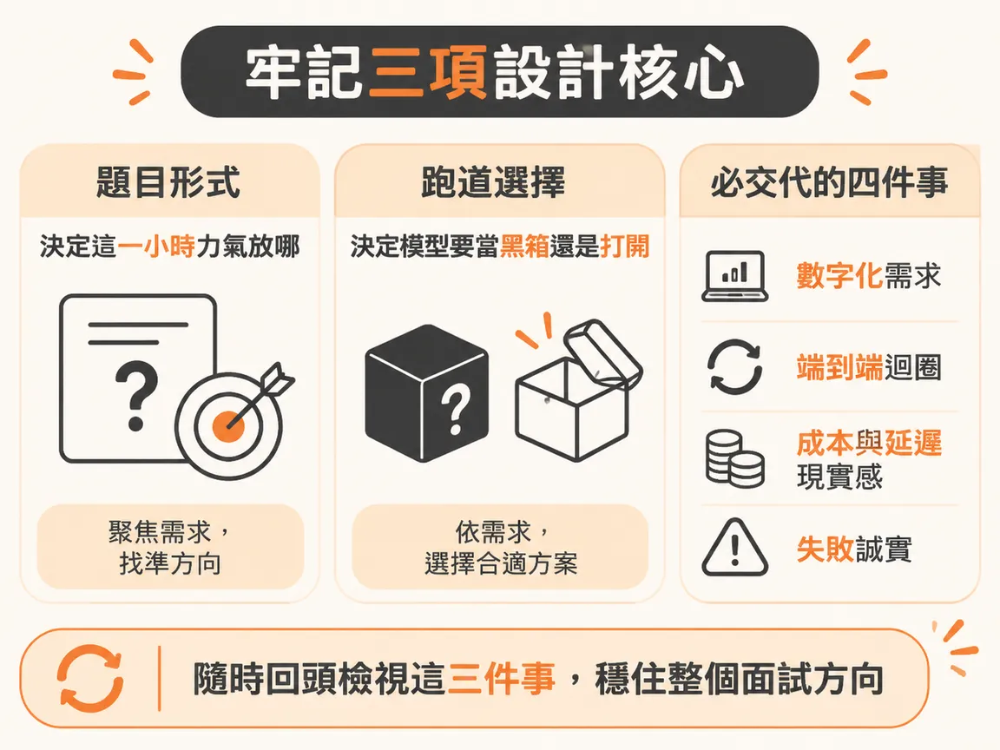

# 在 AI 系統設計面試開場 30 秒內定錨對話

理解了題目形式、個人賽道以及每次都要交代的四個維度後，面試一開始的實戰操作便能迅速收斂。進到 AI 系統設計面試時，許多人常在開頭花費大量時間鋪陳，甚至一頭栽進不加分的技術細節裡。真正有效的開場只需要大約 30 秒：確認題目形式、釐清專業分工、講出討論計畫。白板上一筆都還沒畫，雙方就已經清楚接下來的一小時要如何分配。

## 三個浪費時間卻幾乎不加分的盲點

在進入系統架構前，有三件事會吃掉寶貴的面試時間，卻換不來多少分數：

1. **模型的底層數學**：目前多數大型語言模型（LLM）都採用稱為 Transformer 的架構。但面試官絕不期待在白板上推導注意力機制的數學方程式。
2. **最新模型的具體型號**：模型的名字幾個月就會過期一次。不要執著於特定型號，改用「模型扮演的角色」來說明。例如，處理複雜難題時使用託管型的大型模型，佔多數的簡單狀況則交給便宜的小型模型。
3. **框架的零碎冷知識**：Kafka 和 Kinesis 都是用來處理訊息串流（message streams）；Pinecone 和 pgvector 則是提供向量索引，也就是依照語意相似度來搜尋資料。該展示的是「系統為什麼需要訊息串流或向量索引」，而不是背誦工具之間的零星設定差異。

## 前 30 秒的三步開場法

假設面試官拋出題目：「請在我們的客服工單系統中加入 AI 功能。」這時不要急著畫架構圖，照著以下三步開場：

- **第一步：分類形式（Classify the form）**。這題的情境是工單系統已經存在，題目問的是 AI 該切入哪裡，因此屬於五種題型中的「形式三」。
- **第二步：確認賽道（Confirm the lane）**。主動向面試官確認深度邊界。例如提問後，面試官明確表示「先假設模型已經存在」，就知道不用跳進模型訓練的細節。
- **第三步：說出計畫（State the plan）**。清楚列出接下來的節奏：「我會先挑出第一個 AI 功能並設定量化目標，接著涵蓋推論服務（serving）、成本考量、端到端的回饋迴路，最後討論模型失效時的因應機制。」

把這三點說清楚只需要大約 30 秒，卻能立刻展現掌控全場節奏的專業度。

## 牢記三項設計核心

想在整個面試過程中穩住方向，隨時回頭檢視這三件事：

- **題目形式（Form）**：題目拋出的情境形狀。面試題目共有五種形式，辨識出形式，就能決定這一小時該把時間花在哪裡。
- **所屬賽道（Lane）**：工程角色該深入哪一部分。如果走軟體工程師（SWE）的 loop，通常把模型視為黑箱來串接系統；如果是機器學習工程師（MLE）的 loop，則需要把黑箱打開，深入其內部機制。
- **任何形式都必備的四個維度**：
  1. 帶有具體數字的系統需求。
  2. 端到端的回饋迴路。
  3. 符合現實的成本與延遲估算。
  4. 坦誠面對模型可能的失敗狀況。

過程中如果面試官追問：「你會選用哪一款模型？」記住用「角色」回答，而不是報出最新的型號名牌。直接告訴對方：最困難的問題會交給外部託管的大型模型，而佔絕大多數的日常簡單問題，則交給輕量、低成本的小型模型處理。
