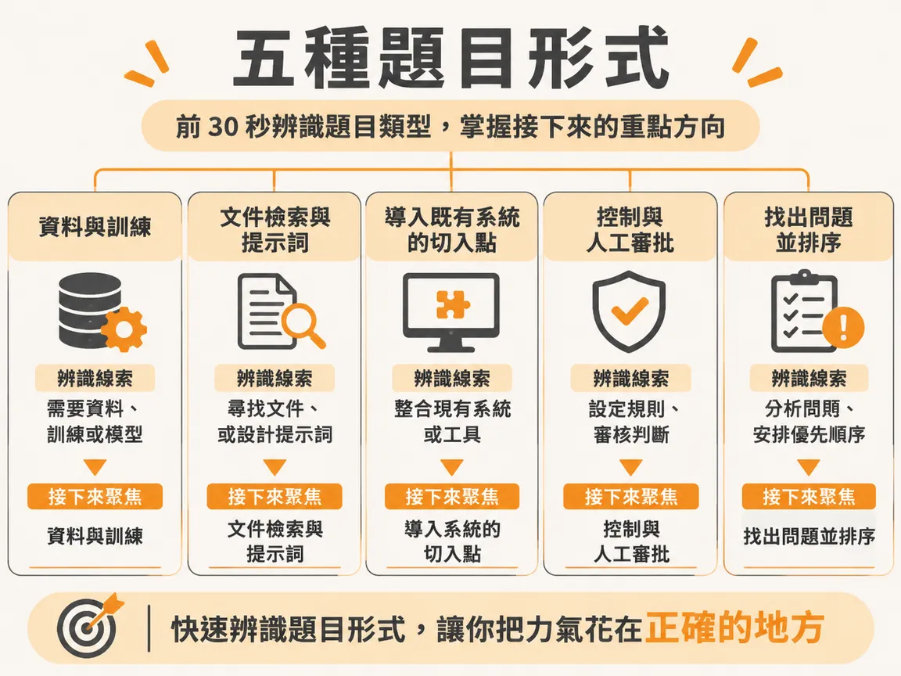
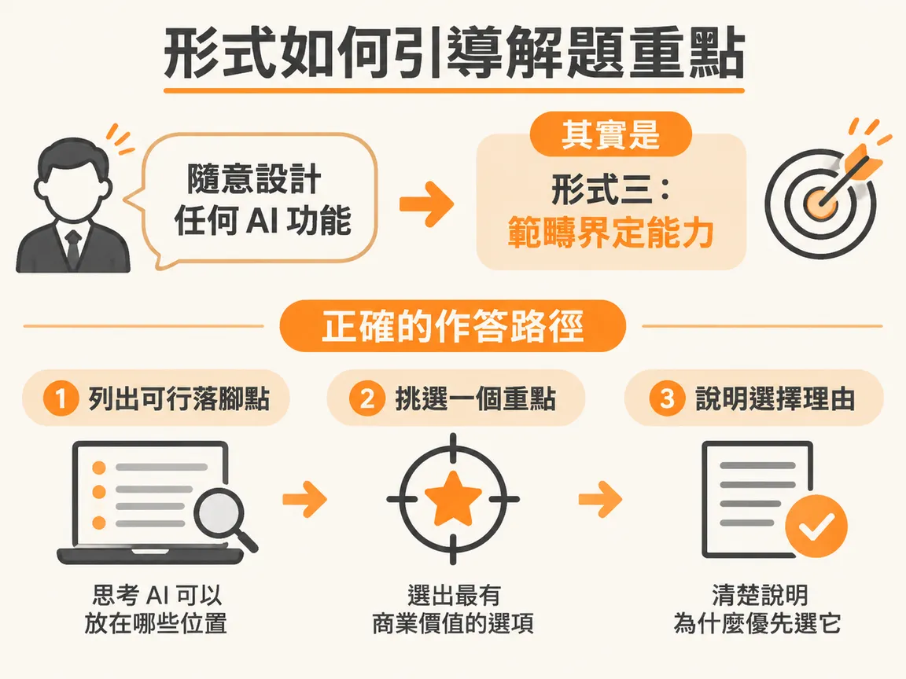
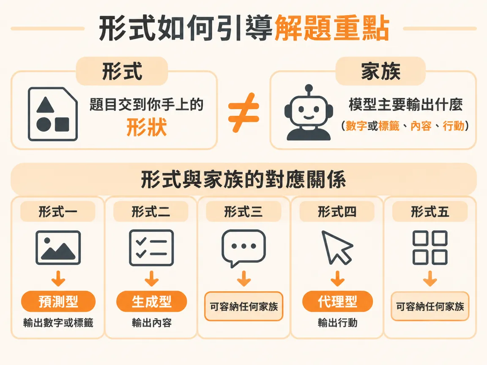

# 辨識 AI 系統設計面試的五種題目形式

想像兩位準備了相同題材的應徵者走進同一家外送平台的面試。第一位抽到的題目是：「替我們的 App 設計一套送達時間預估系統。」第二位抽到的題目則是：「這是我們的客服工單系統，請把 AI 加進去。」

兩題都是典型的 AI 系統設計題，但需要的回答截然不同。第一題需要一套預測系統，核心在於資料與模型訓練；第二題考驗的卻是判斷力——AI 到底該用在工單系統的哪個環節，以及應該先推出什麼功能。如果拿回答第一題的方式去套第二題，只會替錯誤的問題給出看似精美的設計。

要在面試開始的第一分鐘內避免這類偏差，最關鍵的工具就是辨識題目的「形式」（form），也就是題目拋過來的形狀。這類面試一共有五種形式，只要在前 30 秒內辨識出題目屬於哪一種，你就能明確掌握接下來這一小時該把力氣花在哪裡。

## 五種題目形式

### 形式一：已知的機器學習產品

這類題目要求設計明確的機器學習（Machine Learning, ML）功能，也就是訓練模型從過去的範例中學習規律。外送時間預估就是標準的形式一。

模型使用的每項單一輸入數值稱為特徵（feature），特徵管線（feature pipeline）則負責計算這些數值。面對這類形式，面試的大部分時間應該投入在資料來源、特徵工程、模型訓練與離線及線上評估指標上。

### 形式二：生成式 AI 產品

生成式 AI（Generative AI）的核心是產出全新的內容，例如設計一個客服對話助理。

當題目屬於形式二時，焦點不再是特徵工程，而是整個系統架構如何運作：如何檢索出正確的參考文件、系統安全與防護機制（safety），以及提示詞（prompt，也就是模型讀取的完整文字脈絡）該如何設計。

### 形式三：將 AI 加入既有系統

前述「把 AI 加進客服工單系統」就屬於形式三。這類題目並非從零打造新模型，而是必須在既有業務流程中找出最能發揮價值的切入點。

### 形式四：智慧代理（Agent）

智慧代理指的是模型在任務執行過程中，能即時決定下一步該做什麼的系統。這裡的「步驟」往往包含呼叫工具（tool，也就是模型要求系統去執行的特定函式），例如允許客服助理替使用者發放小額退款。

由於這類動作會直接影響現實世界的運作（例如涉及真實金錢交易），形式四的核心往往在於「控制機制」——例如系統該如何設定權限邊界，以及哪些敏感操作必須交由人工審批。

### 形式五：架構批判或擴展規模

在形式五中，面試官會直接展示一份現有的設計架構，問「這個設計有什麼問題？」或是「當流量暴增到十倍時，哪裡會先垮掉？」這時任務是找出潛在瓶頸與缺陷，並將問題依危害程度排序，先從最嚴重的核心問題開始剖析。

## 形式如何引導解題重點

這五種形式並非理論分類，同一家外送平台在不同的面試關卡中，就曾完整考過這五種題目。題目的形式，直接決定了一份扎實的回答必須涵蓋哪些內容。

有些題目會刻意隱藏自己的真實形式。例如面試官可能會說：「這是我們的產品，請隨意設計任何你想加的 AI 功能。」這其實是偽裝過的形式三。面試官把「AI 該放在哪裡」的決定權交了出來，題目的本質是在測驗範疇界定（scoping）能力。面對這種情境，優秀的回答不是馬上埋頭設計，而是先列出幾個可行的落腳點，挑選最有商業價值的一個，並清楚說明為什麼優先選擇它。

此外，題目的形式也不等於系統背後的「三大家族」。家族分類看的是預測模型的主要輸出：
- 預測型（predictive）模型主要輸出數字或標籤。
- 生成型（generative）模型輸出內容。
- 代理型（agentic）模型輸出行動。

形式描述的是在面試當下「接收題目時的形狀」。形式一、二、四剛好分別對應預測、生成與代理這三大家族；但形式三（融入現有系統）與形式五（架構批判）則可能包含任何一種家族的模型。這五種形式純粹代表問題切入的角度與作答重點的分配，本身並沒有難易度高低之分。
