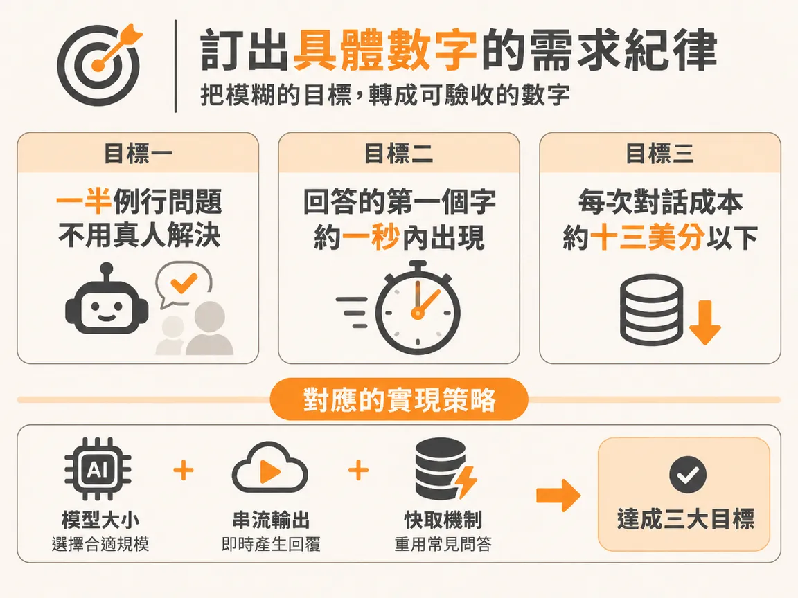
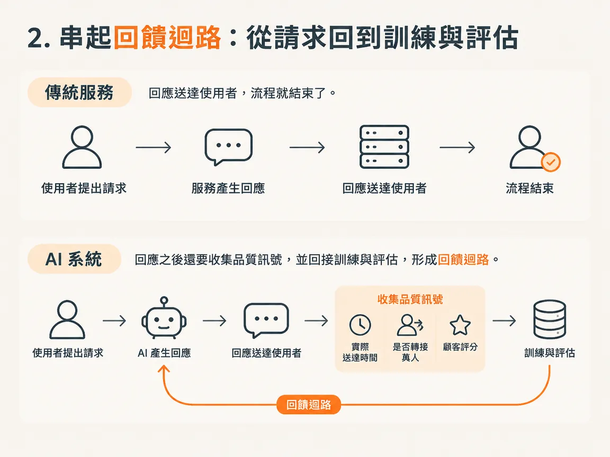
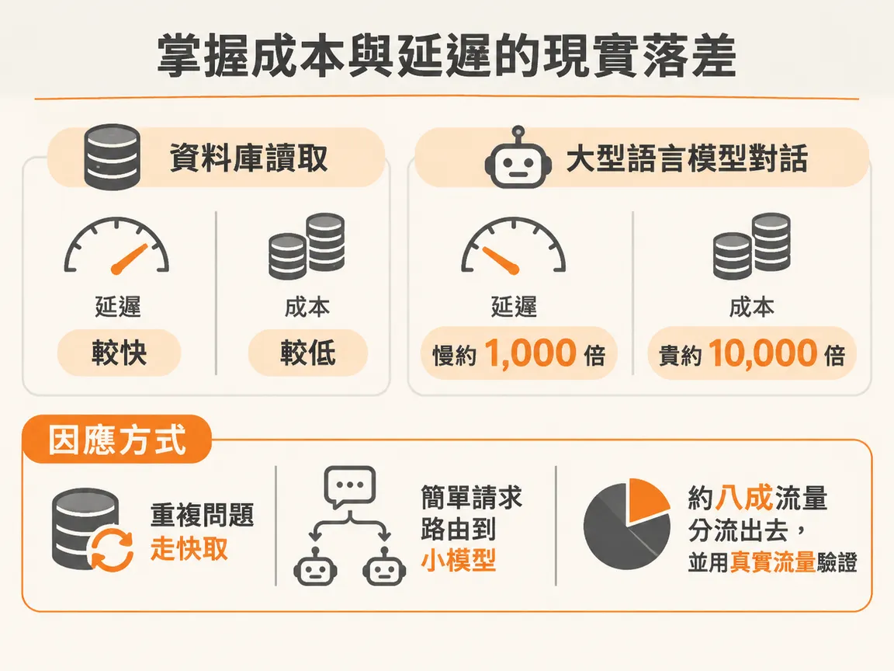
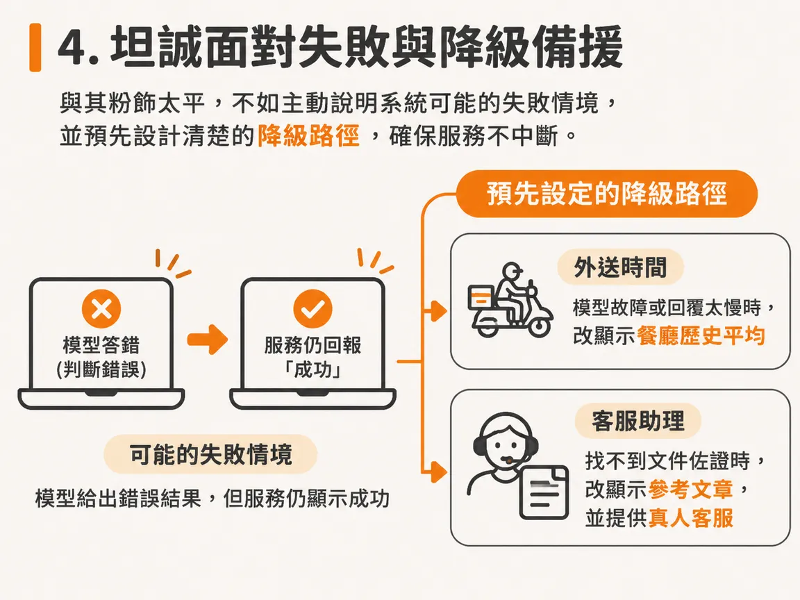

# 設計 AI 系統必須交代的四個關鍵維度

在確立了題目的形式與角色所屬的賽道後，無論最後設計的是哪一類系統，答題時都不能停留在抽象的概念描述，例如只說「我們要打造一個更聰明的客服系統」或「用大語言模型（LLM）回答使用者問題」。「讓客服更聰明」並不是一個真正的需求。模型的品質往往無法單純用「對」或「錯」二分，必須親自定義什麼叫做「夠好」。

無論面對哪種 AI 系統題目，都有四個核心維度值得完整交代：具體的需求指標、端到端的回饋迴路、成本與延遲的現實感，以及對失敗的坦誠態度。

## 1. 訂出具體數字的需求紀律

設計系統的第一步，是用具體數字定義衡量指標。有了量化目標，後續架構的每一項選擇才有依據。

以智慧客服助理為例，可以設定以下目標：

* 至少有一半的例行問題，不需要真人客服介入即可解決。
* 系統送出回答的第一個字，延遲要控制在約 1 秒內。
* 每次對話的平均花費成本，要壓在約 13 美分（cents）以下。

設定好這些指標後，接下來在選擇模型大小、決定是否使用串流輸出（streaming）或設計快取時，就有了清楚的驗收標準。

## 2. 串起回饋迴路：從請求回到訓練與評估

在傳統系統設計中，服務將回應成功送達使用者端，流程通常就算結束了。AI 系統不能停在這裡，因為即使 HTTP 狀態碼回傳 200 成功，模型的回答依然可能是錯的。

一個完整的 AI 系統必須能捕捉品質訊號，並將這些資料反饋回訓練與評估流程：

* **外送預估時間系統**：品質訊號是餐點最終「實際送達的時間」。這個數據會在稍後產生，並用來訓練下一版模型。
* **智慧客服助理**：品質訊號包括顧客在對話結束後是否仍轉接真人客服，以及顧客給予這次回覆的評分。

## 3. 掌握成本與延遲的現實落差

設計架構時，必須對底層元件的成本與延遲級距有務實的認知。

粗略的數量級對比：

* 從 Key-Value 資料庫讀取一筆資料，成本大約是一百萬分之一美元，耗時約 2 毫秒。
* 在雲端託管的 LLM 上跑一輪對話，成本大約是 1 美分，耗時約 2 秒。

換句話說，呼叫一次大語言模型的成本大約貴了 10,000 倍，速度慢了約 1,000 倍。

這麼巨大的落差會直接改變系統架構的設計。為了控制成本與延遲，不能讓所有請求都直接打到大型 LLM：

* **建立快取（Cache）**：針對重複出現的高頻問題（例如「退款政策」），直接由快取回傳，完全不呼叫模型。
* **流量路由（Router）**：將簡單的請求路由到較小、反應更快且成本更低的模型上，目標是將約 80% 的日常流量分流給小模型。
* **驗證機制**：這項 80% 的分流比例，必須經過真實流量的測試驗證才能作準。

## 4. 坦誠面對失敗與降級備援

AI 模型最棘手的特性之一，就是即使答錯了，語氣聽起來依然非常肯定。送達時間預估可能會少算 20 分鐘；客服助理也可能憑空捏造一條根本不存在的退款規定——而在這兩種情況下，系統底層的服務都顯示正常運作。

與其粉飾太平，不如在被問到之前先主動說出系統可能失敗的地方：

* **外送時間模型故障或反應過慢時**：系統不該硬等，而是立即降級（fallback），直接顯示該餐廳過去的歷史平均外送時間。
* **客服助理無法從檢索到的說明文件中找到佐證時**：系統應誠實退回較安全的作法，直接將找到的參考文章呈現給使用者，同時提供轉接真人客服的管道。

在面試官開口追問之前，主動指出模型可能出錯並拿出安全降級方案，正是展現系統設計實戰經驗的最好方式。
