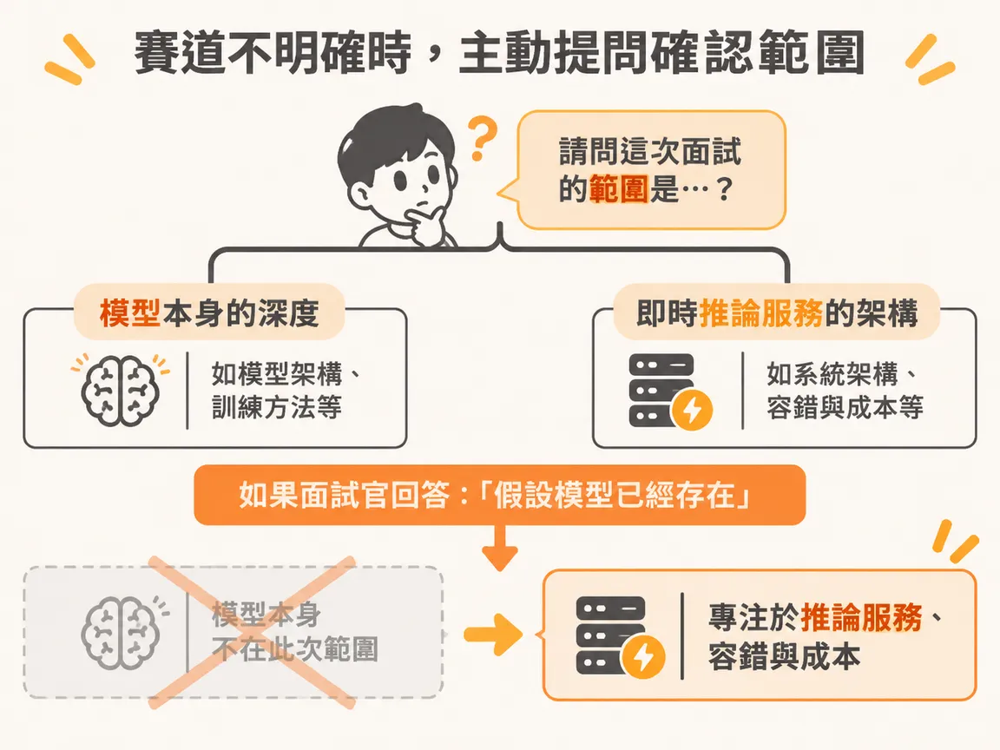

# AI 系統設計面試的賽道：模型該當黑箱還是打開？

在辨識出題目的形式之後，緊接著要解決另一個常見難題：這題到底該花時間聊模型結構與微調，還是該專注在後端系統與擴展性？答案取決於應徵角色的「賽道」（lane），也就是該職位必須深入設計的範圍。

一間公司為特定職位安排的一整套面試流程稱為面試組合（loop），每家公司的 loop 安排都不盡相同，應徵角色決定了賽道在哪裡。

### 不同角色的深入重點

在資深軟體工程師（Senior Software Engineer）的 loop 中，模型通常被當成一個「黑箱」（box）。不需要拆解模型內部，面試官想看的是圍繞在模型周圍的架構設計：資料流向、即時推論服務（serving，也就是用模型回應即時請求）、系統容錯處理以及運行成本。雖然把模型當成黑箱，仍然必須清楚交代黑箱的介面與限制：輸入是什麼、輸出是什麼、回應速度允許有多慢，以及容許出現錯誤的頻率。

換成機器學習工程師（ML Engineer）的 loop，這個黑箱就必須打開。必須深入探討模型選擇、特徵工程、訓練流程與評估指標。

如果是 AI 工程師或平台工程師（AI / Platform Engineer），深究的核心則是 GPU 使用率。GPU 是用來執行模型複雜數學運算的昂貴晶片，使用率指的就是在付費時間內，GPU 實際執行有效工作的比例；同時，把多個請求合併處理的批次處理（batching）也是這類角色必須著墨的重點。

若是工程主管或經理（Manager）的角色，重點則會轉向自研或採購的決策（build versus buy，究竟該自己從頭打造組件，還是直接付費採用現成服務），以及分階段推出（phased rollout，先將變更釋出給少部分使用者測試）的策略。

### 最常見的失誤：偏離賽道

軟體工程師 loop 最常見的失誤，就是一頭栽進模型細節裡。

例如，一位資深工程師拿到「設計文件助理」的題目，立刻花了 15 分鐘滔滔不絕地討論微調（fine-tuning，使用自有資料對既有模型進行額外訓練）。這些機器學習知識固然正確，但這 15 分鐘原本應該用來討論即時推論服務與成本架構，結果反而排擠了核心架構的展示時間。

### 賽道不明確時，主動提問確認範圍

如果你在面試當下無法確定守備範圍，最直接有效的方法就是開口詢問面試官：

> 「我應該專注在模型本身的深度，還是即時推論服務的架構？」

舉例來說，在設計客服工單（ticket）分類系統的題目中，面試官往往會回答：「請先假設模型已經存在。」

這句話等於明確把模型訓練移出討論範圍，能把整整一個小時的火力集中在即時推論架構、容錯機制與硬體成本上。
