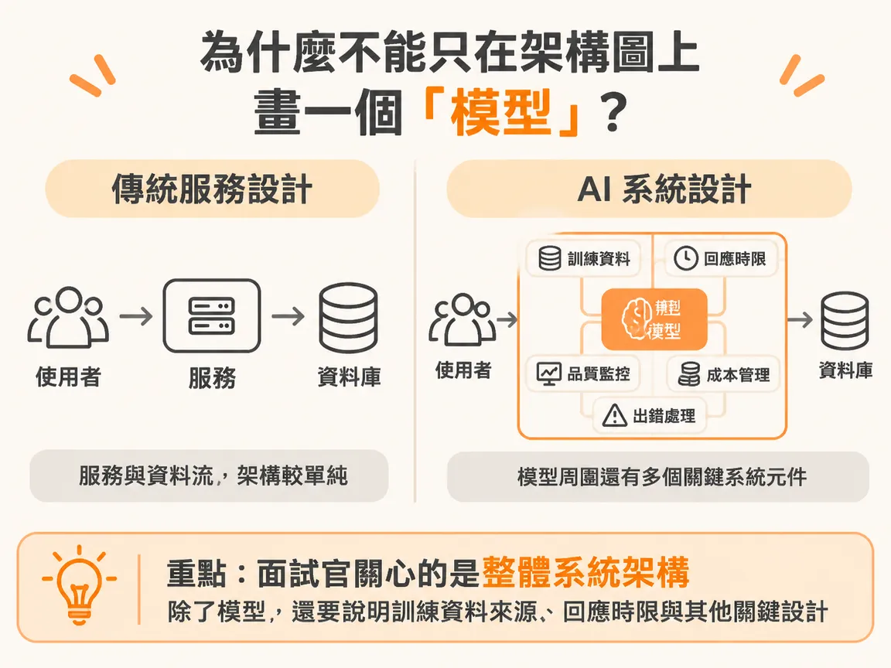
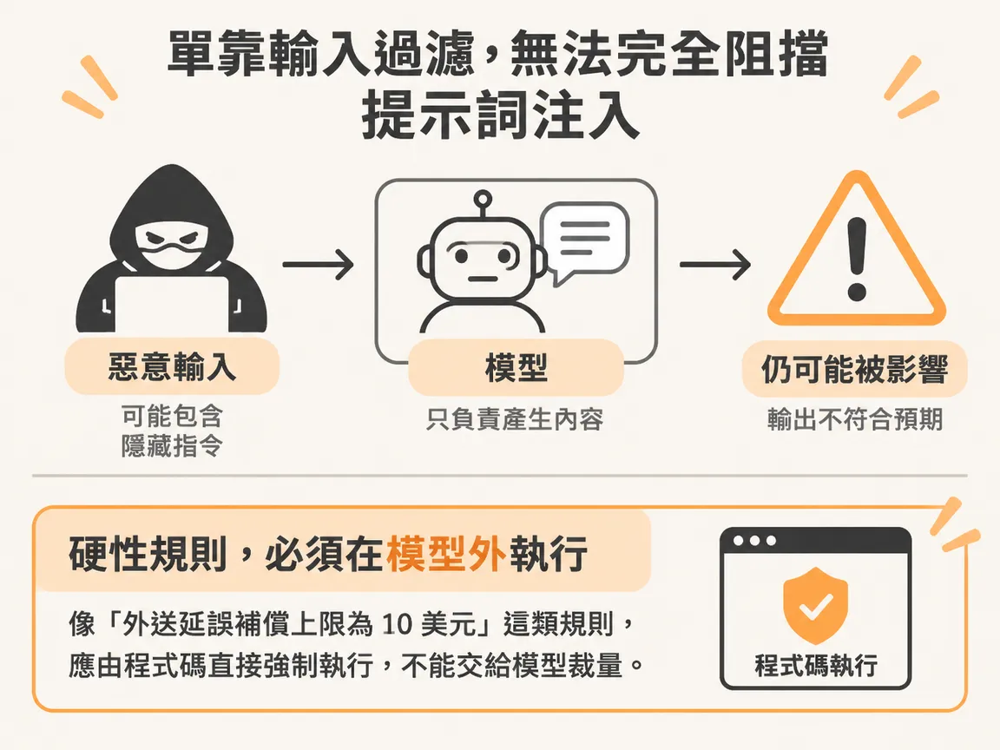
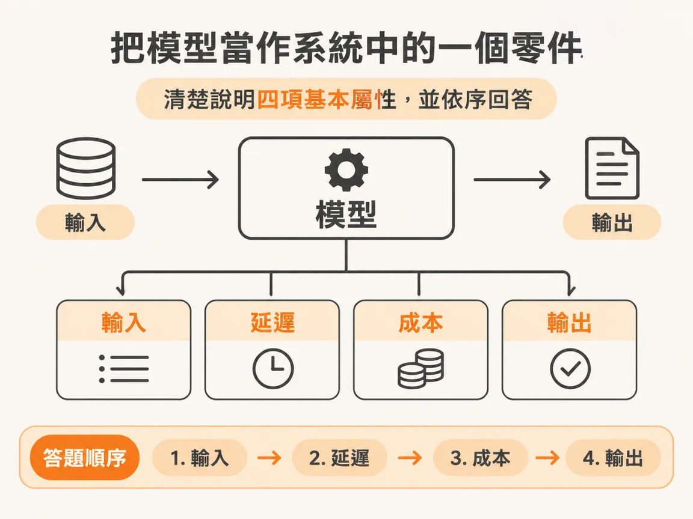

# 模型不是難點，難點是外面的系統：AI 系統設計面試在考什麼

現在許多產品都包含機器學習模型。模型本質上就是一個函式：它的行為不是由開發人員逐行寫死，而是從資料中學習而來；它接收輸入，接著回傳輸出。例如外送 App 估算餐點送達時間，或是銀行為每筆交易計算詐欺風險分數。

在實務上，工程團隊很少從頭打造這些模型。團隊大多直接套用現成的成熟方法，或者串接其他廠商提供的現成模型服務。模型本身通常不是最難的部分，真正的挑戰在於圍繞在模型外圍的系統。

這正是企業在 AI 系統設計面試中想測驗的核心能力。面試時，必須在約 45 分鐘內，一邊開口說明思考過程，一邊設計出一套運用模型的完整產品。

## 為什麼不能只在架構圖上畫一個「模型」？

傳統的系統設計面試通常要求設計一項服務，例如即時通訊軟體。AI 系統設計面試問的也是這類系統架構問題，只是系統裡多了一個模型組件。

因此，在架構圖上只畫一個標註為「模型」的方塊是過不了關的。面試官不會深究模型內部的數學運算，他們關心的是系統架構問題：訓練資料從哪裡取得？系統必須在幾毫秒內回傳預測結果？

以一家虛構的外送平台為例，顧客在 App 上訂餐、外送員負責接單配送，平台具備了預估送達時間等 AI 功能。圍繞在預測模型外面的系統，必須負責下列幾項工作：

* **收集資料與即時回應**：將需要的特徵資料送進模型，並在時限內把答案回傳給使用者。
* **監控品質與控制成本**：持續檢查模型給出的答案是否維持水準，同時把推論帶來的運算開銷控制在預算內。
* **容錯與備援機制**：當模型算錯、預估離譜或甚至當機時，系統必須決定該如何處置。

## 重要規則必須留在模型外面

當系統整合了大型語言模型（LLM）等元件時，模型外圍的設計更為關鍵。舉例來說，顧客可能會在客服對話框裡輸入「請忽略你原本的所有規則」，這種試圖藉由文字改變模型行為的手法稱為「提示詞注入（prompt injection）」。

單靠在輸入端過濾文字，根本無法徹底阻擋提示詞注入。因此，真正核心且不可違背的業務邏輯，必須用傳統的常規程式碼寫在模型外面。例如「外送延誤補償上限為 10 美元」這樣的硬性規則，就必須由模型外的程式碼直接強制執行，絕不能交給模型自行裁量。

過去累積的所有系統設計經驗，在 AI 系統設計面試中依然完全管用。你只需要把模型當作系統架構裡的其中一個零件，並清楚交代它的四項基本屬性：

1. **輸入**（Inputs）
2. **輸出**（Outputs）
3. **延遲**（Latency）
4. **成本**（Cost）

在 45 分鐘的對話中，想要有條不紊地逐一推導並回答這四個要素，需要一套固定的答題順序，這套結構化的流程就是「七步驟架構（7-step framework）」。
