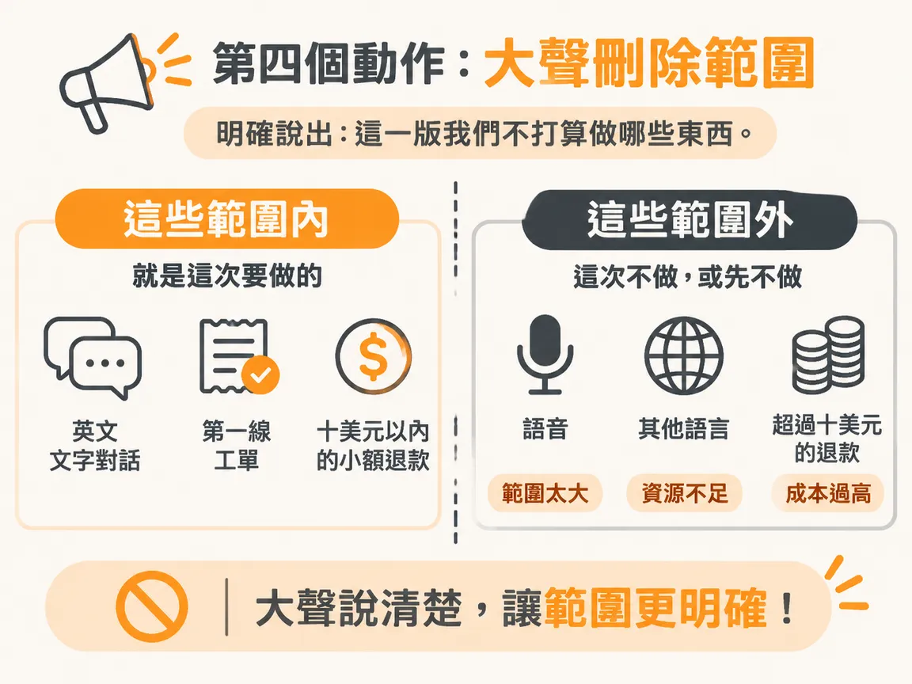
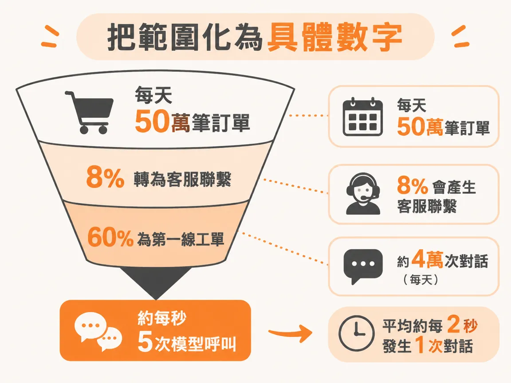
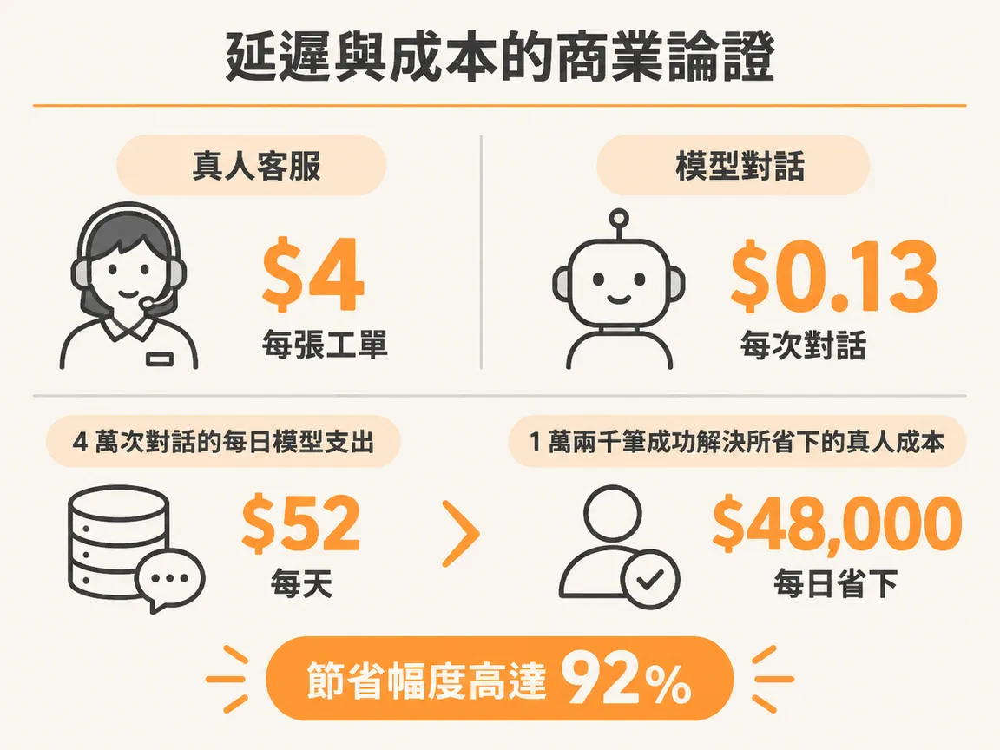

# 劃定 AI 系統範圍：大聲砍掉需求，用數字鎖定規格

在討論 AI 系統設計時，最常見的失誤就是試圖打造一個「什麼問題都能解決」的客服助手。這種模糊的需求會讓工程團隊陷入泥淖。在定義系統架構前，必須清楚說明這一版「不做什麼」，並將流量、解析率、延遲與成本轉化為可驗證的具體數字。

## 第四個動作：大聲刪除範圍

刪除範圍（Scope cut）指的是由你主動明確說出：「這一版我們不打算做哪些東西。」

以電商客服為例，納入這一版範圍的只有兩項：英文文字對話，以及第一線（Tier 1）工單。所謂第一線工單，是指像「我的訂單在哪裡？」這類例行且低風險的常見問題。另外，助手可以協助處理退款，但金額必須設有上限，例如限制在 10 美元以內。

明確排除在外的範圍則包括：

* **語音對話**：語音需要獨立的語音處理系統，對回應時間的要求也更為嚴格，因此這版不做。
* **其他語言**：每增加一種語言，就必須針對所有政策與回答單獨重新測試，成本過高，暫時不納入。
* **超過 10 美元的退款**：系統如果誤退 8 美元，損失有限；但如果誤退 200 美元，就是實打實的重大損失。因此，退款工具會在自身的程式碼中檢查金額，只要金額超出上限，就一律轉交真人客服處理。

## 第五個動作：把範圍化為具體數字

確認範圍後，接下來要用數字來評估規模與工作量。

首先從流量與負載開始估算。假設每天有 500,000 筆訂單，其中 8% 的訂單會產生客服聯繫，這代表每天會有 40,000 次對話，平均約每 2 秒發生 1 次。

假設這些對話中有 60% 屬於第一線工單，相當於每天 24,000 次。如果每次對話平均需要呼叫 10 次模型，系統每秒大約承受 5 次模型呼叫。以系統負載來說，這樣的規模相當溫和。

在說明這些數據時，所有的假設都要主動大聲說出來。如果有人詢問「8% 的客服率是怎麼來的」，直接說明這是設定的假設即可。即便實際數字是 4% 或 12%，整體規模依然落在每天數萬次對話的區間，不會改變整體的設計邏輯。

## 設定解析率與護欄指標

系統的核心品質指標是「未轉接真人時的解析率」。轉接（escalation）是指將對話移交給真人客服專員處理。

單看解析率有盲點：一個因為體驗太差而直接放棄對話的顧客，在系統紀錄上看起來也像「已解決」。因此，必須引入一個不能隨之惡化的第二指標，也就是護欄指標（guardrail metric）。在這裡，護欄指標就是顧客滿意度。

本階段的目標設定為解決 50% 的第一線工單。這意味著每天約有 12,000 筆工單完全不需要真人介入，便能順利結案。

## 延遲與成本的商業論證

延遲方面有兩個具體目標：

* **首字時間（time to first token, TTFT）**：也就是等待模型吐出第一個文字片段（token）的時間，目標設定在 1 秒左右。
* **完成時間（time to finish）**：簡短回答的完成時間大約設定在 5 秒。前端配合採用串流傳輸（streaming），在模型生成文字的當下同步顯示給使用者，減少等待感。

在財務與成本上，可以和真人客服的基準做比較：

* **真人基準**：真人專員處理每張工單的成本約為 4 美元。
* **模型成本**：助手處理每次對話的模型費用約為 13 美分。

若每天 40,000 次對話全部先由 AI 助手接待，一天的模型總花費約為 5,000 美元。而這套系統若能成功解決 12,000 筆工單，每天就能為公司省下約 48,000 美元的真人處理成本。模型產生的帳單，大約只有它所取代之人力成本的十分之一，這就構成了有力的商業論證。

要注意的是，如果一次對話以失敗收場、最後仍轉交真人，那次對話的成本就會變成 13 美分再加上 4 美元。因此在長期評估時，必須比較的是「每個被正確解決的問題所花費的總客服成本」。

## 資歷不同，開場方式也不同

面對同樣的設計題目，工程師的資歷往往體現在開場的應對方式上：

* **中階回答**：通常只會說「我們來做一個聊天機器人，然後衡量使用者的滿意度」。這種回答沒有列出選項、沒有說明理由，也沒有刪減範圍，而「滿意度」只是一個方向，並不是可驗證的量化目標。
* **資深回答**：不需要他人提醒，就會主動走完包含列出選項、決定設計重心、刪除範圍與數據化在內的五個動作。
* **Staff 等級回答**：除了完成上述動作外，還會展現兩個關鍵判斷：
  1. **質疑需求**：在 App 內設計一個清晰的即時訂單狀態畫面，可能完全不需要動用模型，就能消除大量的客服諮詢。
  2. **看見上下游關聯**：回答「我的訂單在哪裡」的品質，完全取決於預計送達時間（ETA）預測得準不準。因此 ETA 系統和 AI 助手不是互相競爭的關係，而是彼此相輔相成。

在面對這類系統設計時，記住三個核心原則：

1. 題目故意留白，省略了某些功能、指標或技術家族，能夠主動補齊這些空缺正是評分的首要標準。
2. 先把選項列成選單，再決定切入點；挑選時要兼顧系統的影響力與可做性。
3. 說出架構家族與設計重心，大聲講明要砍掉的範圍，並把所有假設化為可驗證的數字。

在前 8 分鐘內把這五個動作交代清楚、確認範圍，後續的架構展開就會扎實許多。
